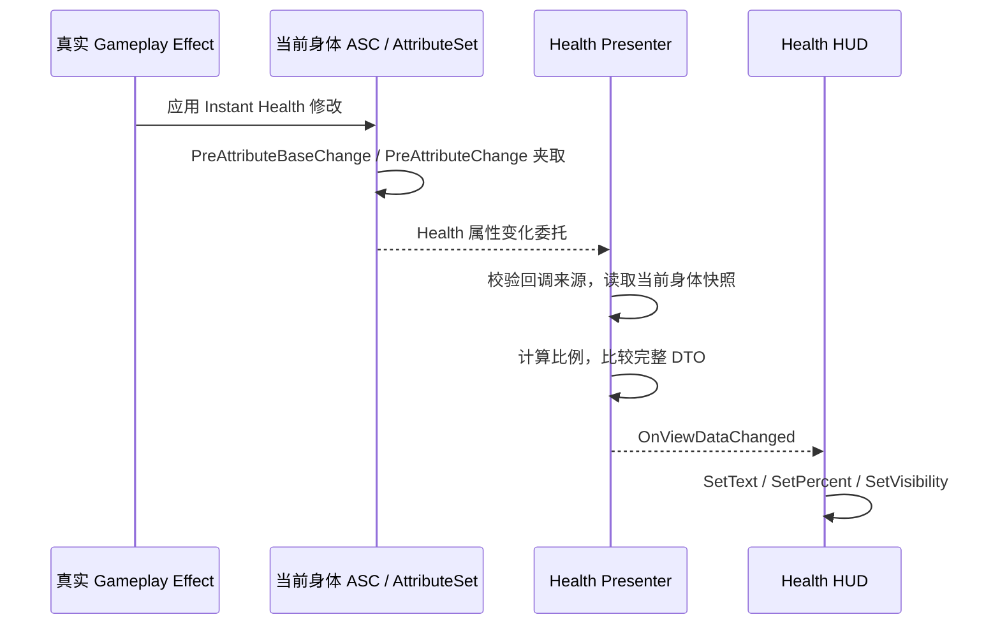
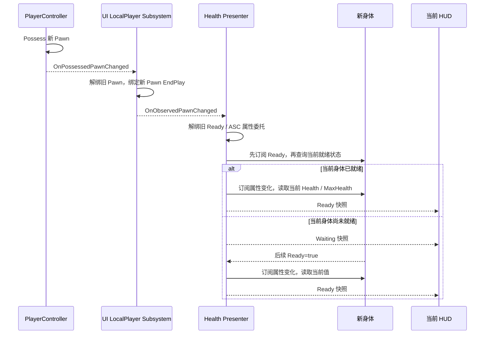

# M1-03C：属性与 HUD 数据流阶段汇总

日期：2026-10-05。**本章已通过证据汇总完成，M1-03 总任务验收通过。**执行方式采用已选的[方案 B](AcceptanceWorkflow_Options.md)：沿用 A / B 已通过且未受修改影响的结果，只在发现缺口时补查。

## 1. 本章安排

| 项目 | 本章内容 |
| --- | --- |
| 新增成果 | 一份完整数据流说明、证据索引、后续专项检查触发清单，以及 M1-03 总验收结论 |
| 工程改动 | 无新增 C++、蓝图、配置或美术资产 |
| 沿用基线 | A1 的 ASC / ActorInfo；A2 的生命属性与 Effect；B1 / B2 / B3 的 Presenter、HUD 和生命周期结果 |
| 助手直接核对 | 当前 33 份源码与 B3 基线一致；没有额外源码文件；清单 29 项资产均与记录哈希一致；阅读现有实现并汇总证据 |
| 必须由你操作 | 本章没有新增手动实现或运行检查，不需要提交一张新的重复验收表 |
| 时间 | 可用约 10–15 分钟阅读数据流与源码入口；这是阅读估计，不计为已发生工时 |
| 完成依据 | 各项阶段条件已有已通过证据，B1 结束保护和 B3 Waiting 补项均已关闭，当前基线没有发生新改动 |

[本次基线核对](Reports/Raw/M1_03C_Baseline.json)只证明所列文件与已记录基线一致。蓝图连线、配置恢复、界面及输入表现沿用此前的实机结果；哈希不替代这些检查。本章未新执行 Build、PIE 或自动化测试，也未修改引擎资产。

## 2. 当前系统如何工作

### 2.1 谁负责什么

| 对象 | 当前职责 | 数据与引用归属 |
| --- | --- | --- |
| `AEmberTrialCharacter` | 建立 ASC ActorInfo，校验并一次性初始化出生属性，公布 GameplayReady | 身体持有自己的原生 ASC 和 Health AttributeSet；Owner / Avatar 均为该身体 |
| `UETHealthAttributeSet` | 维护 Health / MaxHealth 的数值范围；上限下降时夹取当前生命 | 权威生命数值属于 Gameplay；UI 不存第二份可写生命值 |
| `UETUILocalPlayerSubsystem` | 观察所属本地 Controller 及当前 Pawn，通知更换和销毁 | 弱引用 Controller / Pawn；更换前解绑旧对象，绑定后补读当前状态 |
| `UETUIBootstrapComponent` | 创建、持有 Presenter 与两个 Widget，负责重建和结束清理 | 位于 Controller；通过 UPROPERTY 持有当前 Presenter / Widget |
| `UETHealthPresenter` | 判断当前数据源是否可用，订阅 Ready / 属性事件，输出展示快照 | 弱引用 Subsystem / Character / ASC；保存和移除委托句柄；不写属性 |
| `FETHealthViewData` | 保存状态、Pawn 名字、Health、MaxHealth 和比例 | 纯展示数据，不持有旧身体或 ASC 对象引用 |
| `UETHealthHUDWidget` / `WBP_ETHealthHUD` | 订阅快照，设置文本、进度条和可见状态 | 弱引用 Presenter；不读取 ASC，不执行 Gameplay Effect；C++ 负责更新，蓝图负责布局 / 控件装配 |

**模块方向：**`EmberTrialUI → EmberTrial`。核心模块没有 UMG / UI 模块依赖；UI 模块通过核心公开查询与事件观察 Gameplay。

### 2.2 一次扣血到画面更新

已经验证过：100/100 扣血后成为 75/100；过量扣血到 0；治疗封顶；最大值下降夹取生命、上升不补血。Current / Base 的实际范围验证见[A2 总验收](Reports/M1_03A2_Verification.md)，相应 HUD 展示见[B2 验收](Reports/M1_03B2_Verification.md)。

Presenter 的“去重”比较整个 DTO：数值、状态、名字、比例都相同时才跳过普通变化广播。**这不保证一个 Effect 永远只有一次事件。**例如最大生命下降可能先产生 MaxHealth 变化，再产生 Health 夹取变化；应检查最终数值正确、无重复绑定或旧源更新，不能把全部合法中间通知都当作 Bug。

当前正式地图的临时扣血键已清理。真实战斗尚未接入，因此不要为了再次看到 75/100 而恢复临时函数；后续正式伤害将接入这条已验证链路。

### 2.3 更换身体到 HUD 重绑

两种顺序都已经实测：View 先订阅、身体后就绪；身体先就绪、Presenter / View 后加入。后加入者主动读快照，不依赖再扣一次血触发通知。

这里更换的是实际 Pawn 和实际 ASC。原身体 75/100 与新身体 40/80 互相独立；恢复原身体保留原值，新生成身体使用自己的初值。旧身体的属性修改或销毁不会更新当前 HUD。裸 Pawn 为 `UnsupportedPawn`；没有当前 Pawn 为 `NoPawn`；合法类型但属性未准备好为 `WaitingForGameplayReady`。

### 2.4 清理与重建

重建 HUD 会创建新 Widget 实例，名字后缀递增是正常现象；当前显示的一份 HUD 不等于整个运行期间只创建过一个 UObject。

移除 View 时，Bootstrap 先调用 `StopObserving()`，再 `RemoveFromParent()` 并释放自己的引用。旧 Widget 即使被其他引用暂时留住，也不再接收 Presenter 事件；不依赖 GC 及时执行才能正确清理。

Bootstrap 的 EndPlay 先设置结束标记，移除两个 View，再 Shutdown Presenter；Character 的 EndPlay 撤销 Ready、取消能力 / Cue 并清空 ActorInfo。**不同 Actor 的 EndPlay 顺序不应假定固定**，因此每层仍须独立校验对象、移除自己的订阅并允许重复清理。现有结束用例已覆盖；正式重生和切图接入时还要验证相应新流程。

## 3. 阶段条件与已有证据

下表是后续可复用的检查索引，**本章不用再执行一遍**。

| 阶段条件 | 已通过证据 | 本章如何处理 |
| --- | --- | --- |
| 单 ASC，Owner / Avatar 正确，失去 / 恢复控制不换归属 | [A1](Reports/M1_03A1_Verification.md)、[B3](Reports/M1_03B3_Verification.md) | 沿用；当前源码不变 |
| 出生属性只初始化一次；重复 Ensure 不重置已修改属性 | [A2](Reports/M1_03A2_Verification.md)、[B1](Reports/M1_03B1_Verification.md) | 沿用；初始化职责仍在 Character |
| Health / MaxHealth、Current / Base 与动态上下界正确 | [A2](Reports/M1_03A2_Verification.md) | 沿用；现阶段仅已测试的 Instant Effect |
| 事件驱动 HUD，数值 / 比例 / 无变化去重正确 | [B1](Reports/M1_03B1_Verification.md)、[B2](Reports/M1_03B2_Verification.md) | 沿用；无 Tick / Text Bind / Percent Bind 配置按此前反馈登记 |
| 早 / 晚订阅都取得当前快照 | [B2](Reports/M1_03B2_Verification.md)、[B3](Reports/M1_03B3_Verification.md) | 沿用；无新增 Delay 或伪造 Ready |
| 真实不同身体、旧源修改 / 销毁隔离、新实例恢复 | [B3](Reports/M1_03B3_Verification.md) | 沿用；当前 Controller 与清理后的基线一致 |
| Unsupported / Waiting / NoPawn 正确 | [B3](Reports/M1_03B3_Verification.md)第 5 节含 Waiting 最终补修 | 沿用；原生新建 Rebuilt 已代替停用样例 |
| 重建不重复显示；存活旧 View 解绑；PIE 结束清理 | [B2](Reports/M1_03B2_Verification.md)、[B3](Reports/M1_03B3_Verification.md) | 沿用；不重做十次重建 / 三轮 PIE |
| 原动作、交互、暂停和输入恢复正常 | B2 / B3 用户实机结果、B3 收尾短基线 | 沿用；完整键鼠 / 画面结果与日志证据分开记录 |
| Editor / Game 构建、模块依赖及索引目标正确 | [B2](Reports/M1_03B2_Verification.md)、当前 Build.cs | 源码未变，沿用双目标成功结果，不新 Build |

本章没有新增性能实测。事件驱动、关闭非必要 Tick 是已有实现方式，不能据此宣称具体 FPS 提升、CPU 节省比例或已达到最终性能目标。

## 4. 下次哪些修改会触发专项

| 修改内容 | 必须验证的新行为及相关专项 | 继续沿用的部分 |
| --- | --- | --- |
| 新增攻击 / 伤害 / 死亡 | 新能力开始 / 完成 / 取消；真实命中一次结算；伤害 → 属性 → HUD；零血规则和清理 | 未修改的布局、晚加入、最大值 GE 全矩阵 |
| 改 Health / MaxHealth 夹取，或加入持续 / 临时属性效果 | 受影响的 Current / Base、效果到期 / 移除与上下界；最终 HUD 值 | 未修改的 Controller 观察与输入焦点 |
| 改 Pawn / ASC 归属或正式重生 | 真实换身体、旧源修改 / 销毁隔离、NoPawn / Ready 恢复；新旧身体属性 | 未修改的基础布局及独立数值规则 |
| 改 Presenter 订阅 / 生命周期 | 先就绪 / 后就绪、重复订阅、旧 ASC 回调拒绝、EndPlay | 未修改的伤害算法和动画资源 |
| 改 Widget 重建 / 订阅 / 控件绑定 | 立即快照、旧 View 存活时解绑、单份显示、必需控件 | 未修改的 ASC 初始化与所有数值边界 |
| 改暂停、输入模式或移动门控 | 受影响的按键、长按 / 松键、菜单无补执行、焦点恢复 | 未修改的属性与旧源隔离矩阵 |
| 接异步资源 / 装备就绪 | 真实异步完成顺序、过期回调、取消和对象更换 | 同步路径的历史结果作为基线，不能替代新异步验证 |

每批由助手根据实际修改选取相关行，并写清“准备 → 操作 → 预期 → 恢复”。新增蓝图仍逐节点说明 Target、数据引脚与执行出口；精简验收不等于省略实现细节。

目前复用的是**已验收证据与固定清单**。永久测试入口尚未建成；只有同类操作再次需要、值得复用时才分批投入原定 4–8 小时。现有 M0 自动测试覆盖练习动作 / 位移，不称为 GAS / HUD 自动化测试。

## 5. 你现在如何使用本章

本章不用打开 UE 重新搭功能，建议阅读第 2 节并在 CLion 查看下列入口。阅读或答题不是新增验收门槛，也不要求现在交一份面试作业。

| 想看什么 | 源码入口与函数 |
| --- | --- |
| 初始化为什么不重复 | [EmberTrialCharacter.cpp](../EmberTrial/Source/EmberTrial/Private/Characters/EmberTrialCharacter.cpp)：`EnsureGameplayInitialized()` |
| 谁保证生命范围 | [ETHealthAttributeSet.cpp](../EmberTrial/Source/EmberTrial/Private/Attributes/ETHealthAttributeSet.cpp)：`ClampAttribute()`、`PostAttributeChange()` |
| Controller / Pawn 如何变化 | [ETUILocalPlayerSubsystem.cpp](../EmberTrial/Source/EmberTrialUI/Private/Lifecycle/ETUILocalPlayerSubsystem.cpp)：`RebindController()`、`SetObservedPawn()` |
| 新源绑定与旧源清理 | [ETHealthPresenter.cpp](../EmberTrial/Source/EmberTrialUI/Private/Presenters/ETHealthPresenter.cpp)：`RebindObservedPawn()`、`ClearPawnBindings()`、`RefreshReadyBinding()` |
| 快照与去重 | 同一 Presenter 文件：`BuildSnapshot()`、`PublishSnapshot()` |
| 重建与主动解绑 | [ETUIBootstrapComponent.cpp](../EmberTrial/Source/EmberTrialUI/Private/Bootstrap/ETUIBootstrapComponent.cpp)：`RebuildHealthWidget()`、`RemoveHealthWidget()`、`EndPlay()` |
| View 只负责展示 | [ETHealthHUDWidget.cpp](../EmberTrial/Source/EmberTrialUI/Private/Widgets/ETHealthHUDWidget.cpp)：`StartObserving()`、`StopObserving()`、`ApplyViewData()` |

后期复盘时，可以沿以上入口回答：为什么同一身体重新受控不回血？为什么新 Widget 不用等待下一次属性事件？为什么旧身体 / Widget 仍有效时也不会影响当前画面？这些答案来自实际实现和已有证据。

如果阅读中发现新问题，发“章节 / 函数 + 实际现象”，编译错误或运行日志优先贴文字，连线 / 控件配置问题附截图，时序 / 动画问题附短视频。无需整理旧功能完整表，也无需手动复制长段日志；给出发生时间后助手读取本机日志。

## 6. 完成边界与交接

M1-03 已完成的链路：**Character / ASC / 生命属性 → Ready 与属性事件 → Presenter 快照 → 只读 HUD**，以及控制变化、独立身体、View 重建、旧源隔离、同步就绪顺序和结束清理。

尚未完成：正式 Gameplay Ability、伤害命中、死亡判定、重生 / 检查点、异步装配、持续 Buff / 到期、网络玩法以及当前阶段的独立包。旧 M0 包仍对应旧版本，不能展示新增的 GAS / HUD 成果。

下一开发章为 **M1-04：单段攻击与受击 / 死亡**。首批将先明确正式动作状态与 GAS 能力的唯一所有权及 M0 练习动作的迁移边界，再逐批接动画、命中、伤害和死亡。复用现有骨架 / Montage、ASC / Health 与 Presenter / HUD，避免重复制作一套数据流；C++ 仍先输出到文档，由你手动录入。

[M1-03 总验收记录](Reports/M1_03_Verification.md)记录本章的实际证据与限制。本章没有新增用户报告工时，累计仍为手动 1198 分钟、已报告等待 73 分钟。
