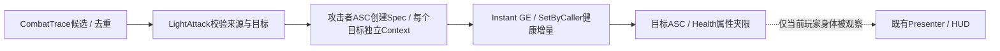

# M1-04B2：真实GameplayEffect伤害

日期：2026-10-06；UE5.5.4。前置：[B1已验收](Reports/M1_04B1_Verification.md)。**状态：用户已手动完成并验收，手动35 / 等待5分钟，见[B2结果](Reports/M1_04B2_Verification.md)。下一批[C1正式受击](M1_04C1_HitReaction.md)。本文保留实施步骤；助手未修改项目Source / UE资产、未执行本批Build或PIE。**

## 1. 本批成果、范围和时间

左键 / 数字1沿用正式攻击。B1检测到合法训练身体后，由攻击者ASC创建GameplayEffect Spec，传入本次伤害数值，应用到目标ASC。默认每击25点：目标100→75→50→25→0；同次攻击仍只处理同一身体一次，下一次攻击重新结算。玩家自身HUD仍100/100，因为本批打的是训练目标。

预计手动40–70分钟：代码20–35 / 资产10–20 / 相关检查10–15；构建等待与失败排查另计。B1实际40分钟、检查5分钟已登记，B2仍要验证首次真实Effect的新边界。检查顺利时以10–15分钟为目标，失败停在对应组，不为赶时间跳过关键项。

不新增输入节点、Controller测试函数、伤害Actor、属性集或Widget。沿用现有训练目标、攻击窗口、去重集合与属性夹限。本批目标归零仍保持在场景；Ready表示属性已初始化，不表示活着。正式受击 / 死亡留M1-04C。

## 2. 职责与数据规则



| 对象 | 职责 |
| --- | --- |
| CombatTrace / NotifyState | 沿用B1空间、窗口与每次攻击去重；不决定伤害数值，不Include GAS |
| UETGA_LightAttack | 验证自己的伤害配置、来源和目标；每个候选创建独立Spec / Hit Context并应用；不直接SetHealth |
| GE_ET_LightAttackDamage | 配置Instant、Health的加法Modifier、读取SetByCaller Tag；不在GE中固定写25 |
| UETHealthAttributeSet | 沿用Health Base / Current夹到0–MaxHealth、MaxHealth至少1的规则 |
| Blueprint | 选择GE Class和正数Attack Damage；不复制一份目标生命变量或另接扣血节点 |
| Presenter / HUD | 继续只展示当前受控玩家的属性；训练目标血量先由日志观察 |

采用**正数Attack Damage=25**，传入GE的**健康增量=-25**。Tag命名为`SetByCaller.HealthDelta`，明确它是有正负号的健康增量。本批只用它传负值；不叫“伤害25”却向同一语义传负数。

UE5.5.4的`FSetByCallerFloat.DataTag`有`Categories="SetByCaller"`筛选，所以使用该前缀。不要另建`Data.Damage`或只填Data Name。5.5.4 Modifier Op的界面名称是**Add (Base)**；代码对应`EGameplayModOp::AddBase`，旧名Additive是隐藏的兼容别名。不要选Add (Final)、Override或Scalable Float。

候选已经由组件加入本次去重集合，能力不再保存第二份集合。不支持的Pawn、未Ready、零血目标也仅记录一次拒绝；本次攻击内不会因为它后来改变状态而重新命中。所有合法非自身Character暂可受伤，阵营、护甲、无敌窗和联机权威不属于这一版离线单人规则。

## 3. 保存与文件范围

先Save All并关闭UE，CLion可保留打开；不要通过Live Coding新增反射属性或Native Tag。只改下列四份现有文件，**不新建C++类**：

| 文件（相对EmberTrial/Source/EmberTrial） | 改动 |
| --- | --- |
| Public/Abilities/ETGameplayTags.h | 新增一个Tag声明，原两项保留 |
| Private/Abilities/ETGameplayTags.cpp | 新增一个Tag定义，原两项保留 |
| Public/Abilities/ETGA_LightAttack.h | 前置声明、两个可配置属性、一个私有查询函数 |
| Private/Abilities/ETGA_LightAttack.cpp | include、配置查询、CanActivate局部门控、替换候选回调 |

Character、Build.cs、AttributeSet、CombatTrace、NotifyState、UI与Practice均保留。Source文件数量仍41、索引工程cpp仍20。配置完成后才会新增一份GE资产，目前清单33项不提前加上它。

## 4. 手动输入C++

### 4.1 Native Tag

打开`Public/Abilities/ETGameplayTags.h`。在已有`namespace ETGameplayTags`的花括号**内部**、原两个声明之后加入：

```cpp
EMBERTRIAL_API UE_DECLARE_GAMEPLAY_TAG_EXTERN(SetByCaller_HealthDelta);
```

打开`Private/Abilities/ETGameplayTags.cpp`。在同一个namespace内部、原两个定义之后加入：

```cpp
UE_DEFINE_GAMEPLAY_TAG_COMMENT(SetByCaller_HealthDelta,
    "SetByCaller.HealthDelta", "Signed Health delta carried by an effect spec.");
```

不新建第二个同名Tag、不删除Ability.Attack.Light / State.Attacking，也不在Project Settings重复添加本项。正常Build并重启UE后该原生Tag才会出现。

### 4.2 Ability头文件

打开`Public/Abilities/ETGA_LightAttack.h`。

1. 在已有`class UAnimMontage;`等前置声明所在位置加入下面一行。`ETGA_LightAttack.generated.h`仍是最后一个include；前置声明放在它之后、UCLASS之前。

```cpp
class UGameplayEffect;
```

2. 在已有`private:`区域、`AttackMaxHorizontalSpeed`之后、`MontageTask`之前，插入：

```cpp
UPROPERTY(EditDefaultsOnly, Category = "EmberTrial|Attack")
TSubclassOf<UGameplayEffect> DamageEffectClass;

UPROPERTY(EditDefaultsOnly, Category = "EmberTrial|Attack",
    meta = (ClampMin = "0.0"))
float AttackDamage = 25.0f;
```

3. 在已有`void HandleTraceHit(uint32 Serial, const FHitResult& Hit);`的上一行加入：

```cpp
bool HasValidDamageConfiguration() const;
```

以上查询仅供C++使用，不加UFUNCTION，不做Blueprint Pure节点。原Montage、任务、ActiveTrace / Serial、两个Montage回调与Override声明全部保留。

### 4.3 cpp include

打开`Private/Abilities/ETGA_LightAttack.cpp`，在现有include区域增加以下三项；已有项不重复：

```cpp
#include "ActiveGameplayEffectHandle.h"
#include "Attributes/ETHealthAttributeSet.h"
#include "GameplayEffect.h"
```

原`AbilitySystemComponent.h`、`ETGameplayTags.h`、Character、Trace与Montage Task等include保留，不Include任何UI头文件。

### 4.4 新增配置查询函数

在构造函数结束后、`CanActivateAbility`开始前，加入**一份**以下完整实现。不要放进构造函数或另一个函数的花括号内。

```cpp
bool UETGA_LightAttack::HasValidDamageConfiguration() const
{
    if (!FMath::IsFinite(AttackDamage) || AttackDamage <= 0.0f ||
        !IsValid(DamageEffectClass.Get()))
    {
        return false;
    }

    const UGameplayEffect* Effect = DamageEffectClass.GetDefaultObject();
    if (!IsValid(Effect) ||
        Effect->DurationPolicy != EGameplayEffectDurationType::Instant ||
        Effect->Modifiers.Num() != 1 || Effect->Executions.Num() != 0)
    {
        return false;
    }

    const FGameplayModifierInfo& Modifier = Effect->Modifiers[0];
    if (Modifier.Attribute != UETHealthAttributeSet::GetHealthAttribute() ||
        Modifier.ModifierOp != EGameplayModOp::AddBase ||
        Modifier.ModifierMagnitude.GetMagnitudeCalculationType() !=
            EGameplayEffectMagnitudeCalculation::SetByCaller)
    {
        return false;
    }

    return Modifier.ModifierMagnitude.GetSetByCallerFloat().DataTag ==
        ETGameplayTags::SetByCaller_HealthDelta;
}
```

这是本批明确的GE契约：Instant、恰好一条Health加法、无Execution、指定SetByCaller Tag。配置不符合时拒绝攻击，避免看似挥击成功却无损伤。之后若改为护甲计算 / Execution，应一起修改此契约，不能只在资产里增加一条Modifier。

### 4.5 CanActivateAbility局部加入门控

在现有`CanActivateAbility`中找到以下位置：Practice忙碌检查结束后，即`const UETCombatTraceComponent* Trace = ...`之前。原Practice检查保留，在两者之间插入：

```cpp
if (!HasValidDamageConfiguration())
{
    UE_LOG(LogETLightAttack, Warning,
        TEXT("[M1-04B2] Invalid damage config Character=%s Effect=%s Damage=%.1f"),
        *GetNameSafe(Character), *GetNameSafe(DamageEffectClass.Get()), AttackDamage);
    return false;
}
```

完整位置关系应为“原Practice忙碌检查 → 新配置检查 → 原Trace / AnimInstance与最终return”。别把新代码放到最终return之后，也不要改原来源 / 地面速度 / 输入 / Health门控。

### 4.6 替换HandleTraceHit整段函数

找到B1已有的`void UETGA_LightAttack::HandleTraceHit(...)`，从函数签名到该函数结束花括号，**整体替换**为以下代码。原B1的`DamageApplied=0`回调不保留第二份；其他函数不改。

```cpp
void UETGA_LightAttack::HandleTraceHit(uint32 Serial, const FHitResult& Hit)
{
    if (!IsActive() || Serial == 0 || Serial != ActiveTraceSerial || !CurrentActorInfo)
    {
        return;
    }

    const FString TargetName = GetNameSafe(Hit.GetActor());
    const auto Reject = [Serial, &TargetName](const TCHAR* Reason)
    {
        UE_LOG(LogETLightAttack, Display,
            TEXT("[M1-04B2] Damage skipped Serial=%u Target=%s Reason=%s"),
            Serial, *TargetName, Reason);
    };

    AEmberTrialCharacter* Source =
        Cast<AEmberTrialCharacter>(CurrentActorInfo->AvatarActor.Get());
    UAbilitySystemComponent* SourceASC = CurrentActorInfo->AbilitySystemComponent.Get();
    float SourceHealth = 0.0f;
    float SourceMaxHealth = 0.0f;
    if (!IsValid(Source) || !Source->HasAuthority() || !IsValid(SourceASC) ||
        CurrentActorInfo->OwnerActor.Get() != Source ||
        Source->GetAbilitySystemComponent() != SourceASC ||
        !Source->GetGameplayHealthSnapshot(SourceHealth, SourceMaxHealth) ||
        !FMath::IsFinite(SourceHealth) || !FMath::IsFinite(SourceMaxHealth) ||
        SourceHealth <= 0.0f || SourceMaxHealth < 1.0f ||
        SourceHealth > SourceMaxHealth || UGameplayStatics::IsGamePaused(Source))
    {
        Reject(TEXT("SourceUnavailable"));
        return;
    }
    if (!HasValidDamageConfiguration())
    {
        Reject(TEXT("InvalidDamageConfig"));
        return;
    }

    AEmberTrialCharacter* Target = Cast<AEmberTrialCharacter>(Hit.GetActor());
    if (!IsValid(Target) || Target == Source)
    {
        Reject(TEXT("UnsupportedTarget"));
        return;
    }

    float HealthBefore = 0.0f;
    float MaxHealthBefore = 0.0f;
    if (!Target->GetGameplayHealthSnapshot(HealthBefore, MaxHealthBefore) ||
        !FMath::IsFinite(HealthBefore) || !FMath::IsFinite(MaxHealthBefore) ||
        MaxHealthBefore < 1.0f || HealthBefore < 0.0f || HealthBefore > MaxHealthBefore)
    {
        Reject(TEXT("TargetNotReady"));
        return;
    }
    if (HealthBefore <= 0.0f)
    {
        Reject(TEXT("TargetZeroHealth"));
        return;
    }

    UAbilitySystemComponent* TargetASC = Target->GetAbilitySystemComponent();
    if (!IsValid(TargetASC) || !TargetASC->AbilityActorInfo.IsValid() ||
        TargetASC->AbilityActorInfo->OwnerActor.Get() != Target ||
        TargetASC->AbilityActorInfo->AvatarActor.Get() != Target ||
        !TargetASC->HasAttributeSetForAttribute(UETHealthAttributeSet::GetHealthAttribute()))
    {
        Reject(TEXT("TargetASCUnavailable"));
        return;
    }

    const FString SourceName = GetNameSafe(Source);
    const float RequestedDamage = AttackDamage;
    const TWeakObjectPtr<AEmberTrialCharacter> WeakTarget(Target);
    const TWeakObjectPtr<UAbilitySystemComponent> WeakTargetASC(TargetASC);

    FGameplayEffectContextHandle Context = SourceASC->MakeEffectContext();
    if (!Context.IsValid())
    {
        Reject(TEXT("ContextUnavailable"));
        return;
    }
    Context.AddSourceObject(this);
    Context.AddHitResult(Hit, true);
    FGameplayEffectSpecHandle Spec = SourceASC->MakeOutgoingSpec(
        DamageEffectClass, GetAbilityLevel(), Context);
    if (!Spec.IsValid())
    {
        Reject(TEXT("SpecUnavailable"));
        return;
    }
    Spec.Data->SetSetByCallerMagnitude(
        ETGameplayTags::SetByCaller_HealthDelta, -RequestedDamage);

    const FActiveGameplayEffectHandle Result = SourceASC->ApplyGameplayEffectSpecToTarget(
        *Spec.Data.Get(), TargetASC);
    const bool bApplied = Result.WasSuccessfullyApplied();

    // Applying an effect can synchronously cancel abilities or destroy actors.
    // Do not reuse CurrentActorInfo or raw actor pointers after the call.
    float HealthAfter = 0.0f;
    float MaxHealthAfter = 0.0f;
    AEmberTrialCharacter* LiveTarget = WeakTarget.Get();
    UAbilitySystemComponent* LiveTargetASC = WeakTargetASC.Get();
    if (!IsValid(LiveTarget) || !IsValid(LiveTargetASC) ||
        LiveTarget->GetAbilitySystemComponent() != LiveTargetASC ||
        !LiveTarget->GetGameplayHealthSnapshot(HealthAfter, MaxHealthAfter))
    {
        UE_LOG(LogETLightAttack, Display,
            TEXT("[M1-04B2] Damage Serial=%u Source=%s Target=%s Requested=%.1f Applied=%d ActiveHandle=%d Snapshot=Unavailable"),
            Serial, *SourceName, *TargetName, RequestedDamage,
            bApplied ? 1 : 0, Result.IsValid() ? 1 : 0);
        return;
    }

    const float BaseAfter = LiveTargetASC->GetNumericAttributeBase(
        UETHealthAttributeSet::GetHealthAttribute());
    UE_LOG(LogETLightAttack, Display,
        TEXT("[M1-04B2] Damage Serial=%u Source=%s Target=%s Requested=%.1f Applied=%d ActiveHandle=%d Before=%.1f After=%.1f BaseAfter=%.1f Max=%.1f Actual=%.1f"),
        Serial, *SourceName, *TargetName, RequestedDamage,
        bApplied ? 1 : 0, Result.IsValid() ? 1 : 0,
        HealthBefore, HealthAfter, BaseAfter, MaxHealthAfter,
        FMath::Max(0.0f, HealthBefore - HealthAfter));
}
```

`Applied`使用`WasSuccessfullyApplied()`：Instant GE成功后通常没有仍存活的Active Handle，**Applied=1 / ActiveHandle=0是正常结果**。不能用`Result.IsValid()`判定Instant伤害失败，也不用保存这个Handle来移除伤害。

每个目标单独创建Spec并复制本次Hit到Context；不同目标不共用可变Context。Apply后只用提前保存的名称 / 数值和重新验证的弱引用，因为未来受伤事件可能同步取消能力或销毁对象。当前B2没有死亡销毁，所以正常应取得After / BaseAfter。

`ActivateAbility`、`EndAbility`和两个Montage回调**不改**；能力结束仍先撤销候选与检测，伤害一旦成功不会因为后续取消而回滚。Source.HasAuthority约束本地单人规则，不代表本能力已支持多人复制 / 预测。

## 5. 正常Build与索引

保存四份源码，UE保持关闭。在PowerShell执行：

```powershell
Set-Location 'E:\UE_Project\Demo'
.\Tools\Refresh-CLion.ps1
```

Editor Build成功后，在原CLion工程执行Reload CMake Project。CodeModel仍应包含20份工程cpp；Ctrl+B检查GameplayEffect.h / ETHealthAttributeSet.h与新函数声明。继续执行Game Development Build：

```powershell
& 'D:\UE5\UE_5.5\Engine\Build\BatchFiles\Build.bat' EmberTrial Win64 Development '-Project=E:\UE_Project\Demo\EmberTrial\EmberTrial.uproject' -WaitMutex -NoHotReloadFromIDE
```

两项成功后打开原.uproject。编译失败时停在这里，将第一条实际编译错误与上下各5–10行作为文字发来，不继续改资产。不用清缓存 / 删除Intermediate / 换CLion工作区。

## 6. GE与能力资产配置

### 6.1 新建一份正式GE

在Content Browser建立`/Game/EmberTrial/Abilities/Effects`文件夹，右键 → Blueprint Class → All Classes，搜索并选择**GameplayEffect**原生父类，命名`GE_ET_LightAttackDamage`。不要Duplicate旧测试GE，也不要选择GameplayAbility父类。

打开新GE，在**Class Defaults**中操作。先清空Details搜索，设置下表；名称不容易定位时再分别搜索Duration或Modifiers，编辑嵌套Magnitude前清空搜索，以免其子字段被隐藏。

| 层级 / 属性 | 设置 |
| --- | --- |
| Duration Policy | Instant |
| Modifiers | 数组只保留1项：Element 0 |
| Element 0 → Attribute | ETHealthAttributeSet的Health，不能是MaxHealth |
| Element 0 → Modifier Op | **Add (Base)** |
| Element 0 → Modifier Magnitude → Magnitude Calculation Type | **Set By Caller** |
| 同一Magnitude展开的Set By Caller Magnitude → Data Tag | **SetByCaller.HealthDelta** |
| Data Name（若显示） | 默认None，使用Tag而非Name |
| Executions / Gameplay Cues / 额外Components | 保持新资产默认空配置，不新增Execution / 条件Effect |

展开箭头通常依次是“Modifiers → 0 → Modifier Magnitude → Set By Caller Magnitude”。部分面板把Magnitude的类型选择和内容合并到同一行，以**类型Set By Caller、Data Tag为指定原生Tag**为最终判据。数值来自代码，不在Scalable Float里写-25。

如果Tag列表没有本项：检查两份Tag文件是否保存、Editor Build是否成功、UE是否已正常关闭后重启；不要临时另建拼写近似的Tag。没有Modifiers入口时确认自己位于GE资产的Class Defaults，并清空Details搜索；不要到攻击Montage编辑器找这些设置。仍不一致时发完整Details截图，先定位界面再继续。

Compile → Save。GE无需Event Graph节点。

### 6.2 配置已有GA

打开`/Game/EmberTrial/Abilities/GA_ET_LightAttack` → Class Defaults，搜索`EmberTrial`或`Damage`，设置：

| 属性 | 最终值 |
| --- | --- |
| Damage Effect Class | GE_ET_LightAttackDamage |
| Attack Damage | 25.0 |
| Attack Montage | 仍为AM_M0_Attack_01_Montage |
| Attack Max Horizontal Speed | 仍为3.0 |

Compile → Save。再检查玩家Character的能力Class仍是GA_ET_LightAttack、CombatTrace的Draw Debug仍False；训练目标Blueprint的初始生命仍100 / 100。没有新增任何输入 / 执行节点，原白线和Target保持不变。

首次新增属性时Damage Effect Class默认None，所以**资产配置前左键被拒绝并出现Invalid damage config是预期**；不要为了恢复动作删掉配置保护。

## 7. 共享检查准备

打开正式地图L_ET_VerticalSlice，保留训练目标A；确保临时B / 挡板已清理、帧率已恢复。清空Output Log显示或过滤`M1-04B2`；正常窗口 / 清理查`M1-04B1`，能力结束查`M1-04A`。本批不新建Controller调试按键或扣血函数。

每次Play创建新的ASC / 属性，训练目标默认100/100。使用B1已确认能命中的站位，走近后松开移动键、站定再按左键。B1日志已有出生原地空挥的样本；如果没有Candidate，先检查站位与窗口，不把未接触目标当作Effect失败。

正常命中示例（对象名 / Serial会随PIE变化）：

```text
[M1-04B2] Damage Serial=1 Source=BP_ThirdPersonCharacter_C_0 Target=BP_ETCombatTrainingTarget_C_1 Requested=25.0 Applied=1 ActiveHandle=0 Before=100.0 After=75.0 BaseAfter=75.0 Max=100.0 Actual=25.0
```

同一次攻击允许多条Sweep日志，但对同一目标应只有一条Damage或Damage skipped。重开PIE不要求对象名字与上一轮相同。训练目标目前是静态Cube，不会因为25点伤害后仰，日志数值是本批结算证据。

## 8. 分组检查（只覆盖新增伤害与直接依赖）

### 8.1 单目标、去重、范围与零血

**准备：**正常25配置，新PIE，A出生100/100。走到能命中的站位、松开移动键。

**操作：**

1. 按一次左键；等待动作结束。查看一条Before100 / After75 / BaseAfter75、Applied1。
2. 下一次按住左键直到动作结束再松开；应只有一次成功伤害，Before75 / After50，不因长按额外扣血。
3. 离开命中范围，站定空挥一次；再返回原站位、站定打一次。返回后应Before50 / After25，证明范围外没有暗扣血。
4. 再命中一次，Before25 / After0 / BaseAfter0 / Actual25。再命中第五次，应只出现一次`Damage skipped ... Reason=TargetZeroHealth`，不能出现新的Applied1伤害。

**预期：**每个Serial同一目标最多一次结算，下一次攻击仍可命中；目标Health / Base一致，玩家HUD始终100/100。零血Cube继续在场，暂不隐藏 / 死亡，符合本批范围。

**清理：**停止PIE，确认GA仍25。属性运行值不保存到目标Class Defaults。

### 8.2 过量伤害夹限

**准备：**停止PIE，将GA_ET_LightAttack的Attack Damage临时改130，Compile → Save；其他配置不变。

**操作：**新PIE走近、站定命中一次，再打一击。

**预期：**首次Requested130 / Before100 / After0 / BaseAfter0 / Actual100、Applied1；第二次TargetZeroHealth。没有负Health、隐藏负Base或玩家HUD变化。

**清理：**停止PIE，立刻恢复Attack Damage=25，Compile → Save。

### 8.3 取消与暂停不产生额外伤害

**准备：**恢复25，新PIE，站在同一个有效站位。保留已有数字3过渡取消路线，不搭新函数。

**操作：**

1. 按左键后立刻按3，在第8帧窗口前取消。等待受击结束，再正常打一次；其Before应100 / After75。若先打中了才取消，该次伤害合法，应重开本组而非认定失败。
2. 再攻击一次，确认接触 / Damage后按3取消余下动作；取消不会撤回已成功的25点，Before75 / After50只有一条。等待受击结束。
3. 再攻击后立刻按P，尽量暂停在第8帧前；菜单中点击继续，释放左键并等本次动作结束。本次最多再扣25，命中后应Before50 / After25。菜单期间的左键不会补出第二次攻击 / 伤害。

**预期：**窗口前取消不扣血；窗口已经产生的伤害不回滚；恢复没有重复结算。取消后B1 Disarm Tick0，A End AttackingTag0仍正常。这里只查Effect接入的边界，不重跑B1全部动画时间 / 墙 / 限帧矩阵。

**清理：**停止PIE。若手动时点无法判断，发该次短视频或相邻Begin / Open / Damage / End日志；不要为对齐时点加入新Delay或测试蓝图。

### 8.4 双目标独立结算

**准备：**停止PIE，临时再放一个同类训练目标B，沿用B1已通过的双目标位置。若此前使用默认位置，A=(-490,25,96)、B=(-490,50,96)、Rotation均0；最终以两者确实进入扫掠为准，不改Trace Radius来强行覆盖。

**操作：**新PIE站定攻击一次，等待动作结束，再攻击一次。

**预期：**第一次两个不同Target各有一条Before100 / After75 / BaseAfter75，下一次各Before75 / After50。同一个Serial允许不同Target各一次，不能同一Target出现两次Applied1。玩家HUD仍100/100。

**清理：**停止PIE，删除临时B，仅保留A；保存地图。不改正式范围 / Notify窗口。

### 8.5 配置和未就绪保护

**准备：**每个子项都先停止PIE，在Class Defaults修改后Compile / Save，再新PIE；不能在正在运行的能力实例里测试资产默认值。

| 子项 | 临时配置与操作 | 预期 | 恢复 |
| --- | --- | --- | --- |
| 无伤害数值 | GA Attack Damage=0；在合法站位按一次左键 | Invalid damage config Warning；Request拒绝，无新Begin / Arm、无扣血 | 停止PIE，恢复25，Compile / Save |
| 无GE | GA Damage Effect Class=None；按一次左键 | 同类配置Warning与拒绝，不能继续播放一次无效攻击 | 停止PIE，恢复GE_ET_LightAttackDamage，Compile / Save |
| 目标未Ready | 训练目标Class Defaults的Initial Health=100 / Initial Max Health=60；新PIE命中它 | 目标出生Invalid startup health Warning；本次仍可产生Candidate，但Damage skipped为TargetNotReady，无Applied1；玩家仍Ready100/100 | 停止PIE，恢复目标100 / 100，Compile / Save |

本组上述Warning是预期保护结果。恢复合法配置后再正常命中一次应100→75；若恢复后仍有配置Warning，按第6节逐项检查Instant / 单Health / Add (Base) / Set By Caller / Data Tag，先修配置再继续。

### 8.6 最后短基线与保存

**准备：**GA25 / 正确GE，训练目标初始100/100，地图仅A，Draw Debug=False，临时配置均恢复。

**操作：**新PIE确认目标出生100/100、玩家单HUD100/100；正常一击目标75。原E-A/B、P鼠标 / 键盘继续、移动 / 转向 / 跳跃各走一次短流程，然后停止PIE。

**预期：**无Accessed None / Gameplay运行Error；能力结束AttackingTag0、检测Disarm Tick0。新PIE回到初始100，不沿用上轮0血。旧HUD / 换身体 / MaxHealth矩阵和闪避自动测试实现未变，不重复设计这些测试。

**清理：**GA / GE / 训练目标Compile → Save，Save All；确认没有临时B、挡板、配置残留。Game Build不是新阶段打包，本批不要求Cook。

## 9. 遇到问题时怎么发

| 现象 | 发来的材料 / 先查点 |
| --- | --- |
| C++失败 | 第一条具体错误文字与上下各5–10行；说明Editor还是Game目标。不只截最后exit code 6 |
| 没有攻击，配置Warning | GA四个属性和GE Modifier完整Details截图；检查是否漏配新GE Class、选择错Magnitude类型 / Tag |
| 有挥击但没有Candidate | 先用B1有效站位；发角色 / 目标位置和窗口附近日志。没候选时不会进入伤害回调 |
| 有Candidate但skipped | 发Serial及Reason前后的文字日志；TargetNotReady查目标100/100 / 原生父类 / Ready，TargetASCUnavailable查独立ASC归属 |
| Applied=1 / ActiveHandle=0 | Instant正常结果，看After / BaseAfter。不能改成只判断Handle.IsValid |
| 已打中但HUD不降 | 训练目标不是当前玩家，玩家HUD保持100正常。以Target对应的Before / After观察目标血量 |
| 取消 / 暂停时点不清 | 10–20秒短视频或Begin / Open / Damage / Close / End相邻文字日志，不必先分析根因 |

本批正常不需要写新Blueprint Event Graph；如果其他章节的既有线误改，请发包含节点Target和白线的完整局部截图。助手可以读取源码 / 日志排查，仍按当前约定把修正代码输出供你手动实现；只有明确要求才直接改源码。

## 10. 完成反馈模板

```text
M1-04B2 完成
Editor Build / 索引 / Game Build：
Native Tag / GE Instant单Health Add(Base) SetByCaller / GA25：
单目标25递减 / 同次去重 / 范围外 / 零血拒绝：
130过量夹限，Current / Base均0，已恢复25：
窗口前取消 / 命中后取消 / 暂停恢复无额外伤害：
双目标各一次 / 下一次独立递减，B已删除：
0数值 / None GE拒绝、未Ready目标跳过；全部恢复：
重开初始100 / E / P / 基础输入 / 玩家HUD100：
源码资产已保存、最终配置恢复：
失败或特别说明：
大致完成时间：
实际用时：代码 / 资产 / 检查；构建等待：
```

不必逐条复制成功日志，给完成时间后由助手读取并保存相应片段。失败提供所在组与实际结果，验收只补该组缺口。

## 11. 实施后的边界与依据

B2通过才可说“命中到真实伤害的链路完成”；零血本身不等于死亡系统完成。C将接正式受击 / 一次死亡、取消能力与行动门控，D汇总短闭环。体力、连击、正式重试和投递包继续按后续计划推进。

本方案已核对本机UE5.5.4源码：

- [GameplayEffect.h](D:/UE5/UE_5.5/Engine/Plugins/Runtime/GameplayAbilities/Source/GameplayAbilities/Public/GameplayEffect.h)：SetByCaller Data Tag筛选、Magnitude查询与Spec数值接口。
- [GameplayEffectTypes.h](D:/UE5/UE_5.5/Engine/Plugins/Runtime/GameplayAbilities/Source/GameplayAbilities/Public/GameplayEffectTypes.h)：5.5.4 Add (Base)名称及Hit Context接口。
- [ActiveGameplayEffectHandle.h](D:/UE5/UE_5.5/Engine/Plugins/Runtime/GameplayAbilities/Source/GameplayAbilities/Public/ActiveGameplayEffectHandle.h)：Instant成功和Active Handle有效性区别。
- [AbilitySystemComponent.h](D:/UE5/UE_5.5/Engine/Plugins/Runtime/GameplayAbilities/Source/GameplayAbilities/Public/AbilitySystemComponent.h)：MakeEffectContext / MakeOutgoingSpec / ApplyGameplayEffectSpecToTarget、属性集与ActorInfo查询。

以上为接口 / 本地源码核查，不能代替你正常Build与本批实机结果。本指南没有宣称新增代码已编译或真实伤害已通过。
