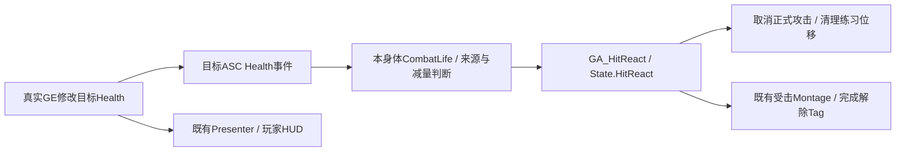

# M1-04C1：生命观察组件与正式GAS受击

2026-10-18清理同步：本页保留历史规则、接入差异、资产配置和验收经验，重复整文件 / 完整方法改为当前Source链接；不要将旧阶段代码覆盖到现有M2-04B2工程。本次清理范围、验证与提交清单见[Cleanup](Cleanup.md)。

日期：2026-10-06；UE5.5.4。前置：[B2真实伤害已验收](Reports/M1_04B2_Verification.md)。**状态：用户已实施，C1验收通过。**手动25 / 等待5分钟，45份Source / 22cpp、双构建产物与受击 / 取消清理日志已核对，见[C1结果](Reports/M1_04C1_Verification.md)。后续执行[C2一次死亡](M1_04C2_DeathState.md)。以下保留原操作步骤与实施前预算，不要求重复制作；本指南下发时助手未改Source / UE资产或代执行Build / PIE。

## 1. 成果、时间与边界

玩家攻击训练目标后，真实Health降低触发目标的正式受击Montage。数字3改为同一个正式受击能力的诊断入口，可以取消正式攻击或练习闪避；受击过程中再按3不重启，结束恢复行动。数字4用既有测试GE给玩家扣25，验证生命变化、受击和HUD的整条链路，C2继续复用此入口。

预计手动约70–120分钟：代码40–70、资产 / 输入20–35、相关检查10–15；构建等待 / 排障另计。没有五个临时Controller函数、复杂Possess测试图或新动画制作。本批四份新C++文件与五份现有文件，使用现有受击Montage / Quinn / AnimBP。

**本批不实现死亡。**受到致命伤害时不新启动受击，0血仍留在场景，Ready仍表示属性已初始化；C2再一次性处理死亡、取消 / 封锁行动。3只演示受击，不扣血；4才真实扣血。不把这两个用途混为“按3受到真实伤害”。

## 2. 职责与事件规则

| 对象 | 本批职责 |
| --- | --- |
| CombatLife组件 | 每个身体独立观察自己ASC的Health事件，拥有自己授予的受击Spec Handle，Ready撤销 / EndPlay时解绑与清理 |
| GA_HitReact | 拥有State.HitReact，取消Ability.Attack.Light，停止练习动作 / 闪避位移，播放受击Montage并结束；不修改Health |
| Character | 创建单个继承CombatLife，提供RequestHitReact薄命令；FormalIdle同时查询攻击 / 受击状态 |
| Blueprint | 装配能力 / Montage / 模型；3调用命令，4保留简单开发检查入口 |
| AttributeSet / UI | 原实现不改；分别负责生命夹限和只读事件显示 |

本组件只把以下事件当作直接伤害：Health实际降低，GEModData存在且指向本ASC，执行的Modifier属性是Health、操作Add (Base)、计算值为有限负数。这样B2 SetByCaller和旧GE_ET_Test_Damage25都可触发；初始化 / SetNumericAttributeBase、治疗、MaxHealth下降导致的Health夹限不触发受击。

该规则目前覆盖**Instant直接修改Health**。未来护甲 / Damage元属性、持续伤害、联机预测要统一扩展伤害语义，不能假定所有生命变化都是受伤。GEModData只是同步回调期间有效的指针，只立即读取，不保存到组件、Timer或蓝图变量。



伤害仍可在受击期间继续扣血，但不重启当前受击Montage。本批没有无敌帧。组件不Tick，不随控制权变化改绑到别的身体；UI观察当前玩家与身体自身战斗反应是两种不同生命周期。

## 3. 保存与文件准备

Save All后关闭UE；CLion保持打开。不要Live Coding新增反射类 / 原生子对象。以下四份新文件属于EmberTrial核心模块，在CLion对应目录创建文件并手动输入全文：

| 新文件（相对EmberTrial/Source/EmberTrial） | 作用 |
| --- | --- |
| Public/Combat/ETCombatLifeComponent.h | 观察 / 清理 / 受击入口声明 |
| Private/Combat/ETCombatLifeComponent.cpp | 观察属性与授予受击能力 |
| Public/Abilities/ETGA_HitReact.h | 正式受击能力声明 |
| Private/Abilities/ETGA_HitReact.cpp | 受击播放 / 取消 / 结束 |

另局部修改Tag h / cpp、Character h / cpp、LightAttack.cpp共五份现有文件。Build.cs、UI、AttributeSet、Trace / Notify和Practice源码均保留。全部实施后Source预计41→45，工程cpp20→22；目前没有新工程文件，不能提前标完成。

## 4. Native Tag局部增加

在ETGameplayTags.h已有namespace内部、原三个声明后加入：

```cpp
EMBERTRIAL_API UE_DECLARE_GAMEPLAY_TAG_EXTERN(Ability_HitReact);
EMBERTRIAL_API UE_DECLARE_GAMEPLAY_TAG_EXTERN(State_HitReact);
```

在ETGameplayTags.cpp同一个namespace内部加入：

```cpp
UE_DEFINE_GAMEPLAY_TAG_COMMENT(Ability_HitReact,
    "Ability.HitReact", "Identifies the formal hit reaction ability.");
UE_DEFINE_GAMEPLAY_TAG_COMMENT(State_HitReact,
    "State.HitReact", "Owned by GAS while a formal hit reaction is active.");
```

原Ability.Attack.Light / State.Attacking / SetByCaller.HealthDelta保留。本批暂不声明State.Dead。

## 5. 正式受击Ability

### 5.1 ETGA_HitReact.h全文

当前源码：[ETGA_HitReact.h](../EmberTrial/Source/EmberTrial/Public/Abilities/ETGA_HitReact.h)。

受击保留原配置与GAS入口；不负责直接修改生命。

### 5.2 ETGA_HitReact.cpp全文

当前源码：[ETGA_HitReact.cpp](../EmberTrial/Source/EmberTrial/Private/Abilities/ETGA_HitReact.cpp)。

受击在正式取消完成后启动自己的Montage；死亡与其他动作取消优先级保持。

采用ServerOnly是为了本地权威身体都能受击，包括没有Controller的训练身体；不能照抄玩家攻击的LocalOnly / LocalPlayer检查。这不代表已实现网络同步。能力不限制站定 / 地面，因此移动时也可受击；空中速度会被停止后继续受重力影响，尚无专用空中受击动画。

CancelAbilitiesWithTag由GAS在激活准备时取消正式攻击；随后取消Practice以清除闪避RootMotionSource。不手动删State.Attacking，也不使用Delay等淡出。受击Own Tag由GAS结束时移除；ScopeLock结束保护沿用已核对的引擎规则。

## 6. 身体生命观察组件

### 6.1 ETCombatLifeComponent.h全文

当前源码：[ETCombatLifeComponent.h](../EmberTrial/Source/EmberTrial/Public/Combat/ETCombatLifeComponent.h)。

声明区分观察归属、一次死亡锁、自己持有的Tag计数与最终封口事件。

### 6.2 ETCombatLifeComponent.cpp全文

当前源码：[ETCombatLifeComponent.cpp](../EmberTrial/Source/EmberTrial/Private/Combat/ETCombatLifeComponent.cpp)。

当前实现包含受击、死亡及失败流程事件；只保存一份实现，历史版本不再整文件覆盖。

HitReactAbilityClass=None的旧UI测试身体可以继续观察生命，但不授予 / 播放受击，不产生依赖Error。正式玩家和训练目标都必须配置该Class。StartObserving先检查同一ASC / 已绑定句柄，避免重复订阅和重复授予；Stop先撤销自身引用，再解绑 / 取消 / 清除自己授予的Handle，不误清LightAttack。

Character结束时已有Ready=false广播，组件在ClearActorInfo之前清理；之后组件EndPlay重复Stop安全。Grant未成功或动画配置缺失时不会伪造受击完成，正常应见Granted1 / Accepted1及Hit begin / end。

## 7. Character与攻击局部接入

### 7.1 Character头文件

打开Public/Characters/EmberTrialCharacter.h。

在已有class前置声明区域加入：

```cpp
class UETCombatLifeComponent;
```

在已有CombatTraceComponent属性之后、`public:`之前加入：

```cpp
UPROPERTY(VisibleAnywhere, BlueprintReadOnly, Category = "EmberTrial|Combat",
    meta = (AllowPrivateAccess = "true"))
TObjectPtr<UETCombatLifeComponent> CombatLifeComponent;
```

在已有public的RequestLightAttack / CancelLightAttack附近加入：

```cpp
UFUNCTION(BlueprintCallable, Category = "EmberTrial|Combat")
bool RequestHitReact();
```

原角色类名、父类、Ready / Health、输入和各函数声明保留，不移动文件。

### 7.2 Character.cpp三处

1. include区域增加：

```cpp
#include "Combat/ETCombatLifeComponent.h"
```

2. 构造函数里，在已有CombatTrace默认子对象创建之后加入：

```cpp
CombatLifeComponent = CreateDefaultSubobject<UETCombatLifeComponent>(TEXT("CombatLife"));
```

3. 在`CancelLightAttack`结束后、`IsFormalActionIdle`之前新增下面函数，再**替换**原IsFormalActionIdle整个函数为下面版本：

```cpp
bool AEmberTrialCharacter::RequestHitReact()
{
    return !bAbilitySystemShuttingDown && IsGameplayReady() &&
        IsValid(CombatLifeComponent) && CombatLifeComponent->RequestHitReact();
}

bool AEmberTrialCharacter::IsFormalActionIdle() const
{
    return IsValid(AbilitySystemComponent) &&
        !AbilitySystemComponent->HasMatchingGameplayTag(ETGameplayTags::State_Attacking) &&
        !AbilitySystemComponent->HasMatchingGameplayTag(ETGameplayTags::State_HitReact);
}
```

BeginPlay / EnsureGameplayInitialized / EndPlay **不另加第二套组件初始化或受击授予**；组件自己通过Ready与自身BeginPlay装配。Move / Jump已经查询FormalIdle，无需重写。

### 7.3 LightAttack.cpp一行

打开Private/Abilities/ETGA_LightAttack.cpp，构造函数已有`ActivationBlockedTags.AddTag(ETGameplayTags::State_Attacking);`。紧接其后增加：

```cpp
ActivationBlockedTags.AddTag(ETGameplayTags::State_HitReact);
```

B2伤害回调、配置保护、Trace登记 / 结束全部保留。正式攻击不能在受击期间启动；受击不以State.Attacking作为Blocked Tag，因为它需要取消正在进行的攻击。

## 8. Build与索引

保存四新 / 五现有文件，UE保持关闭。PowerShell执行：

```powershell
Set-Location 'E:\UE_Project\Demo'
.\Tools\Refresh-CLion.ps1
```

成功后在原CLion工程Reload CMake Project，EmberTrial CodeModel应包含新HitReact / CombatLife两份cpp，工程cpp合计22；Ctrl+B检查GameplayEffectExtension.h与新组件头文件。继续：

```powershell
& 'D:\UE5\UE_5.5\Engine\Build\BatchFiles\Build.bat' EmberTrial Win64 Development '-Project=E:\UE_Project\Demo\EmberTrial\EmberTrial.uproject' -WaitMutex -NoHotReloadFromIDE
```

成功后打开UE。失败发第一条实际编译错误文字和上下各5–10行，停在Build；不清缓存、不删除Intermediate，不在失败后继续改蓝图资产。

## 9. 资产与输入装配

### 9.1 新受击能力Blueprint

在`/Game/EmberTrial/Abilities`右键 → Blueprint Class → All Classes，选择新原生**ETGA_HitReact**，命名`GA_ET_HitReact`。不是GameplayEffect，也不Duplicate已有LightAttack。

Class Defaults的Hit React Montage设为已有`/Game/EmberTrial/Animations/Practice/Montages/AM_M0_HitResult_01_Montage`，使用实际HitResult命名，不另造HitReact同名资产。保持无Cost / Cooldown、无Event Graph覆盖、不改继承的ServerOnly / 实例策略。Compile → Save。

### 9.2 玩家：只配置一个继承组件

打开BP_ThirdPersonCharacter，Components应新增**一个继承CombatLife**。不要手动Add第二个。选中它，Hit React Ability Class=GA_ET_HitReact，Auto Activate保持True。

原ASC、PracticeAction、CombatTrace、Quinn / AnimBP、DefaultSlot、攻击GE25配置保留。Compile → Save。此时出生应有本玩家`Life observing ... Granted=1`一次。

### 9.3 训练目标：从Cube改为现有Quinn

打开原BP_ETCombatTrainingTarget，不新建 / Duplicate身体。

1. 选中继承CombatLife，Hit React Ability Class=GA_ET_HitReact；单ASC / 单CombatTrace保留。
2. 选中原TrainingBody静态Cube，在Rendering中Visible=False，并将Hidden in Game=True。保留该组件作原型备用，不增加碰撞。
3. 选中继承Mesh，Skeletal Mesh=SKM_Quinn_Simple，Animation Mode=Use Animation Blueprint，Anim Class=ABP_Quinn。
4. Mesh的Relative Location / Rotation / Scale：先打开玩家Blueprint，选中其Mesh，逐项读取这三个Transform；把同样的三个数值组填到训练目标Mesh。**复制的是玩家Mesh相对胶囊的Transform，不是角色Actor / 胶囊或骨骼坐标。**这种方式使用你已验收的足部对齐，避免猜模板Z / Yaw。
5. Mesh Collision Presets=NoCollision，Generate Overlap Events=False；Visible=True、Hidden in Game=False；Visibility Based Anim Tick Option=Always Tick Pose and Refresh Bones。胶囊仍32 / 96、Query Only、Pawn对象、Visibility Overlap，其他Ignore。
6. 初始生命仍100/100，Light Attack Ability Class仍None，Auto Possess仍Disabled，Movement None / Gravity0 / MaxWalk0 / NoController Physics False；四个模板输入资源保留。不要给训练目标添加PracticeAction或Controller。

Compile → Save。场景仍仅TrainingTarget_A，Location沿用B2；默认出生点设置下，将该目标Actor的Rotation设为X=0 / Y=0 / Z=180（Yaw180），使其面向出生玩家。若你的出生点已调整，以目标朝向玩家为准；只改目标Actor旋转，不改PlayerStart或Mesh的相对Transform。胶囊查询仍为同一圆柱。进入场景可见Quinn，不再是Cube；尚无AI / 攻击 / Root Motion反应位移，目标脚应留在原位置。两者共用动画资源，能力 / 状态 / 属性属于不同身体。

### 9.4 数字3替换为正式命令（详细接线）

打开BP_ThirdPersonCharacter Event Graph，找到原IA_PracticeHit事件（数字3）。保留Started输入与原暂停OR / Branch：

- OR第一个红色输入接bPauseMenuOpen变量Get；第二个接Is Game Paused的Return Value。
- Started白线接暂停Branch；Branch.Condition接OR输出。
- 暂停Branch.True留空；False改接新**Request Hit React**可调用节点的白色执行输入。
- Request Hit React的**Target=Self**（角色），不是PracticeAction、ASC或CombatLife。Return Value无需另接Branch / Print。
- 旧False后面的Cancel Light Attack、FormalIdle Branch、Request Practice Action(HitReact)从这条执行链断开；只删除这条3路线专用的孤立节点，不删其他路线共享的查询 / Cancel函数或Practice组件。

```text
IA_PracticeHit.Started
  → Branch(Condition = bPauseMenuOpen OR IsGamePaused)
      True  → 无操作
      False → Request Hit React(Target=Self)
```

**不要在Request前加FormalIdle检查**：攻击中它本来是False，会把需要的受击取消挡掉。能力内统一取消正式攻击与Practice；旧蓝图不再先手动取消。Completed / Triggered / Ongoing不接播放，长按只按Started触发。

原左键 / 1不改；数字2仍通过Is Formal Action Idle(Self)再Request Practice Action(Dodging)。E原Practice Idle AND FormalIdle分支不改；新C++查询已经把受击纳入门控。原暂停 / 焦点 / EndPlay流程保留。Compile → Save。

### 9.5 数字4：复用真实玩家损伤入口

这是本次唯一新增开发检查输入，约几个节点，**保留到C2 / D后再统一移除**，无需每批重搭。放在角色Event Graph的Comment内，名称`Development Diagnostics - Health Damage`。它不属于正式游戏操作或投递演示的玩法按钮，不修改Controller。

节点与数据：

1. 新建普通Keyboard **4**事件（顶部数字4，非NumPad）；只用Pressed，Execute When Paused=False。
2. 建立OR和暂停Branch：bPauseMenuOpen Get、Is Game Paused的bool分别接OR两个输入；OR输出接Branch.Condition。
3. 建立**Get Ability System Component**纯节点，选择Ability System Blueprint Library版本，**Actor输入=Self**，其Return Value作为本组ASC引用；不是对组件调用的同名Get节点。
4. 建立带白线的**Is Valid**判断节点，**Input Object接上述ASC Return Value**。
5. 建立Ready Branch，Condition接**Is Gameplay Ready(Target=Self)**的bool。
6. 建立**Make Effect Context**，**Target接上述ASC引用**，Return Value接下一节点Effect Context。
7. 建立**Apply Gameplay Effect to Self**，Target接同一ASC；Gameplay Effect Class选择旧`GE_ET_Test_Damage25`（Tests/Effects）；Level=1，Effect Context接Make的返回值。这里是旧固定-25的测试GE，不是需要SetByCaller Spec的正式GE_ET_LightAttackDamage。

白线按这个顺序接：

```text
Keyboard 4.Pressed → 暂停Branch
    True → 留空
    False → Is Valid(Input Object=ASC)
        Is Not Valid → 留空
        Is Valid → Ready Branch(Condition=IsGameplayReady(Self))
            False → 留空
            True → Apply Gameplay Effect to Self(Target=ASC)
```

Make Effect Context是const查询，正常以纯节点提供结构体数据，不插入上述白线。若你放出的节点带执行引脚，则把Ready True改接Make的执行输入，再将Make执行输出接Apply，数据连接仍相同；发局部截图即可核对。Apply的Handle输出不做IsValid成功判断，Instant的该问题已在B2说明。

不添加新函数 / 变量 / Timer / SetHealth / 额外伤害集合；不使用Apply Gameplay Effect Spec To Self而又把Class接错成Spec。本入口已经有暂停 / ASC有效 / Ready保护，恢复后不会补执行菜单里的按键。Compile → Save。

## 10. 共享准备与分组检查

打开L_ET_VerticalSlice，GA攻击25、玩家 / 目标初始100/100、两者Hit Class正确、单个目标A、Draw Debug=False。Output Log过滤M1-04C1；必要时同时看B1 Disarm、A End与HUD日志。不用再搭换身体函数或重跑B2全矩阵。

### 10.1 自动受击与身体隔离

**准备：**新PIE，确认玩家与训练目标各一条Life observing / Granted1，HUD100/100，Quinn训练身体脚部位置正常。

**操作：**有效站位站定攻击目标一次，等动作结束，再打一击。

**预期：**B2日志目标100→75→50；每次目标对应Health damage → Hit begin → Hit end，End的HitTag0。目标播放原受击后回待机，玩家仅攻击、HUD100/100；两者不串状态。训练目标无Controller仍应正常受击，无脚 / root漂移。

**清理：**停止PIE，不改变目标生命默认值。画面有问题优先发目标Mesh配置与短视频，先不修改命中半径。

### 10.2 正式3、动作取消与门控

**准备：**新PIE，避免误按4降低生命。

**操作：**站定按3，受击中再次按3 / 左键 / 2 / E / 跳跃 / 移动，镜头转动一次；等结束后移动 / 跳跃和重新攻击。再做攻击中1→3，以及位移中的2→3。

**预期：**3走Hit begin，重复3显示Busy拒绝、不重启Montage，玩家生命仍100；受击期间动作 / 交互被门控，镜头可转。1→3先取消攻击，B1 Disarm Tick0 / A End AttackingTag0；2→3清掉Practice RootMotion，受击期间没有残留侧移。正式Hit end HitTag0后恢复。不会再见Practice Begin HitReact作为数字3路线。

**清理：**松开所有输入、停止PIE。旧Practice自动测试源码未改变，不要求重复Lifecycle / DodgeMovement；这里验证新能力对它的取消调用。

### 10.3 真实玩家损伤、忙碌再扣与HUD

**准备：**新PIE，确认单份玩家HUD100/100。

**操作：**按4一次，然后在受击尚未结束时立即再按4；等结束。之后按3一次。

**预期：**玩家Health100→75→50，HUD显示75%再50%；两条Health damage，但第一段受击只启动一次，第二次请求Busy拒绝，不获得无敌。结束HitTag0，3可以新播放受击但不再扣血，HUD仍50。此组验证正式生命链，不能用3动画播放代替。

**清理：**停止PIE，生命通过新PIE回100，不添加治疗函数。本组不要连续按4到0；致命分支留C2重点实现。

### 10.4 暂停恢复与结束清理

**准备：**新PIE，3启动受击后按P暂停。

**操作：**菜单停留约2秒，按3 / 4，鼠标继续；等受击结束。再按3，在受击中停止PIE，再Play一次正常按3、按4一次并等待完成。

**预期：**菜单中不新播 / 不扣血，恢复完成原受击、不补执行菜单键。停止PIE时Hit被取消、Life stopped；新PIE各身体一条新观察 / 授予，玩家100，正常3与4可触发，无旧轮Health damage / Hit begin或Accessed None。

**清理：**停止PIE。记录最近这两轮完成时间即可，不要求十次重建或三轮全部旧矩阵。

### 10.5 最后保存与短基线

**准备：**正式25伤害、100/100默认值、单A、Quinn显示 / Cube隐藏、单CombatLife、开发4图有Comment、Draw Debug=False。

**操作：**新PIE确认玩家100 / 单HUD，最后移动转向 / 跳跃、E-A/B和P开关各一次短流程；停止PIE。

**预期：**无游戏运行Error、旧功能正常。尚无死亡，不把可行动的0血身体当成本批已经处理死亡。

**清理：**GA / 玩家 / 训练目标Compile → Save，地图Save All。保留简单4入口供C2使用；不要清理它后下一批又重新创建，不增加临时目标 / 挡板或帧率设置。

## 11. 报错材料与完成反馈

| 问题 | 最有用的材料 |
| --- | --- |
| Build失败 | 第一条实际错误文字，上下5–10行，注明Editor / Game |
| 受伤但不播放 | 对应Life observing / Health damage / Hit request日志，加目标Mesh Anim Class和CombatLife Hit Class截图 |
| 3不取消攻击 | 3完整局部白线，确认未保留FormalIdle前置Branch；Cancel Tags继承设置、A / B1 / C1相邻日志 |
| 2→3残留侧移 | 短视频，Practice End / DodgeEnd / Hit begin时间附近文字日志 |
| 4无反应 / 报空引用 | 4全部节点和数据引脚截图，特别是Library.Actor、IsValid.Input Object、Make / Apply.Target、Effect Class |
| 镜头 / 暂停 / 动作时点不清 | 10–20秒短视频，不必先判断根因 |

```text
M1-04C1 完成
Editor Build / 索引22cpp / Game Build：
单CombatLife / 双身体Hit Class / 原Montage / Quinn目标：
目标真实扣血自动受击，独立状态与脚部位置：
3正式受击 / 不重启 / 门控 / 1→3与2→3：
4真实玩家扣血 / 忙碌继续扣但不重启 / HUD同步：
暂停3/4无执行无补播 / 受击中停止 / 下一轮清理：
最后E / P / 基础输入 / HUD100：
源码资产保存；4入口保留、默认值100/100、调试绘制False：
失败或特别说明：
大致完成时间（例20:40）：
实际用时：代码 / 资产 / 检查；构建等待：
```

成功日志不用逐条复制；提供完整本地时间后由助手读取。普通报错不自动授权改C++，仍由助手定位后在文档 / 回复提供局部修正；明确要求才接管。

## 12. C2交接与核查依据

C2将在同一CombatLife上新增死亡锁与State.Dead：初始0或当前Health到0只死亡一次，先锁定再取消能力 / 位移 / 检测与行动；不会将GameplayReady置False来隐藏玩家0血HUD，也不会由Widget执行死亡。正式重试 / 重生在后续章节，死亡视觉先用占位方案。C2尚未实施 / 下发，本批不自行补代码。

本批核对本机5.5.4的GameplayEffect.cpp中Health委托同步数据、GameplayEffectExtension.h中回调Target / EvaluatedData、GameplayAbility.cpp中Owned Tag / Cancel Tag激活次序及Montage Task / ScopeLock接口。检查仅确认接口与设计依据，不能替代本批正常Build和实机结果。
