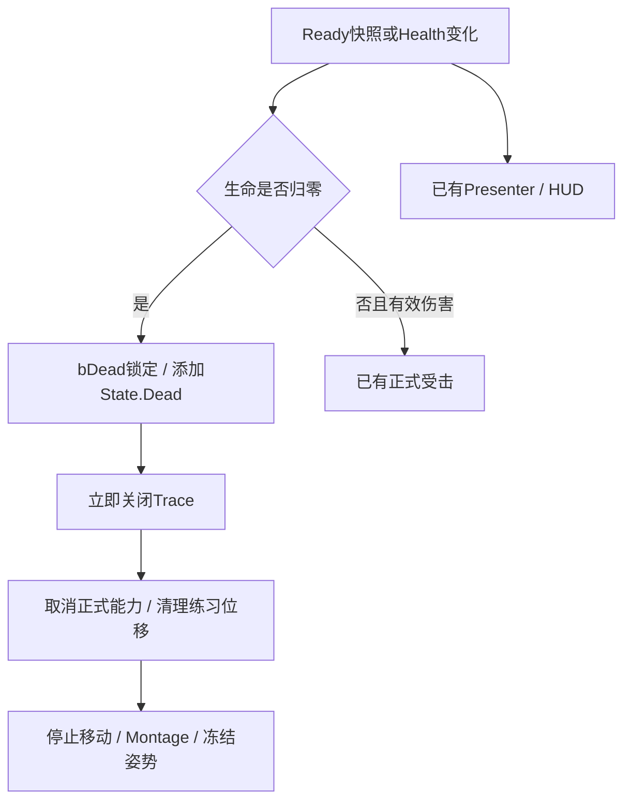

# M1-04C2：一次死亡与行动封锁

2026-10-18清理同步：本页保留历史规则、接入差异、资产配置和验收经验，重复整文件 / 完整方法改为当前Source链接；不要将旧阶段代码覆盖到现有M2-04B2工程。本次清理范围、验证与提交清单见[Cleanup](Cleanup.md)。

实施日期：2026-10-06；收尾：2026-10-07；UE5.5.4。前置：[C1正式受击已验收](Reports/M1_04C1_Verification.md)。**状态：C2已验收完成；助手经授权实测窗口内死亡并恢复配置，第13节无需再操作。**见[C2核查](Reports/M1_04C2_Verification.md)及[D阶段汇总](M1_04D_CombatReview.md)。下方保留原实施步骤、预算与历史复验办法。收尾未修改C++或执行Build，仅通过GUI恢复玩家100/100与Debug False、Compile→Save及短PIE。

## 1. 本批结果与投入

玩家 / 训练目标生命归零时，各自只进入一次死亡状态。死亡先锁定，再关闭命中检测、取消正式能力和练习闪避、停止移动 / 跳跃与Montage。死亡身体保留在场景，冻结当前姿势；玩家仍能转镜头、打开 / 关闭P菜单，HUD保留Ready与0/100。

这是死亡的**逻辑与占位表现**：可能冻结在站姿、受击或攻击姿势，没有倒地动画、尸体物理、死亡菜单、重试或自动重生。最终演示需在后续动画 / 美术阶段替换这一占位，并在游戏流程阶段接新身体重试；本批通过不等于最终投递质量已达成。

预计手动90–150分钟：代码70–110、资产 / 入口核对10–20、相关检查10–20；Build等待与失败排查另计。共局部修改**11份既有文件**，不新建C++类或UE资产。沿用数字4，不搭建Controller函数、变量或新测试平台。代码全部完成后才正常Build；不要每个片段单独编译。

## 2. 死亡契约与职责

| 对象 | 新责任 |
| --- | --- |
| CombatLife | 每身体的bDead死亡锁；死亡提交一次；持有自己添加的一份State.Dead计数；管理结束清理 |
| Character | IsCombatDead公开查询；请求与FormalIdle封锁；已有移动 / 跳跃 / 2 / E查询随之生效 |
| Trace | 提供CancelActiveAttack命令，立即清活动序号 / 窗口 / Tick，允许能力稍后再次幂等清理 |
| LightAttack / HitReact | State.Dead阻止激活；原生检查拒绝死亡身体；伤害回调拒绝死亡来源 / 目标 |
| AttributeSet | 在已有Health范围夹限上增加死亡Tag规则：死亡身体Health的Base / Current保持0，治疗不复活 |
| Presenter / HUD | 保留原只读实现；Health=0仍是Ready，死亡不等于缺少数据或没有Pawn |

死亡判断先于C1的“是不是直接伤害”过滤：**任何有效Health事件的新值≤0**都要死亡，不要求GEModData；订阅后立即读取快照，合法的出生0/100也要死亡一次。非法100/60仍Waiting，不能当作死亡。死亡锁不会因为治疗、重订阅或受击结束而重置；本批仅新PIE / 新身体拥有新的存活生命周期。

State.Dead由CombatLife手动持有一份Loose Tag，并在本组件EndPlay移除自己的一份。攻击 / 受击的Owned Tag仍由GAS清理，不在死亡代码中强行清空。Ready、ASC、Controller和HUD不因死亡而销毁 / 清空。



## 当前所有权与数值规则（清理同步）

- Ready撤销只解除观察与本组件授予的受击能力；bDead是同一身体的终态，不在StopObserving中重置。
- DeadTagASC与BoundASC分开：观察解除后仍要找到自己添加的一份State.Dead；EndPlay只移除这份计数，不清其他来源。
- 添加Tag、取消GA、停止Montage都可能同步调用外部监听，各段重新获取弱引用不是冗余。OnDeathSealed在Trace / 动作 / 移动 / 动画封锁之后广播，广播后不再访问身体。
- [生命属性](../EmberTrial/Source/EmberTrial/Private/Attributes/ETHealthAttributeSet.cpp)负责数值夹限与死亡后禁止回填；[体力属性](../EmberTrial/Source/EmberTrial/Private/Attributes/ETStaminaAttributeSet.cpp)保留自己的非有限值回退和Base / Current同步，不能只因结构相似就合并行为。
- 构造中的Max=100 / Current=0是原生基线；正式初值由Character配置、校验后经ASC写入并发布Ready。上下限0 / 1是数值契约，不变成额外运行时配置。

## 3. 保存、关闭与修改清单

先Save All并关闭UE，CLion保留打开。不要使用Live Coding处理新增反射函数。源码根目录：`E:\UE_Project\Demo\EmberTrial\Source\EmberTrial`。

| 文件（相对源码根目录） | 操作 |
| --- | --- |
| Public/Abilities/ETGameplayTags.h、Private/Abilities/ETGameplayTags.cpp | 各加一条State.Dead |
| Public/Combat/ETCombatLifeComponent.h | 替换全文，保留受击配置并增加死亡状态 |
| Private/Combat/ETCombatLifeComponent.cpp | 加include、改四处函数、新增死亡 / Tag清理函数 |
| Public/Characters/EmberTrialCharacter.h、Private/Characters/EmberTrialCharacter.cpp | 查询与命令 / 门控局部修改 |
| Public/Combat/ETCombatTraceComponent.h、Private/Combat/ETCombatTraceComponent.cpp | 各加一个取消命令 |
| Private/Abilities/ETGA_LightAttack.cpp、Private/Abilities/ETGA_HitReact.cpp | 追加死亡保护，原Task / EndAbility保留 |
| Private/Attributes/ETHealthAttributeSet.cpp | 加Tag include、替换夹限函数 |

Build.cs、UI模块、Practice及自动测试、两个Ability头文件、NotifyState不改。完成后Source仍45份，工程cpp仍22。

## 4. Tag、Trace与属性规则

### 4.1 Native Tag

在ETGameplayTags.h已有`namespace ETGameplayTags`内部、其他Tag声明后**追加**：

```cpp
EMBERTRIAL_API UE_DECLARE_GAMEPLAY_TAG_EXTERN(State_Dead);
```

在ETGameplayTags.cpp同名namespace内部、其他定义后追加：

```cpp
UE_DEFINE_GAMEPLAY_TAG(State_Dead, "State.Dead");
```

原五个Tag不删除。不在蓝图手动增删State.Dead。

### 4.2 Trace公开取消命令

在ETCombatTraceComponent.h的public区域，`void EndAttack(uint32 Serial);`下方加入：

```cpp
void CancelActiveAttack();
```

在ETCombatTraceComponent.cpp的EndAttack完整函数后、EndPlay之前，加入：

```cpp
void UETCombatTraceComponent::CancelActiveAttack()
{
    EndAttack(ActiveSerial);
    CloseWindow(TEXT("OwnerCancelled"));
}
```

EndAttack原来的序号校验、弱引用 / SeenTargets清理都保留。第二次取消没有活动序号也安全；迟到Notify因ActiveSerial=0不能重开窗口。它只关闭检测，不负责改变生命 / 取消能力 / 移除别的订阅。Trace仍不依赖GAS或UI。

### 4.3 死亡后Health保持0

在ETHealthAttributeSet.cpp现有include后加：

```cpp
#include "Abilities/ETGameplayTags.h"
```

**只替换ClampAttribute整个函数**为下面版本；构造、PreAttributeBaseChange、PreAttributeChange、PostAttributeChange原样保留，它们仍调用这个函数：

当前源码：[ETHealthAttributeSet.cpp](../EmberTrial/Source/EmberTrial/Private/Attributes/ETHealthAttributeSet.cpp)。

ClampAttribute保留死亡Tag门控；本段历史新增原因仍保留，当前代码以Source为准。

AttributeSet只查询公开Tag，不能Include CombatLife / Character或操作Widget。两种Pre钩子都需要保留：只夹Current而放过Base会产生隐藏生命值。旧“从0治疗”样例属于尚无死亡规则时的基线；**接入本批后，已死亡身体的治疗保持0是新的预期**，不为恢复旧预期而删除死亡保护。存活身体原治疗 / 最大值规则保留。

## 5. CombatLife增加一次死亡

### 5.1 头文件全文

**替换ETCombatLifeComponent.h全文**。HitReactAbilityClass名字 / 类型 / Category保持相同，原蓝图配置应保留，后续仍要核对：

当前源码：[ETCombatLifeComponent.h](../EmberTrial/Source/EmberTrial/Public/Combat/ETCombatLifeComponent.h)。

声明区分观察归属、一次死亡锁、自己持有的Tag计数与最终封口事件。

bDead不是可配置初值，也不放到Blueprint变量中。StopObserving只清观察和自己授予的能力，不重置死亡锁。DeadTagASC单独保存，是因为Ready撤销时BoundASC已清空，EndPlay仍要找到自己持有的Tag。

### 5.2 cpp加入include

在ETCombatLifeComponent.cpp已有include后追加以下五行，已有include和日志分类都保留：

```cpp
#include "Abilities/ETGameplayTags.h"
#include "Animation/AnimInstance.h"
#include "Combat/ETCombatTraceComponent.h"
#include "Components/SkeletalMeshComponent.h"
#include "GameFramework/CharacterMovementComponent.h"
```

再加Practice头文件；从`Private/Combat`到模块根目录两层，因此使用：

```cpp
#include "../../ETPracticeActionComponent.h"
```

本批不迁移Practice文件。这个相对路径和当前目录对应，不能用`../`少退一层。

### 5.3 替换StartObserving

**替换StartObserving整个函数**。绑定后读快照；出生0先死亡，不授予受击。已经死亡的身体不会因重新观察再获受击能力。

当前源码：[ETCombatLifeComponent.cpp](../EmberTrial/Source/EmberTrial/Private/Combat/ETCombatLifeComponent.cpp)。

StartObserving先订阅再读快照，覆盖出生零血；同步回调后重新获取弱引用，再决定是否授予受击能力。

### 5.4 受击请求入口追加一项保护

在RequestHitReactInternal原第一个if中，把起始条件：

```cpp
if (bEndingPlay || !IsValid(Character) || !IsValid(ASC) ||
```

**改为**：

```cpp
if (bEndingPlay || bDead || !IsValid(Character) || !IsValid(ASC) ||
```

这个片段后还有现有条件，不能删掉后面的ASC身份 / 快照 / 暂停 / Handle检查；函数其他部分不变。

### 5.5 替换Health事件处理

**替换HandleHealthChanged整个函数**。先检查当前身体与有限新值，再处理零血；只有存活的非致命下降才继续C1直接伤害判定。

当前源码：[ETCombatLifeComponent.cpp](../EmberTrial/Source/EmberTrial/Private/Combat/ETCombatLifeComponent.cpp)。

HandleHealthChanged优先提交零血死亡；只将真实负值生命GE识别为受击，不把治疗或上限夹限当命中。

致命伤害不再输出DeathPendingC2，也不先启动一个新的HitReact。已有受击会由死亡取消。这里仍不保存GEModData。

### 5.6 新增死亡提交与Tag清理

将下面两个**完整新函数**放在HandleHealthChanged后、EndPlay之前。先锁bDead / Tag，立即关Trace，再取消能力。这样即使能力EndAbility因ScopeLock稍后执行，窗口已经失效，新的输入也已拒绝。

当前源码：[ETCombatLifeComponent.cpp](../EmberTrial/Source/EmberTrial/Private/Combat/ETCombatLifeComponent.cpp)。

CommitDeath先置死亡锁 / Tag并关闭Trace，再取消动作、停止移动和冻结动画，最后广播OnDeathSealed；ClearOwnedDeadTag只移除自己的一份计数。

CancelAllAbilities只取消当前身体ASC上的活动能力，不清掉其他对象的Spec。Practice取消先移除自己的Root Motion Source，不能仅用StopMovementImmediately代替。AnimPaused只作用在这个死亡Mesh实例；不要在Blueprint默认值或AnimBP中永久设置。

### 5.7 替换EndPlay

**替换组件EndPlay整个函数**；Character自己的EndPlay保持原顺序。bDead不在清理阶段重置为false；移除Tag是释放所有权，不是复活。

当前源码：[ETCombatLifeComponent.cpp](../EmberTrial/Source/EmberTrial/Private/Combat/ETCombatLifeComponent.cpp)。

EndPlay先封锁回调并清空死亡事件监听，再解除Ready / 属性 / 能力绑定并释放自己持有的Tag。

构造、BeginPlay、HandleReadyChanged、StopObserving、RequestHitReact保留C1实现；它们不能重复出现两份。StopObserving中不要增加ClearOwnedDeadTag或`bDead=false`。清理时若ASC的Tag容器已经被结束流程清空，不再重复减计数；组件仍释放自己的持有标记。

## 6. Character公开查询与封锁

### 6.1 头文件

在EmberTrialCharacter.h的public区域，IsFormalActionIdle声明后增加：

```cpp
UFUNCTION(BlueprintPure, Category = "EmberTrial|Combat")
bool IsCombatDead() const;
```

没有新组件、没有新死亡Blueprint变量。原单CombatLife / CombatTrace / ASC / Practice都保留。

### 6.2 cpp替换查询与受击命令

在EmberTrialCharacter.cpp **替换RequestHitReact与IsFormalActionIdle两个完整函数**，同时在它们之间新增IsCombatDead完整函数：

```cpp
bool AEmberTrialCharacter::RequestHitReact()
{
    return !bAbilitySystemShuttingDown && IsGameplayReady() && !IsCombatDead() &&
        IsValid(CombatLifeComponent) && CombatLifeComponent->RequestHitReact();
}

bool AEmberTrialCharacter::IsCombatDead() const
{
    return IsValid(CombatLifeComponent) && CombatLifeComponent->IsDead();
}

bool AEmberTrialCharacter::IsFormalActionIdle() const
{
    return !bAbilitySystemShuttingDown && IsGameplayReady() && !IsCombatDead() &&
        IsValid(AbilitySystemComponent) &&
        !AbilitySystemComponent->HasMatchingGameplayTag(ETGameplayTags::State_Dead) &&
        !AbilitySystemComponent->HasMatchingGameplayTag(ETGameplayTags::State_Attacking) &&
        !AbilitySystemComponent->HasMatchingGameplayTag(ETGameplayTags::State_HitReact);
}
```

FormalIdle现在也要求Ready；出生初始化尚未完成的身体不能行动。Move / StartPracticeAwareJump已有FormalIdle检查，不重写这些函数。Look仍保留镜头输入。

### 6.3 授予与攻击请求各改一行

GrantLightAttackAbility原第一个if起始行：

```cpp
if (!IsGameplayReady() || bAbilitySystemShuttingDown || !HasAuthority() ||
```

改为：

```cpp
if (!IsGameplayReady() || IsCombatDead() || bAbilitySystemShuttingDown || !HasAuthority() ||
```

RequestLightAttack原第一个if起始行：

```cpp
if (!IsGameplayReady() || bAbilitySystemShuttingDown ||
```

改为：

```cpp
if (!IsGameplayReady() || IsCombatDead() || bAbilitySystemShuttingDown ||
```

两处都是在既有条件中追加一项，后续条件、日志和函数体保留。出生0身体在Ready回调中先死亡，随后Character不会授予轻攻击。BeginPlay / EnsureGameplayInitialized / SetGameplayReady / EndPlay不增加第二套死亡调用。

## 7. 两个正式能力追加死亡保护

### 7.1 LightAttack.cpp

1. 构造中现有ActivationBlockedTags两条后追加：

```cpp
ActivationBlockedTags.AddTag(ETGameplayTags::State_Dead);
```

2. **CanActivateAbility**第一个Character合法性if，在`!IsValid(Character) ||`后追加`Character->IsCombatDead() ||`。该判断必须位于有效性判断之后，不能先解引用无效Character。其余身份、Health、Controller、地面 / 速度、Practice、GE配置、Trace与Anim检查全部保留。

3. **ActivateAbility**原`if (!IsValid(Character) || !IsValid(AttackMontage) || ...`改起始部分为下面片段，后面的条件 / EndAbility失败出口保留：

```cpp
if (!IsValid(Character) || Character->IsCombatDead() ||
    !IsValid(AttackMontage) || !IsValid(Trace) ||
```

4. **HandleTraceHit**来源校验原`if (!IsValid(Source) || !Source->HasAuthority() || ...`改起始部分为：

```cpp
if (!IsValid(Source) || Source->IsCombatDead() || !Source->HasAuthority() || !IsValid(SourceASC) ||
```

后面的SourceASC身份 / Health / 暂停等校验和SourceUnavailable出口保留。组件即使已关闭，本层仍明确拒绝死亡来源。

5. HandleTraceHit中找到目标类型判定`if (!IsValid(Target) || Target == Source)`及其UnsupportedTarget出口。**在这个if完整结束之后、读取目标Health之前**加入：

```cpp
if (Target->IsCombatDead())
{
    Reject(TEXT("TargetDead"));
    return;
}
```

死亡目标仍有查询胶囊，后续攻击可能得到它的候选；能力输出TargetDead并跳过伤害，这不是漏判。原TargetZeroHealth保护也保留，负责尚未进入死亡或其他零值情况。

### 7.2 HitReact.cpp

1. 构造中现有State.HitReact阻止标签后追加：

```cpp
ActivationBlockedTags.AddTag(ETGameplayTags::State_Dead);
```

2. **CanActivateAbility**第一个Character合法性if，在`!IsValid(Character) ||`后追加`Character->IsCombatDead() ||`；其他身份、authority、Health / 暂停 / 动画校验保留。

3. **ActivateAbility**原`if (!IsValid(Character) || !IsValid(ASC) || ...`改起始部分为：

```cpp
if (!IsValid(Character) || Character->IsCombatDead() || !IsValid(ASC) ||
```

CommitAbility、未清的State.Attacking检查、取消Practice、Task绑定与EndAbility原样保留。

**不要改两个EndAbility去手动清空State.Dead / State.Attacking / State.HitReact，也不要在那里恢复MOVE_Walking或解除Mesh动画暂停。**正常受击结束后能行动，是因为HitReact Tag解除；死亡状态仍独立阻止行动。

## 8. 正常Build、索引与资产核对

### 8.1 保存并构建

确认UE仍关闭，保存全部11份文件。在PowerShell执行：

```powershell
Set-Location 'E:\UE_Project\Demo'
.\Tools\Refresh-CLion.ps1
```

该脚本做正常Editor Build再刷新索引。成功后在CLion Reload CMake；确认IsCombatDead声明 / 实现、Tag、两个组件新命令可导航。工程cpp还是22，无需删除.idea或清缓存。

再执行Game Development Build：

```powershell
& 'D:\UE5\UE_5.5\Engine\Build\BatchFiles\Build.bat' EmberTrial Win64 Development '-Project=E:\UE_Project\Demo\EmberTrial\EmberTrial.uproject' -WaitMutex -NoHotReloadFromIDE
```

两个Build均成功才打开UE。失败先保留第一条error及前后约20行、文件路径 / 行号，告诉我；不要为通过Build删除保护，也不必贴整段重复UBT尾部。本批代码仅做本机5.5.4 API静态核对，成功构建仍以你的结果为准。

### 8.2 已有配置核对，无新资产

打开BP_ThirdPersonCharacter与BP_ETCombatTrainingTarget：

- 单个继承CombatLife，HitReactAbilityClass仍GA_ET_HitReact；玩家LightAttackAbilityClass仍GA_ET_LightAttack，目标LightAttack仍None。
- 两身体Initial Health / Max仍100/100。玩家 / 目标Quinn与AnimBP、原受击Montage保留，不手动勾Mesh的Pause Anims。
- 玩家2入口仍经Self的IsFormalActionIdle Branch：True才执行RequestPracticeAction(Dodging)，False无执行线；已有Practice有效性及暂停判断保留。
- TryInteractWithCurrentTarget中仍同时要求Practice Idle与Self的IsFormalActionIdle，True才继续原有效目标 / 接口调用，False结束。
- 3仍是C1的暂停判断后RequestHitReact(Target=Self)，不另加FormalIdle前置条件；死亡由原生拒绝，存活时3仍能打断攻击 / 闪避。
- P / Resume保持原流程，不用死亡Tag阻止菜单。4仍保留C1简单开发入口，**本批不要加死亡拒绝Branch到4**，它需要验证重复扣血 / 治疗的幂等规则。

对玩家、目标、GA_ET_LightAttack、GA_ET_HitReact依次Compile→Save。正常父类更新若一时显示旧节点，先刷新对应节点 / 重开Blueprint再Compile；有报错发实际文本。不要新挂第二个CombatLife。

### 8.3 数字4复用连线核对

无需重新搭图；为避免治疗检查时改错Target，现有小图应保持以下结构。位置是**BP_ThirdPersonCharacter / EventGraph**，不是Controller：

1. `Keyboard 4.Pressed` → 暂停Branch白色执行输入；Condition为`bPauseMenuOpen OR IsGamePaused`。True留空，False → 执行版`Is Valid`。
2. 从`Self`接到`Get Ability System Component`（Ability System Blueprint Library）的Actor引脚；Return Value就是玩家ASC。
3. `Is Valid.Input Object`接这个ASC Return Value；Is Valid白线 → 第二个Branch，Is Not Valid留空。第二个Branch.Condition接`Is Gameplay Ready(Target=Self)`，False留空。
4. 第二个Branch.True → `Apply Gameplay Effect to Self`白色输入。**Apply.Target接ASC**；Class=`GE_ET_Test_Damage25`，Level=1；Effect Context接`Make Effect Context(Target=同一个ASC)`返回值。
5. 如果本机Make Effect Context显示执行引脚，则白线是第二Branch.True → Make Effect Context → Apply；若是纯节点，白线直接到Apply。两种情况下数据来源相同。

4事件Execute When Paused保持False。Apply的返回Handle可不接，Instant成功不要求Active Handle有效。不要误用ApplyGameplayEffectToTarget、不要让Target指向训练目标、不要另建一个ASC。

## 9. 本批分组检查（约10–20分钟）

只查本批的新规则和直接依赖，不重跑完整墙 / 双目标 / 限帧伤害、最大值、十次HUD重建或生命周期五函数矩阵。每组重开PIE就是新身体；一个死身体在本批不能自行恢复。

### 9.1 目标死亡一次与存活玩家隔离（约2分钟）

**准备：**新地图、玩家 / 目标均100/100、GA伤害25；玩家靠近原目标并朝向它。

**操作：**间隔挥击四次，确认目标前三次受击、第四次归零；之后再挥击两次。目标死后玩家移动 / 跳跃、转镜头、一次E和P仍正常。

**预期：**前三次沿用C1 HealthLoss；第四次目标出现一条`Death committed ... Reason=HealthZero ... Health=0.0 DeadTag=1`及一条Death sealed。目标冻结，后两次候选只输出TargetDead，不再扣血或重播受击 / 提交死亡。玩家HUD仍100/100、身体不冻结。

死亡目标应有`TraceTick=0 PracticeIdle=1 MoveMode=0 AnimPaused=1`。目标没有Practice时PracticeIdle也按1输出。没有UI引用或Controller是目标死亡的正常情况。

**清理：**停止PIE即可，无需删除训练目标或恢复它的运行时血量。

### 9.2 玩家死亡、行动门控与重复输入（约2–3分钟）

**准备：**新PIE，玩家100/100，在交互A附近，便于检查E。

**操作：**用4逐次扣到25；按3启动受击，马上按4造成致命伤害。等约1秒，再按住W、按跳跃 / 左键 / 1 / 2 / 3 / E，最后多按两次4。

**预期：**本玩家只一条Death committed；已有受击Cancelled结束 / HitTag0，之后无新的Hit begin、攻击Begin或DodgeMove Begin。身体不移动 / 跳跃 / 闪避，E不能激活A；HUD保留0/100和Ready，面板不消失。多按4保持0，不重新执行死亡。镜头仍能转。

**清理：**停止PIE。等待受击原时长结束后仍不能行动，证明结束回调没有解除死亡。

### 9.3 攻击 / 闪避中死亡立即清理（约3分钟）

**准备：**停止PIE后，BP_ThirdPersonCharacter.Class Defaults仅把Initial Health临时改25，Initial Max Health保持100；Compile→Save。4仍Damage25。

**攻击一轮：**Play，左键或1启动攻击，约0.3秒时按4（尽量落在8–14帧窗口内）。观察玩家冻结、Trace关闭；等待1秒，多按1 / 2 / 3不再动作。日志应有原攻击Disarm / Tick0、End Cancelled1 / AttackingTag0以及一次死亡。若按晚了，只验证到攻击结束后死亡，重试这一小轮即可，不重做其他组。

**闪避一轮：**重开Play，按2后立刻按4，尽量在0.30秒位移结束前完成。应有DodgeMove End Reason=Cancelled，SourceTime小于0.300；位移没有残留漂移、死亡后长按W无移动，PracticeIdle1。若SourceTime已0.300，说明按晚了，只重试闪避这一轮。

在当前实现中死亡提交先关Trace；能力有延迟清理时，Death committed当下不必已经打印AttackingTag0，但对应能力结束后要0。Death sealed的TraceTick必须立即0，不能用“动画后来结束了”替代。

**恢复：**停止PIE，把玩家Initial Health恢复100；Compile→Save。下一组暂时继续使用25时必须明确填写，不要把低血默认值遗留到最终资产。

### 9.4 死亡后治疗不能复活（约2分钟）

**准备：**停止PIE，玩家Initial Health临时25 / Max100。此前9.2 / 9.3已经验证致命伤害，本组不再重复打一轮死亡。

**修改现有图：**把原Apply Gameplay Effect to Self的**Class下拉**临时改成既有`/Game/EmberTrial/Tests/Effects/GE_ET_Test_Heal40`。执行线、Target、Level与Context都不改，Compile→Save。不要改GE资产的Modifier数值，也不建立治疗函数。

**操作：**新Play按4，此时玩家存活，25→65且无HealthLoss受击。停止PIE，只把Initial Health改0 / Max100，4.Class保持Heal40，Compile→Save。第二轮Play确认出生已死，然后按4两次；第9.5组直接沿用这轮，不再重新启动。

**读取Base，无新蓝图：**在第二轮游戏视口按键盘1左侧的反引号键打开控制台，先输入`AbilitySystem.ClearDebugAttributes`回车，再输入`AbilitySystem.DebugAttribute Health`回车，关闭控制台。引擎在有ASC的身体旁显示Health当前值及`(Base: ...)`，玩家应为0 / Base0，训练目标仍100 / Base100。按4治疗后玩家两值仍0。必要时转镜头让玩家上方文字进入画面；看不清时发局部截图，我帮助定位，不另搭一套查询函数。

**预期：**存活25→65证明原治疗仍有效；出生死亡时一次ReadySnapshot死亡，按Heal40后HUD / Current / Base仍0、State.Dead仍存在，1 / 2 / 3 / 移动不能恢复，死亡日志不重复。第9.5组直接沿用这轮完成出生0和结束清理，无需再重复启动一轮。

**说明：**本组没有通过新蓝图变量保存旧身体，也不在运行中改GE Class。存活与死亡使用同一旧GE，差异来自死亡Tag规则；不能靠一个“死亡时不执行4”的Branch假装证明属性保护。

**清理调试显示：**再次打开控制台输入`AbilitySystem.ClearDebugAttributes`回车，关闭控制台后继续9.5。这条设置可能跨PIE保留，不能只停止PIE而遗漏清理。Health仍用正式HUD显示。

### 9.5 出生0快照、暂停与结束清理（约2–3分钟）

**准备：**沿用9.4的0/100 + Heal40出生轮，目标仍100/100；若9.4未执行，按其准备配置新Play。

**操作：**出生不能行动，转镜头正常；P打开后按3 / 4，鼠标继续，确认无补播 / 治疗。再P打开，用Enter或Space继续；背景点击后P关闭只需快速核对一次。停止PIE。

**预期：**一次`Reason=ReadySnapshot`死亡，不要求Health从正数下降或存在GEModData；Life observing对玩家Granted=0，轻攻击无Granted日志。HUD最终是Ready0/100，不是Waiting / NoPawn。停止时一条Death tag released Remaining0，并有原Life stopped / ActorInfo cleared；结束后没有重新Death committed或Hit begin。

若未来别的系统另持有State.Dead计数，Remaining可以非0；**当前项目没有其他持有者，预期0**，本组件不能为了得到0清掉别人的计数。

**恢复并检查新身体：**停止PIE，把玩家Initial Health / Max恢复100/100、4.Class恢复Damage25；Compile→Save。新Play，HUD100/100 / 正常移动跳跃 / 一次正式攻击与3 / P通过，证明死亡状态和Mesh动画暂停没有泄漏到新身体。原目标和Draw Debug=False保持不变。

合法0/100快照是本批必查的新边界；非法100/60未改过初始化路径，本批不重新搭Waiting样例测试图。Body / UI生命周期旧矩阵沿用已验收结果。

### 9.6 最终保存与短基线（约1分钟）

保持最后一轮新身体100/100：移动 / 转向 / 跳跃、一次2→3、E-A/B、P继续与单个健康HUD正常；停止PIE，Save All。

最终玩家 / 目标100/100；GA伤害25、两个Hit Class / 原Montage正确；4.Class=`GE_ET_Test_Damage25`且入口保留；Trace.Draw Debug=False；无新增Controller临时函数 / 变量，没有把Mesh.Pause Anims改为默认True。

冻结姿势是本批明确的视觉缺口，请观察并记录最明显的冻结姿势情况；不以“没有倒地动画”判本批逻辑失败，也不把它记为最终视觉完成。

## 10. 常见问题定位

- **0血仍能移动：**先核对bDead已提交、FormalIdle追加死亡 / Ready条件、Move仍调用FormalIdle；Death sealed.MoveMode应0。不要用Disable Input阻断所有P与镜头。
- **死亡还能治疗到正数：**检查两个Pre钩子都调用ClampAttribute、Tag拼写 / 定义一致、4.Target为本ASC；不要只把HUD显示值改0。
- **出生0不死：**StartObserving绑定后需要读快照，不能只依赖OldValue>NewValue或GEModData。非法配置Waiting不属于此现象。
- **死亡后Montage结束又活了：**检查EndAbility / Blueprint完成回调有没有恢复移动或清死亡Tag；本指南不加入这些恢复代码。
- **身体冻结但Trace继续：**确认CancelActiveAttack先于CancelAllAbilities；Death sealed.TraceTick必须0。原EndAttack不能把Serial0当作某个有效攻击继续处理。
- **下一轮PIE也冻结：**先核对Mesh默认Pause Anims没有被手工勾上、默认Health恢复100；原生只改变运行时死亡实例，不保存为Blueprint默认值。

报错请发文字：操作到哪节、第一条编译error和相关上下文；节点Class / Target或默认值不清楚时加局部截图。取消时机 / 漂移 / 冻结外观用10–15秒视频更直接。不需要手工摘录所有日志，只给完成时间，我读取本地记录。

## 11. 完成反馈

```text
M1-04C2 完成
Editor Build / 索引22cpp / Game Build：
目标死亡一次 / 再击拒绝 / 玩家隔离：
玩家致命取消受击 / 死后输入与HUD0：
攻击窗口内死亡 / Trace立即关闭：
闪避位移中死亡 / 无残留位移：
存活治疗 / 死亡治疗Base与Current保持0：
出生0快照 / P与镜头 / 结束Tag清理：
新身体恢复 / E-P与基础输入短基线：
最终100/100、4恢复Damage25且保留、Debug False / 已保存：
冻结占位最明显的视觉情况或失败现象：
大致完成时间：
实际用时：代码 / 资产 / 检查；构建等待：
```

收到结果后先核对C2死亡与清理证据，再进入M1-04D短闭环。D再统一整理开发入口，不要求本批删除4。当前M0包未更新，本批两目标Build成功不能代替后续Cook / 独立运行。

## 12. 静态核对范围

新增API已对照本机UE5.5.4：AbilitySystemComponent的Loose Tag计数接口、AnimInstance.StopAllMontages、SkeletalMeshComponent.bPauseAnims、CharacterMovement.DisableMovement及现有Trace / Practice取消实现。9.4控制台命令与Current / Base显示格式已对照GameplayAbilities/Private/AbilitySystemDebugHUD.cpp。死亡顺序、归零快照、GEModData过滤位置与Tag所有权做了静态核对；**没有编译 / 实机执行本批代码，也没有新增自动测试并声称通过**。后续根据这批实际重复成本再决定自动化，不先扩大工具平台。

## 13. C2窄复验：只补开启窗口内死亡

**2026-10-07已由助手接管并完成，不再要求用户执行以下历史步骤。**实际使用slomo 0.01等待WindowOpen后按4：19:53:39.113死亡提交 → WindowClose(AttackEnd) → Disarm.Tick0 → 能力Cancelled1 / AttackingTag0 → Death sealed。已执行slomo 1、恢复100/100与Debug False、Compile→Save并在新PIE确认；详见[C2最终证据](Reports/M1_04C2_Verification.md)。下方slomo 0.1流程保留作为历史说明，不是新的待办。

2026-10-07更新：源码、构建和其余组结果保留。10月6日21:53:40样本比正常关窗晚33毫秒；22:10:15样本在攻击开始0.233秒后死亡，Disarm.Windows=0，没有WindowOpen，属于窗口开启前取消。两次取消都正常，但尚未覆盖开启窗口的主动关闭。先前依靠约0.30秒的人手反应不稳定，**不再沿用该操作**。

**这里只补一轮，操作约1–3分钟，编辑器启动等待另计；不改C++ / 不新增蓝图 / 不重新Build，不重复治疗、出生0、闪避、HUD或暂停矩阵。**使用引擎现有`slomo 0.1`，把0.20秒的游戏时间窗口扩大到约2秒现实时间，再在攻击开始约3秒时按4。慢速只辅助制造这一个事件顺序，不作为正常速度的性能 / 手感证明；原有正常速度结果保留。

### 13.1 准备

1. 若编辑器已关闭，正常打开`E:\UE_Project\Demo\EmberTrial\EmberTrial.uproject`，回到`L_ET_VerticalSlice`；无需Build或刷新CLion。
2. 停止PIE，打开BP_ThirdPersonCharacter的Class Defaults，确认实际Initial Health / Max Health，再临时设为25 / 100，Compile→Save。上一轮用户反馈已恢复，但日志最后一次保存是22:10:09、之后出生为25/100；日志没有独立证明恢复后的保存。本次直接核对默认值，不另安排一轮恢复测试。
3. 4仍使用`GE_ET_Test_Damage25`；原GA25、目标100/100与Draw Debug=False保持不变。无需修改4节点。玩家站到空地，离墙与训练目标至少约2米，避免墙壁先触发关窗。

### 13.2 在PIE开启慢速

1. Play后确认HUD25/100，点击PIE视口，切到英文输入法。
2. 按键盘左上角、Esc下面的`~`键打开游戏控制台，输入`slomo 0.1`，按Enter执行，再按`~`关闭控制台。若使用Output Log底部命令框输入同一命令，执行后重新点击PIE视口。
3. 短按W，确认角色位移或行走动画明显变慢；松开W，等角色完全停稳。不要用镜头转动判断慢速是否生效，镜头输入不一定随世界时间同比减慢。只看到命令打印不等于命令已生效；若角色没有变慢或出现Command not recognized，停止PIE，把这条现象告诉我，不继续猜按键时间。

本机UE5.5.4的`UCheatManager::Slomo`调用WorldSettings.SetTimeDilation；GameModeBase允许PIE使用CheatManager。命令已按本机源码核对，本轮助手没有启动PIE验证。

### 13.3 只触发一次死亡

1. 站定、控制台关闭后，按一次1启动攻击。
2. 从按1开始数约**3秒**，在3–3.5秒左右新按一次4。不要同时按1和4；本次不用P暂停，也不改Montage时间 / 加Delay。
3. 预期玩家在挥击中生命归零，动作取消并冻结，HUD0/100；等约1秒。
4. 再打开控制台，执行`slomo 1`恢复正常时间，关闭控制台，然后停止PIE。

按窗口8/30–14/30估算，慢速时窗口约在现实时间2.67–4.67秒，实际会有动画采样帧偏差，所以最终仍以同一Serial的日志顺序判定。你不必手抄日志，告诉完整完成时间即可。此次若没有覆盖，先由我查日志原因，不让你反复盲试。

### 13.4 判定与恢复

同一攻击Serial应按顺序出现：

```text
WindowOpen
Death committed ... Reason=HealthZero ... DeadTag=1
WindowClose ... Reason=AttackEnd
Disarm ... Tick=0
End ... Cancelled=1 AttackingTag=0
Death sealed ... TraceTick=0 PracticeIdle=1 MoveMode=0 AnimPaused=1
```

关键是死亡提交发生时窗口仍开启，并由EndAttack路径关闭。如果本次攻击没有WindowOpen、Disarm.Windows=0，就是过早；若死亡前已有WindowClose Reason=NotifyEnd，就是过晚。两种情况都不能标为本项通过，也不直接判代码失败。窗口关闭日志可以与死亡同毫秒 / 同帧，不要求隔一帧。

完成后把玩家Initial Health / Max恢复100/100，Compile→Save；新Play确认HUD100、正常速度与移动正常，停止并Save All。这同时核对保存恢复，不重跑旧功能。4入口及Damage25继续保留，Debug False不变。

控制台命令另作提醒：正确写法是`AbilitySystem.DebugAttribute Health`，Attribute为单数，后面有Health；结束用`AbilitySystem.ClearDebugAttributes`清显示。本次不要求再做治疗或搭查询图，你此前的治疗结果仍按反馈保留。

### 13.5 简短反馈

```text
M1-04C2 窄复验完成
窗口内死亡 / 当前动作取消 / 无继续检测：通过或实际现象
已执行slomo 1、恢复100/100并保存，4=Damage25、Debug False：是
大致完成时间（请写完整时分，例如22:18）：
实际用时：
```

此反馈模板现已停用：助手已关闭待查项并完成M1-04D证据汇总；其他已通过结果不重测。
