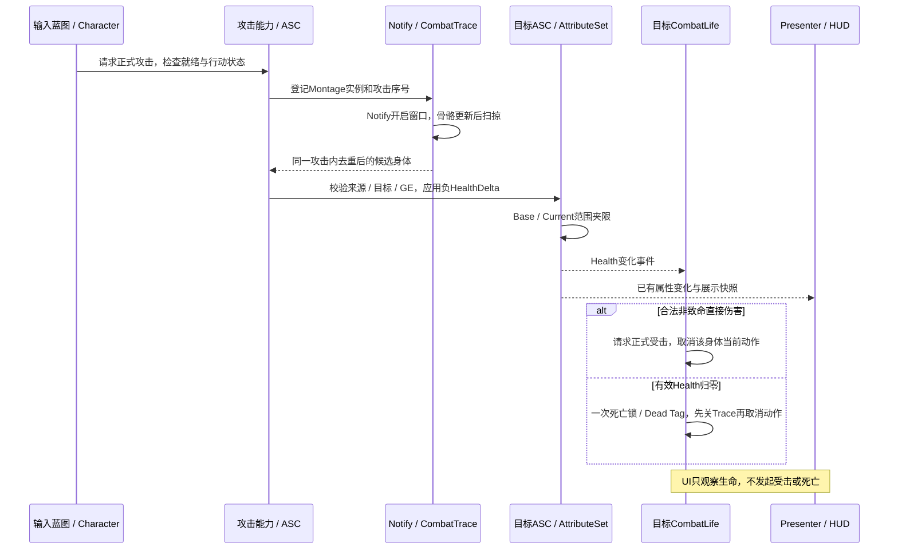

# M1-04D：战斗链路与阶段汇总

日期：2026-10-07；UE5.5.4。**A / B / C与D完成，M1-04总验收通过。**采用已选[方案B](AcceptanceWorkflow_Options.md)，汇总已经接受的结果，只补原C2开窗死亡缺口；该项已由助手经授权控制真实PIE完成。你无需再次搭建验收蓝图、重跑旧矩阵或提交D反馈表。

## 1. 本章完成范围

| 项目 | 当前结果 |
| --- | --- |
| 可玩链路 | 正式攻击 → 动画窗口 → 扫掠候选 → Instant真实伤害 → 属性 / HUD → 正式受击或一次死亡 |
| 本章工程改动 | D不增加C++或新UE资产；C2收尾仅恢复玩家默认100/100与Trace.Debug False |
| 源码与资产 | 45份Source、22个工程cpp；资产来源清单35项；源码与C2实施一致，清单其余34项资产不变 |
| 实测缺口 | 窗口开启后致命伤害，主动关窗、Tick0、当前能力取消及结束Tag释放均通过 |
| 配置恢复 | slomo 1、玩家100/100、Debug False、Compile→Save；新PIE HUD100、正常攻击0.20秒窗口 |
| 构建 | 沿用C2用户已成功的Editor / Game Build；D无C++改变，不重复Build |
| 用户新增操作 | 无；助手接管测试不计入用户手动工时 |

[阶段总验收](Reports/M1_04_Verification.md)区分日志、源码和用户反馈；[当前阶段基线](Reports/Raw/M1_04D_Baseline.json)保存哈希。哈希只识别文件版本，不能独立证明蓝图内部连线或运行表现。

## 2. 一次攻击如何走完整链路

死亡与HUD可能在同一个属性广播中依次更新；不要把两者在日志中的固定顺序作为业务依赖。Gameplay从自身属性判断死亡，HUD不控制它。

## 3. 职责和可复用边界

| 层 | 负责 | 后续复用方式 |
| --- | --- | --- |
| Character | 身体ASC / ActorInfo / Ready、能力授予与输入命令、移动门控 | 新敌人复用原生身体基础，按角色类型配置能力与资源 |
| LightAttack能力 | 激活规则、Montage Task、候选订阅、GE结算、完成 / 取消清理 | 新攻击继续通过能力协调；不在动画Notify里直接扣血 |
| CombatTrace | 活动序号 / Montage实例身份、窗口内Tick、扫掠 / 遮挡 / 每次攻击去重 | 组件不依赖GAS或UI；候选由上层决定效果 |
| AttackWindow NotifyState | 描述窗口并路由到正确身体 / 播放实例 | 动画作者配置时间；C++校验身份和生命周期 |
| AttributeSet | Health / MaxHealth合法范围，死亡Tag下Base / Current保持0 | UI与AI均观察公开数据，不保存另一份可写生命 |
| CombatLife | 本身体属性订阅、非致命损伤请求受击、一次死亡、自己持有的Tag / Handle清理 | 敌人无Controller也可受击；AI通过生命状态停止决策 |
| HitReact能力 | 受击Montage、取消攻击 / 练习位移、Owned Tag及任务结束 | 不扣血、不治疗、不操作Widget |
| Presenter / HUD | 事件快照、来源隔离、文本与血条显示 | 沿用M1-03数据流；核心模块不Include UI |

C++管理规则、身份、句柄和清理；蓝图配置GA子类 / GE / Montage / 输入与UI布局。当前没有新增角色Tick或UI轮询血条，Trace仅窗口开启时Tick，并等待Mesh骨骼更新后采样。

## 4. 三种状态来源

1. 正式攻击 / 受击活动状态由GAS Owned Tag表达，能力结束清理；不再在角色蓝图并存一份正式攻击布尔状态。
2. 数字2仍调用旧PracticeAction闪避；其状态机与正式能力互斥，结束或中断清理自身Root Motion Source。后续迁移正式闪避时只保留一个动作驱动者。
3. 死亡由CombatLife.bDead锁定，独立于动作完成；State.Dead是一份本组件拥有的Loose Tag投影。结束仅移除自己的一份计数，死亡身体不会因Montage结束或治疗重新存活。

归零仍是Ready数据，HUD显示0；它不同于NoPawn、UnsupportedPawn或Waiting。死亡当前阶段不UnPossess / Destroy身体；重试将创建新身体并复用已经验收的UI重绑路径。

## 5. 保留的入口与资源

| 入口 | 当前用途 | 是否保留 |
| --- | --- | --- |
| 左键 / 数字1 | 同一个正式轻攻击请求 | 是；1为开发别名 |
| 数字2 | 旧练习闪避 | 是；正式迁移后再统一 |
| 数字3 | 正式受击命令，不扣血 | 是；复用开发诊断 |
| 数字4 | 既有Damage25 GE应用到玩家自身 | 是；复用生命 / 受击 / 死亡检查 |
| E / P | 既有交互与暂停 | 是；不重新搭建旧测试入口 |
| 训练目标 | 一份独立ASC身体，Quinn占位、100/100 | 是；新增AI前作为固定伤害对象 |

最终投递包的开发入口开关在发布准备时统一处理；现在不要求删除3 / 4、后面再重新搭建。Draw Debug已关闭。攻击 / 闪避 / 受击三段M0动画继续使用；死亡冻结仍是占位，后续需正式表现。

## 6. 后续何时补哪一项

| 实际修改 / 新风险 | 最小相关检查 | 沿用的旧结果 |
| --- | --- | --- |
| 攻击Montage窗口、Trace或取消路径 | 一次命中去重、正常关窗、窗中取消 / 死亡；改遮挡时补墙例 | 未改UI生命周期 / 属性上限规则 |
| GE / SetByCaller结算 | 一次25损伤、过量到0、非法契约拒绝 | 未改的Notify时间与输入焦点 |
| 受击 / 死亡 / Root Motion取消 | 当前动作中损伤或归零、状态与位移清理；只查改变的分支 | 未改的完整HUD重建 / 五身体矩阵 |
| 新敌人AI | AI发起真实攻击、击中玩家、双方受击 / 死亡与AI停止 | 不重搭旧Controller切身体验收函数 |
| 重试创建新身体 | 死亡后新身体、当前HUD重绑、旧身体 / 能力 / 位移隔离 | 旧静态Widget布局与最大值GE全矩阵 |
| 阶段Cook / 打包 | 当前地图与能力资源进入包、独立启动完整闭环 | 构建 / PIE日志不能代替包内检查 |

没有实际改动、新失败或新风险，不触发重跑。动作时序再难掌握时，助手根据真实WindowOpen记录控制窄测试，或按重复频率再建设自动入口，不让用户反复盲试亚秒时间点。

## 7. 下一开发边界

下一章是M1-05：一个近战占位敌人。训练目标目前没有感知、追击、攻击决策，不能称为敌人AI完成；本轮没有开始编写该章代码。

倒地动画、正式闪避 / 体力、连击、主菜单与失败重试、资产校验、Insights性能基线、新阶段包和最终作品整理在对应阶段继续。当前是单人离线能力链路，未实现联网预测或同步；M0旧可执行包仍对应旧内容。

用户累计手动1374分钟、已报告等待95分钟；M1-04用户手动176 / 等待22分钟。助手19:51–19:57进行本项PIE与配置恢复，后续文档整理另计，不并入用户手动数字。本章没有新的重复验收投入，也不以一个样本计算节省百分比。
