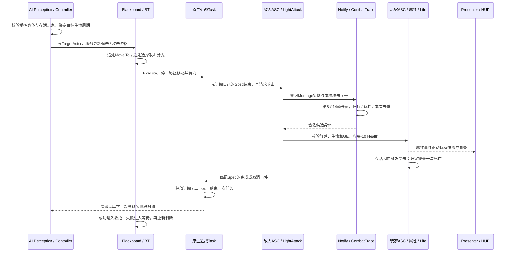

# M1-05D：敌人交战链路与章末复盘

日期：2026-10-10；引擎固定 **UE 5.5.4**。**M1-05 A / B / C / D完成，阶段范围验收通过。**D复用已接受的交战与清理证据，完成职责、时序、问题和交接整理。采用[方案B](AcceptanceWorkflow_Options.md)，本章无需新增测试蓝图、C++、UE资产、Build或PIE，也不需要提交新的D验收表。

你接下来只需阅读复盘并按最后一节在CLion中Commit / Push。第7节的视频留档是可选展示材料，不影响本章验收。阅读预计10–20分钟、可选录制准备与操作约5–10分钟，均为估计；未发生的时间不加入实际工时。

## 1. 本章现在交付了什么

正式地图`/Game/EmberTrial/Maps/L_ET_VerticalSlice`中，一个近战敌人能够发现存活玩家、追击、停步转向、自动挥击。玩家可以移动与闪避躲开拳轨迹，也可以站定后左键反击。双方独立扣血、受击与死亡；玩家HUD只观察玩家身体。暂停、受击、目标死亡、自身死亡和停止PIE均有相应的中止与清理路径。

| 项目 | 当前结果 |
| --- | --- |
| 技术主线 | AI Perception → Blackboard / Behavior Tree → 原生Task → GAS能力 → Notify / Trace → GE / 属性 → Life / HUD |
| 身体与伤害 | 玩家Player阵营、敌人Enemy、训练目标Neutral；玩家轻攻击25，敌人轻攻击10，双方初始100/100 |
| 资源 | Quinn与已制作的占位攻击 / 受击动画；敌人从原生Character直接创建；本章新增资源支出0元 |
| D工程变化 | 仅文档与本地证据基线；C++、Build.cs、Target、uproject和UE资产均保持C2已验收版本 |
| 最终规模 | Source 53份，其中工程cpp 26份；资源来源清单40项，40不是工程全部Content文件数 |
| 构建依据 | 沿用C2已成功的Editor / Game Build与实际CLion索引；D没有重新编译或Cook |
| 当前边界 | 单人离线、单敌人、单段轻攻击；死亡冻结占位；正式主菜单 / 重试 / 检查点与当前阶段独立包后续完成 |

[M1-05总验收](Reports/M1_05_Verification.md)保存分批证据与限制；[D文件基线](Reports/Raw/M1_05D_Baseline.json)用于确认复盘对应的文件版本。哈希一致只能证明文件未变，运行结论来自各批实测与反馈。

## 2. 一次真实交战如何发生



**100cm是开始准备攻击的资格距离，25cm是拳轨迹扫掠半径，二者用途不同。**角色中心够近只允许提出攻击请求；是否命中仍由真实拳轨迹、开窗时段、遮挡、去重和阵营关系决定。准备阶段转向，能力被接受后固定朝向，所以玩家侧移可能让攻击落空。

玩家攻击走同一原生能力和伤害链路，使用自己的GA资源与25点参数。敌人被击改变敌人属性，不会通过AIController或敌人Blueprint直接修改玩家HUD。

## 3. C++、Blueprint与行为树的分工

| 所在层 / 实际入口 | 它负责什么 | 如何避免职责混杂 |
| --- | --- | --- |
| [EmberTrialCharacter.h](../EmberTrial/Source/EmberTrial/Public/Characters/EmberTrialCharacter.h) | 身体就绪、自己的ASC / 属性、阵营查询、公开攻击Spec和命令入口 | 不在Character里写行为树分支或UMG显示逻辑 |
| [ETAIController.cpp](../EmberTrial/Source/EmberTrial/Private/AI/ETAIController.cpp) | 感知玩家、当前身体 / 目标订阅、距离决策、停止移动 / 树、重试时间 | 黑板保存决策结果，生命与动作的真实状态仍来自身体 / GAS |
| [ETBTService_Pursuit.cpp](../EmberTrial/Source/EmberTrial/Private/AI/ETBTService_Pursuit.cpp) | 每0.2秒请求一次决策更新 | 不逐帧新建Move To，不直接播放动画或扣血 |
| [ETBTTask_PursuitMove.cpp](../EmberTrial/Source/EmberTrial/Private/AI/ETBTTask_PursuitMove.cpp) | 复用引擎Move To路径执行与中止 | 不手动每帧SetActorLocation追玩家 |
| [ETBTTask_MeleeAttack.cpp](../EmberTrial/Source/EmberTrial/Private/AI/ETBTTask_MeleeAttack.cpp) | 一次停步、准备转向、请求能力、等自己的Spec结束；取消自己拥有的请求 | 实例化Task保存本敌人本次上下文，其他能力结束不能误完成此任务 |
| [ETGA_LightAttack.cpp](../EmberTrial/Source/EmberTrial/Private/Abilities/ETGA_LightAttack.cpp) | 能力门控、Montage、Trace生命周期与合法GE伤害 | 玩家 / 敌人共用实现，各自资源参数；不依赖具体AIController或UI模块 |
| [ETCombatTraceComponent.cpp](../EmberTrial/Source/EmberTrial/Private/Combat/ETCombatTraceComponent.cpp) | 骨骼更新后窗口扫掠、遮挡、攻击内去重 | 只报告候选，不成为第二个生命或伤害状态源 |
| [ETCombatLifeComponent.cpp](../EmberTrial/Source/EmberTrial/Private/Combat/ETCombatLifeComponent.cpp) | 真实扣血受击、一次死亡、行动 / 治疗封锁与自身结束清理 | 玩家与敌人各自拥有，不复制一套EnemyHealth / EnemyDeath |
| [ETHealthPresenter.cpp](../EmberTrial/Source/EmberTrialUI/Private/Presenters/ETHealthPresenter.cpp)与HUD | 观察本地玩家当前身体，发布 / 渲染快照 | UI依赖核心公开数据；核心不反向依赖UI |
| Enemy / Controller / GA Blueprint | 模型、碰撞、AI Class、能力Class、Montage、GE、数值装配 | 不复制C++战斗实现，不在Event Tick里驱动全部AI |
| Blackboard / Behavior Tree资产 | 四键、优先级、Decorator、收招 / 等待与Task参数 | 不保存一份独立Health，不用固定Delay模拟能力完成 |

这里的高内聚是每层集中处理自己的状态与生命周期；低耦合来自公开查询、命令和事件，而不是增加空模块或给所有对象建立继承层级。AI在核心模块，HUD / Presenter在UI模块；实际构建继续由UBT / UHT完成。

## 4. 为什么这棵树能结束，也能重新开始

当前树结构沿用[C2第2节](M1_05C2_BehaviorTreeMeleeAttack.md#2-参数与树结构先看清楚)，这里用于复盘，**无需重新连接节点**：

```text
ROOT → Selector CombatOrPursuitOrWait（单份Service，0.2秒）
  ├─ MeleeAttackAndRecover
  │    CanMeleeAttack / On Value Change / Lower Priority
  │    ET Melee Attack → Wait AttackRecovery 0.6秒
  ├─ PursuePlayer
  │    CanPursue / On Result Change / Both
  │    ET Pursuit Move To（BB半径90）→ Wait ArrivalSettle 0.25秒
  └─ Wait IdleOrRetry 0.5秒（直接连接Selector）
```

| 边界 | 当前实现及原因 |
| --- | --- |
| 接近 / 重新追击 | Stop90、Resume100、Melee100cm；保持距离使用迟滞，具体到达还受移动接受半径 / 容差影响，不承诺每次停在精确90.0cm |
| 攻击自己变忙 | GAS开始后CanMeleeAttack会变False；攻击Decorator用Lower Priority抢占右侧分支，避免自己的Busy把当前攻击中止 |
| 正常完成 | 等匹配Spec的OnAbilityEnded；成功走0.6秒收招，下一次仍需通过世界时间 / 身体 / 目标 / 距离门控 |
| 无效能力 / GE | 失败返回树，0.5秒有限重试与右侧Wait留出间隔；不是每帧反复请求。实际调度有偏差，日志不是精确0.500秒计时器 |
| 准备卡住 / 异常无结束 | 准备1秒上限、能力5秒Watchdog是防卡死措施；正常完成不用它们计时。现有样本没有触发Watchdog故障 |
| 同步回调 / 重新进入 | 请求期间暂存结束结果；ExecutionSerial防旧执行继续写入新执行；FinishLatentTask后不再写本次状态 |
| 本次取消 | ReleaseRequest先撤销运行 / 持有状态与弱引用，移除自己的委托，再按需要取消自己拥有的Spec；重复清理可安全调用 |

暂停时世界游戏时间停止，重试不是按电脑现实时间到期。0.6秒收招与0.5秒最早重试是不同约束，不能简单相加为固定攻击间隔，也不能把等待结束等同于已经命中。

### 4.1 受击、死亡、Stop的责任边界

| 触发 | 必须保持的结果 | 当前接受依据 |
| --- | --- | --- |
| 敌人移动中受击 | Busy撤销Move；受击结束重新评估目标与距离 | B2活动路径专项已关闭 |
| 敌人攻击中受击 | 能力取消、Trace撤销、Task结束；受击结束可以发起新的任务 | C2的AbilityCancelled与恢复后Prepare，含玩家真实25反击样本 |
| 玩家作为目标死亡 | 清目标 / 关闭意图、停止追击；当前攻击上下文失效并取消 | C2玩家死亡时敌人攻击活动中的ContextLost / Tick0 / Tag0 |
| 敌人自身死亡 | Dead门控立即生效、停止树 / 移动，身体生命层关闭攻击与动作 | C2自身死亡停树；该日志样本在收招间隔，不能改写为窗口内敌人自身死亡实测 |
| Controller结束 / 失控 | 停止树并清目标、移除身体 / 目标事件；活动Task释放自己的订阅与请求 | C2四次活动Abort与新PIE重新初始化 |

Dead Tag提交可能同步唤起多个订阅者。不要依赖AI、Life、Task各个日志在所有场景都严格排成同一顺序；重要约束是死亡后不再接受新动作、Trace被撤销、任务持有资源释放、旧回调不能重新启动已结束的对象。身体死亡层保留先关自身Trace再取消剩余能力的清理动作；AI监听可先触发自己拥有的能力取消。

## 5. 复用的证据与本章真实问题

| 批次 | 已接受结果 / 报告 |
| --- | --- |
| A | [独立身体、AI控制权与导航基础](Reports/M1_05A_Verification.md)：独立生命、真实受伤 / 死亡、初始化 / 清理；UHT参数名遮蔽问题已修复 |
| B1 | [有效玩家目标与感知](Reports/M1_05B1_Verification.md)：目标转换、停止清理；目标有效时暂停 / 结束由助手经授权窄补 |
| B2 | [真实追击与等待](Reports/M1_05B2_Verification.md)：受击中止活动Move、无路径有限重试；右侧Wait父连接补修完成 |
| C1 | [共享攻击 / 阵营 / 玩家真实受伤](Reports/M1_05C1_Verification.md)：玩家与敌人共享能力实现、同方拒绝、10伤害与HUD |
| C2 | [自动交战与任务生命周期](Reports/M1_05C2_Verification.md)：连续10伤害、玩家四次25、取消 / 恢复、重试、暂停与两种死亡 |

C2本轮日志有**58次Prepare = 54次Finish + 4次Abort**，17次敌人能力Begin / End相配，结束AttackingTag均0。41次能力拒绝之间40个间隔为0.549–0.633秒，平均0.5541秒；这支持有限重试，不是性能测量。七轮PIE的关键清理有证据。朝向画面、具体鼠标 / 键盘方式、最终资产字段与短基线使用用户通过反馈，不改写为助手全部亲测。

实际排障应能讲清以下三件事：

1. **UHT报Character参数遮蔽**：AIController继承的AController已有这个名字；反射函数参数改为BodyCharacter，声明 / 定义一致。问题发生在UHT，不是导航或游戏运行。
2. **无路径后没有正确等待**：IdleOrRetry误接到追击Sequence中，前面任务失败时不会执行它。改为Selector的独立右侧子节点，再观察目标保持有效时的失败间隔；无需重做感知和HUD矩阵。
3. **新Task头文件找不到**：实际创建在Public/AI，而cpp include沿用了另一位置。统一为`AI/ETBTTask_MeleeAttack.h`；检查实际目录和include，再正常Build / 刷新索引，不清缓存掩盖路径错误。

Lower Priority、自有Spec、同步回调保护属于预先设计的边界，不把它们写成已经发生过的事故。Git Push / TLS排障另见[版本管理](VersionControl.md)，不混同游戏代码问题。

## 6. 后续怎样检查才不越来越慢

保持[方案B](AcceptanceWorkflow_Options.md)：新增行为及直接受影响的链路优先，未改动的旧结果沿用。D不再重建换身体 / HUD十次重建 / MaxHealth矩阵，也不补一轮新Build或打包。

| 后续实际改动 | 只追加的相关检查 | 无须因此自动重做 |
| --- | --- | --- |
| AI距离 / BT父线 / Decorator | 追击→停步→攻击；准备 / 忙碌 / 失败等待中直接受影响的一项 | 独立属性集、HUD换源完整矩阵 |
| 新攻击动画 / 武器 / Trace位置或窗口 | 真实命中 / 空挥、同次去重、一次取消；发生遮挡规则变化时再查墙 | 所有导航或Controller换控用例 |
| GE / 阵营 / 属性结算 | 来源与目标、数值、零血与一次死亡；玩家HUD归属 | 闪避三帧率与暂停全套输入 |
| M1-06失败重试 / 新身体 | 当前任务结束、旧身体 / View清理、新Pawn初始化 / UI快照、重试后战斗恢复 | 未变化的每一种旧属性与资源负例 |
| 多敌人 / 动态障碍 | 每敌人目标 / Task / 属性隔离，导航失败与实际压力采样 | 以单敌人顺畅推断多敌人性能 |
| 当前阶段独立包 | 新包中主流程、资源 / 中文UI / 输入与一次退出重启 | 把M0旧包直接当成本章可执行交付 |

若有失败，先保存**文字日志、操作顺序、完整时分**；连线 / 属性用截图，朝向 / 动画 / 时序用短视频。我负责读取日志定位，不要求你预测需要截取的亚秒时刻。只有受影响项失败或证据矛盾时再窄补，较难的操作需你明确授权后由我接管。所有C++仍先写进文档，由你手动实现。

性能安排保留M1-07：固定场景与硬件 / 分辨率 / 画质，记录CPU / GPU帧时间、AI / 动画 / Trace与UI开销，使用Unreal Insights定位。现在的事件驱动、0.2秒服务、窗口内Trace Tick和活动Task Tick只是实现策略，**尚无本阶段真实性能结论**。JD中的完整交付、工具、性能分析与面试准备仍需后续完成。

## 7. 可选：留一段自然交战视频

**这是展示留档，不是新增必验项；不录也可直接进入下一开发章。**如果想记录当前成果，准备与操作预计5–10分钟，目标一段45–90秒视频；最多尝试两遍，效果正常即可，不追求电影镜头或刻意卡死亡窗口。

准备：打开`L_ET_VerticalSlice`，保持单个正式敌人、玩家 / 敌人100/100、伤害25 / 10、Debug False与slomo1。使用你此前成功的录屏方法，建议1080p / 60fps；硬件或窗口限制时使用实际分辨率即可，记录真实值。不会为视频增加新测试按键或改蓝图。

1. Start PIE并开始录制，画面保留玩家HUD；走进敌人可见范围，展示自动追击与转向。
2. 让敌人一次真实命中，画面显示玩家100→90与受击；若一次自然交战已包含这一步，不重复安排。
3. 站定左键反击一次，再侧移或按2闪避，展示敌人受击与双方动作；攻击被门控拒绝时先站定，不反复连按补动作。
4. 按P打开暂停，鼠标点击继续，恢复后自然移动或反击。最后可打败敌人展示停止行为，也可在自然交战结束时停止录制；不要求再录玩家死亡。
5. Stop PIE。若只进行了正常操作，不必重新Build；若临时改过场景 / 帧率 / slomo，恢复原值并保存实际改动。

推荐留在`E:\UE_Project\Demo\Artifacts\M1_05D\M1_05D_Combat_01.mp4`。`Artifacts`已忽略，视频单独保留，未录制前不登记为已完成材料。只有视频暴露了实际功能问题才局部修复；不要为了展示重复C2负例。可选反馈只需完整路径、实际分辨率 / 帧率、最明显问题（或无）、实际用时，不新增逐项检查表。

## 8. 工时、复盘要点与下一开发边界

M1-05用户实际手动共**147分钟**：A30、B1 15、B2 32（含窄补5 / 补修2）、C1 35、C2 35；明确等待共**25分钟**。项目累计手动**1521分钟（25小时21分钟）**，等待**120分钟**。D文档整理由助手完成，没有新增用户实施或检查时间；阅读和可选录制仅在你实际反馈后另记。

可以先口头解释四个问题，不要求现在书面答题：为什么近战资格距离不能代替命中；为什么攻击Decorator不用Both；Task为何订阅自己的Spec并先解绑再取消；玩家死亡和敌人死亡为何分别影响目标与受控身体。这些说明将复用于最终整体复盘与面试材料，目前不要求提前背诵完整引擎实现。

下一开发章是**M1-06主菜单、失败重试 / 检查点原型**：把当前死亡后的停止状态接到可操作的失败流程，处理旧身体销毁、新身体 / Controller / Presenter / HUD重绑和AI重新取得有效玩家。分批实现时继续沿用当前战斗能力与事件边界。M1-06尚未实施；正式倒地表现、Blender重要模型、性能与阶段包仍在后续计划。

## 9. 本章需要Commit / Push的内容（固定放在文档最后）

### 9.1 本次文档收尾提交

C2主体已由你提交为`9cdbc75`，D不改源码或UE资产。**本次可以把尚未提交的C2验收收尾和D复盘合并为一次文档提交**；在CLion中按实际Changes选择：

| 文件 | 本次提交用途 |
| --- | --- |
| `Docs/M1_05D_EnemyCombatReview.md` | 本章复盘、后续检查边界和可选展示说明 |
| `Docs/Reports/M1_05_Verification.md` | M1-05总验收摘要，可在GitHub阅读 |
| `Docs/Reports/M1_05C2_Verification.md` | 上一批尚待提交的验收摘要 |
| `Docs/M1_05C2_BehaviorTreeMeleeAttack.md` | 已验收状态与实施 / 路径补修记录，保留原手动代码 |
| `Docs/M1_05_EnemyRoadmap.md`、`Docs/Progress.md`、`Docs/Backlog.md` | 整章完成、工时与下一任务状态 |
| `Docs/Architecture.md`、`Introduction.md` | 当前自动战斗架构与项目进度 |
| `Docs/AcceptanceWorkflow_Options.md`、`Docs/VersionControl.md` | 方案B收尾记录及本次提交说明 |
| `Docs/AssetManifest.csv` | C2已核对的40项资源版本 / 用途 / 哈希；D没有新增资源 |
| `EmberTrial/Config/DefaultEditorPerProjectUserSettings.ini`的**删除记录** | 已暂存的取消跟踪操作，随本次提交；磁盘个人设置保留，不再次删除或git rm |

个人设置删除记录若已由你在另一次提交处理，就不重复操作。上述清单是本次工作区交接，不要求制造没有差异的文件；C2六份源码和四份资产已在主体提交，不需要再次修改。

### 9.2 留本地的内容

`Docs/Reports/Raw/`中的D基线、C2提取日志 / JSON和其他原始证据，`Artifacts/`中的可选视频 / 包，UE的Binaries / Intermediate / Saved / DDC，以及IDE缓存、CMake生成文件 / compile_commands均按现有规则留本地。不要使用Force Add绕过忽略规则。

Raw文件不会随这个提交到GitHub，文档中的本地Raw链接在远端可能不可访问；公开可读的事实与限制已写入两个Markdown验收摘要。视频分享和当前阶段新包交付另行安排，不把大文件塞入本次文档提交。

### 9.3 CLion操作

1. 打开Commit窗口，核对Changes；有Staging模式时把上述实际改动移入Staged，包括个人配置的删除记录。
2. 推荐Commit标题：`docs: close M1-05 enemy combat milestone`。描述可写：`Record C2 verification and M1-05 review; retain accepted runtime baseline.`
3. Commit后Push到已有`origin/main`。本轮只核对本机HEAD与缓存origin/main，不把缓存当作一次新的远端上传验证。
4. Push成功即完成文档交接。发现额外Source / Content改动时先看是否为你主动实现的修改；不按此清单盲目丢弃或一并提交不明变化。
