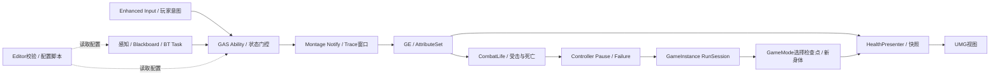

# M1阶段复盘：从灰盒原型到可运行纵向闭环

更新2026-10-14，UE **5.5.4**。M1已完成，证据见[M1总验收](Reports/M1_Verification.md)。本文由助手整理现有源码、分批实机 /自动化 /包 /Trace证据，不要求你再搭验收蓝图。当前可执行入口是C3 Attempt02，后续开发以此为历史回归基线。

## 1. 现在能拿出的成果

这是一个单人第三人称灰盒战斗试炼：菜单进入、移动 /镜头 /跳跃、左键真实攻击、原型闪避、交互中文提示、敌人发现 /追击 /转向 /攻击、独立生命 /受击 /死亡、事件HUD、Pause /Failure、检查点重试 /会话继续、退出。包可以脱离Editor运行，另一进程会清会话。

两Runtime模块与一个Editor模块职责明确；有源码和蓝图分工、两个静态校验器与配置脚本、两个可复用负例、现有动作自动化、两份真实性能采样、多个定位 /修复案例。**M1完成的是最小纵向闭环，最终P0 /P1仍未完成**：缺三段连击、正式资源化闪避、治疗 /破势、构筑 /设置完整页、第二敌人与守关者、磁盘存档、最终视觉 /发布与面试训练。

## 2. 实际架构与一条数据链

1. 左键Started进入正式RequestLightAttack，ASC尝试已授予的Spec；状态、地面 /速度、有效配置决定能否开始。
2. Ability播放Montage并登记攻击实例 /Serial；NotifyState只给窗口边界，Trace组件在窗口内采样手部轨迹、Sweep查询、遮挡过滤和每次攻击目标去重。
3. 有效目标经过Ready /存活 /阵营条件，以SetByCaller.HealthDelta提交Instant GE，AttributeSet夹限Current /Base。
4. CombatLife观察真实属性变化请求受击；到0先封锁与取消 /关闭Trace和位移，再Death sealed。UI Flow在稳定死亡状态后呈现Failure，避免抢在清理之前切页面。
5. Presenter观察当前Pawn / ASC / Ready并维护快照；Widget先绑定Presenter变化事件，再读取当前快照立即显示，之后按事件更新。HUD重建或换Pawn先解绑旧源，不能让旧对象事件更新当前页。
6. Retry /Continue通过RunSession存稳定地图 /检查点ID并切图；GameMode在新Pawn生成前选出生点，旧World /Controller /Widget在EndPlay清理。会话不持有旧Actor /Widget指针。

源码入口分别位于Character、Abilities /Combat、AI、UI Presenters /Flow /Widgets与RunSession；详见[Architecture](Architecture.md)。此阶段正式身体复用AEmberTrialCharacter，避免复制成熟模板输入 /移动和重定向既有蓝图。

## 3. C++与Blueprint怎样分工

| C++拥有 | Blueprint /编辑器资产负责 |
| --- | --- |
| Ability激活 /取消、Effect提交、Tag与实例所有权 | GA子类选择Montage /GE和调参 |
| Trace窗口资格、Sweep /去重、生命周期清理 | Montage通知时点，Mesh /AnimBP /碰撞装配 |
| ASC /属性 /Ready、Life死亡优先级 | 身体初始数值、能力Class、骨骼资源 |
| AI状态条件、原生Service /Task /有限重试 | 黑板 /BT连接、Controller Class与导航场景 |
| Presenter快照 /订阅，UI生命周期与流程状态 | UMG层级 /样式 /BindWidget名称，少量当前Pawn桥接 |
| 会话请求 /身份 /检查点选择，输入恢复契约 | 两地图 /GameMode Override、检查点位置 /触发范围 |
| Editor规则ID /结构化错误、配置读取与启动证据 | 合法配置和隔离样例；用户在CLion检查 /提交最新差异 |

组合和接口用于减少互相持有：Core不依赖UI /Editor；UI明确依赖Core；Editor只读两者涉及的设计数据，不能在校验时初始化角色或改资产。GC强引用和WeakPtr /Delegate Handle分别服务对象所有权和观察关系；“弱引用有效”仍需身份与结束门控。

## 4. 真实问题案例：触发、证据、修复

| 案例 | 观察 /定位 | 修复与保留经验 |
| --- | --- | --- |
| Waiting身体100/60本应非法，但先报Missing gameplay dependencies | 保存实例 /默认对象读取发现HealthAttributes引用None；与旧蓝图复制后的默认子对象问题相符 | 从原生类新建样例；非法 /合法两轮窄检查恢复。新增工具检查正式身体依赖None；不靠重复Initialize掩盖引用丢失。见[B3收尾](Reports/M1_03B3_Verification.md) |
| 无路径仍每约0.033秒重试 | 日志大量Failed、只读BT发现Wait误接Sequence，失败返回前未经过等待 | Wait移到Selector独立右分支，六次间隔约0.55秒。树连接是功能数据，源码正确不等于资产正确。见[追击](Reports/M1_05B2_Verification.md) |
| 暂停迁移后左键失效、1仍播放攻击 | 蓝图Branch Condition没有真实Is Game Paused数据连接，Compile不能证明输入门控 | 恢复数据线 /保存，包内真实25伤害复验。静态IMC映射工具不检查白线，相关运行路径仍需短实测。见[流程D](Reports/M1_06D_Verification.md) |
| 决策Stop90，实际Move却150 | 包Log请求150；FValueOrBBKey_Float先SetKey后常量赋值，后者复制None键清掉绑定 | 先常量后SetKey，BT绑定正确；工具ET-AI-003抓断键，Attempt02真实请求90。原改名示例 /验收漏相对顺序已修文档。见[B](Reports/M1_07B_Verification.md) /[C3](Reports/M1_07C3_Verification.md) |

23:49曾有绑定90仍需贴近的残余现象；后一次站定 /90.3攻击成立，但诊断函数只添加日志，**没有唯一根因证据，不能说“加日志修好了AI”**。最终去掉冗余快照、保留原生Super和必要距离 /半径 /Result；C3两次请求90和连续攻击支持当前可运行版本，不扩写成永远不偶发。

另有Unity匿名命名空间常量重名、UHT参数Character遮蔽AController成员、generated.h与文件名拼写不一致等构建案例。这些说明UE反射 /Unity边界需要准确命名，解决办法是修具体冲突，而非长期关Unity /删缓存绕过。

## 5. 性能结论的口径

| B的历史Attempt01样本 | 主循环开始间隔均值 /P95 | GPU场景Scope均值 /P95 |
| --- | --- | --- |
| Idle01内部10秒 | 7.350 /10.149ms | 6.709 /9.485ms |
| Idle02内部10秒 | 7.122 /9.900ms | 6.488 /9.383ms |
| Combat02死亡前19秒 | 6.630 /8.929ms | 6.003 /8.429ms |

这些不是呈现FPS，不把CPU /GPU相加，也不把嵌套Inclusive时间相加。GPU取的是场景范围，非完整GPU Frame；战斗视角 /可见场景不同，数值较低不是代码优化证据。B用1920×1080参数、sg2、禁用帧率限制等固定条件；真实Viewport /电源风扇档位未知、系统背景内存压力明显、Development+Trace有开销。

C3只有1280×720功能流程，没有新Trace，所以不能给Attempt02“提升了多少FPS”。Cue路径缩小后Runtime回退Warning消失，证明配置生效；没有加载时间改善量测。正式美术 /多敌人 /新能力接入后，按新增负载重采相关窗口，不为每次日志文字调整反复采样。原件与统计见[B报告](Reports/M1_07B_Verification.md)。

## 6. 分层验收已实际落地

用户选定[方案B](AcceptanceWorkflow_Options.md)：运行时已有Lifecycle /DodgeMovement复用；配置用两个原生Editor Validator和只读脚本；每批仅检查新增相关边界；阶段包统一验证Cook /独立进程。C1 /C2工具初建报告手动60 /等待10分钟，只有两批样本，不宣称成熟节省率。

负例覆盖明确：ET-AI-003断键、ET-GA-001缺Montage真实失败→恢复；脚本用Raw副本测试正常 /错误默认图 /缺Cook /缺文件。其余规则是正常资产 +实现核查，未各做独立负例。工具无法替代运行白线 /焦点 /订阅清理、Mesh兼容、完整导航或世界加载；当前包短流程和既有专项保留。

以后修改一个状态拥有者或中断链，优先复用对应已有入口，必要时新增一个能发现具体错误的窄测试；不重新搭五个临时Controller函数，也不因旧证据多就继续重复旧矩阵。

## 7. 实际工时与排期校准

| 已报告用户手动 | 分钟 |
| --- | ---: |
| M0 | 673 |
| M1-01 /02 /03 | 20 /180 /325 |
| M1-04 /05 /06 | 176 /147 /315 |
| M1-07 A /B /C1 /C2 /C3 | 30 /75 /40 /20 /10 |
| M1合计 | **1338，22小时18分钟** |
| 项目累计 | **2011，33小时31分钟** |

已明确构建等待185分钟另列。B最后替换、未报告额外学习 /练习、助手设计 /排障不补算；UAT秒数也不替代用户反馈等待。原M1基准40h，此次报告手动更低，不能按22.3/40的比例压缩M2–M8：代码已由助手准备，动画制作 /能力时序 /美术 /发布与本人独立解释仍有不同成本。

去掉已完成M1后，原M2–M8基础预算合计**350h**；暂保留全局缓冲100–140h，因此当前保守剩余**450–490h /每周30h约15–17个有效投入周**。不是硬期限，基础面试 /理解包含在后续预算；每完成一段再用真实样本调整。M2先保留基础65h，优先给它预留15–25h，来自上述全局缓冲，**不重复叠加**；拆分见[M2路线](M2_Roadmap.md)。

## 8. 下一阶段与美术决策

M2按原四类能力推进：三段轻攻击、方向闪避、有限次数治疗、带冷却范围破势；受击是被动反应，锁定是辅助功能，不能拿它们充数。第一批从体力属性 /资源契约开始，再把M0右向闪避升级到正式GAS方向闪避，接消耗 /无敌与死亡清理；只保留一个正式动作所有者。

继续使用Quinn /SK_Mannequin与现有Control Rig占位资产。新连段 /治疗 /破势先证明时间点可用，再做姿势 /镜头 /音效；关键模型在规格明确后接Blender。没有新增付费资源，百元预算不因工具章节耗费；来源清单发布边界仍逐项核对。M2不同时加第二敌人、Boss、完整遗物页或磁盘存档。

## 9. 本人讲解准备：不增加本轮验收表

后续面试复盘时，应能讲清：为什么ASC放身体；Tag / Ability / MovementSource分别谁清理；HUD为何订阅后立即读取快照；为什么Current / Base一起夹限；为什么Scope / 模块 / Cook不同；MoveRadius默认值与黑板键如何共存；统计均值能证明什么。可沿上面的真实代码链练习5–10分钟，当前不要求回填表或为了准备演示再做一次旧测试。

学历与经历、一般C++题和沟通能力不能由一个可运行包替代；作品技术证据用于支持真实叙述。最终整体复盘 /模拟面试仍在M8，不提前宣称招聘成功概率或当前已适合作为完整投递作品。

## 10. 本次 Commit / Push（固定放在最后）

新增本文、M1 /M1-07 /C3报告和M2路线，以及Introduction /Architecture /Progress /Backlog /VersionControl /方案B的实际收口与排期文字。没有新Source /UE资产；DefaultGame的实际保存差异核查后随共享配置提交，C2未提交实现按原清单合并。

源码 /可编辑资产 /手写工具 /文档由用户Commit /Push；完整包、两Runtime、Raw和Trace留本地，不Force Add。可用 `docs: close M1 vertical slice and calibrate combat phase`；不要用“final demo complete”描述当前灰盒。
