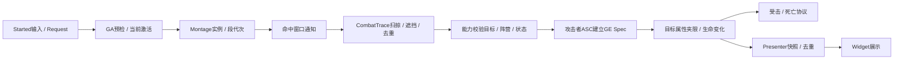

# M2-07C：战斗系统技术复盘与下一阶段校准

2026-10-27，UE **5.5.4**。本章复盘材料已交付，用户本轮要求继续下一章，已保存[C收尾](Reports/M2_07C_Verification.md)及[M2总报告](Reports/M2_Verification.md)，进入[M3-01](M3_01_RelicDefinitions.md)。原阅读材料保留供随时对照，不要求追补答卷、Build或旧测试；未报告的阅读用时保持未登记。

本次是M2阶段学习材料复盘，最终简历定稿、整体作品总复盘和模拟面试仍在M8共同完成。M2功能 / 证据收尾不代表用户已独立讲解每一项；本轮没有逐项理解结果，不据继续开发推断已通过面试训练。

## 1. 当前真正完成了什么

当前可运行基线为**M2_07A/Attempt01**：单敌人灰盒场地，菜单进入、四类主动战斗能力、五HUD、真实近战AI、受击 / 破势 / 死亡、Tab锁定 / 标记 / 右肩镜头、Z / C方向切换、Pause、检查点Retry / 本进程Continue与退出。

四类主动能力是轻攻击、闪避、治疗、范围破势；受击 / Stagger是被动反应。五HUD包括原状态面板、生命、体力、治疗次数和F冷却；锁定菱形是另一个按需View，不把“五”误当作所有场景UI实例总数。Pause / Failure / MainMenu由独立流程装配。

实际157 Source / 86cpp（Core60 / UI23 / Editor3）、23项自动化、来源75。文件数是工程规模，不是作品质量分数；现有素材仍为模板 / Control Rig占位。尚未完成遗物 / 装备界面、完整设置、第二敌人 / 守关者、磁盘存档、最终视觉与发布，不把Development包称为最终招聘作品。

## 2. 顺着一次真实攻击理解整条链



对照[LightAttack](../EmberTrial/Source/EmberTrial/Private/Abilities/ETGA_LightAttack.cpp)、[CombatTrace](../EmberTrial/Source/EmberTrial/Private/Combat/ETCombatTraceComponent.cpp)、[CombatLife](../EmberTrial/Source/EmberTrial/Private/Combat/ETCombatLifeComponent.cpp)和[HealthPresenter](../EmberTrial/Source/EmberTrialUI/Private/Presenters/ETHealthPresenter.cpp)即可，不必逐行通读全部源码。

Notify给出时机，Trace只提供真实候选；正式能力继续决定目标资格、效果与本次结算身份。每段独立Trace Serial让“同段不重复、下一段可再命中”成立。三段实际各25的包内证据在A报告，不能仅凭动画连播就断言真实连段伤害成立。

HUD不直接扣血。玩家与敌人复用同一原生身体 / 能力类，但各有ASC、属性、组件和运行身份；配置把玩家三段25与敌人单段10区分。复用类不等于共享当前血量 / Montage / 命中集合。

## 3. 四种能力的提交时点与取消语义

| 系统 | 可信状态 / 提交点 | 结束与取消为什么要单独考虑 |
| --- | --- | --- |
| 轻攻击 | 当前激活 + 段代次 + Montage实例；输入只有一个有限缓冲槽 | 取消必须清缓冲 / 待切段 / Trace，旧通知不能继续第三段；长按Started不等于每帧请求 |
| 闪避 | 完整预检后一次体力成本；开始时固定方向 | RMS位移、动画与短无敌各有寿命，位移结束不自动解动作锁；受击 / 死亡取消不退款 |
| 治疗 | 开始预检；通知点核对当前Mesh / Montage / 代次后至多生效一次 | 成功应用真实治疗效果才消费次数；生效前取消不扣，生效后不回滚，不用动画播放成功代替治疗成功 |
| 范围破势 | 接受施放时提交真实6游戏秒冷却；.4秒通知至多一次范围结算 | 空放 / 被取消不退冷却；主要削Poise，不假装同时造成生命伤害 |

**预检失败与已提交后取消是两件事。**例如恢复阶段请求闪避时，非法配置 / 体力不足应保留原攻击；有效请求才接管并取消旧链。连段恢复取消、成本事务和清理已有专项，不再为复盘手工复做所有边界。

体力恢复由资源组件按世界时间积分，缺额且空闲才保留Timer；Pause时不把整段现实时间补成体力。治疗次数是有明确消费事务的离散资源；没有为了形式统一把所有整数都塞成GAS属性。

## 4. 所有权与生命周期：重点理解五件事

1. **ActorInfo有效不等于GameplayReady。**当前Ready对应身体属性初始化成功；受控、存活、能力是否可激活仍有各自条件。后续装备 / 异步资源加入时，也要说明新增域的就绪边界。
2. **弱引用解决对象有效性，不解决业务来源过期。**旧Pawn还活着、旧Widget还未GC，不代表它仍该更新当前HUD。必须解绑旧源，并核对观察代次 / 当前身份。
3. **订阅后立刻读快照。**新HUD晚加入或先Ready后Possess时不能等待一个可能永远不再发生的事件；重建View也不能重置ASC / 资源。
4. **取消可能同步重入。**撤Tag、停止Montage、ApplyGE、广播委托都可能触发其他回调；旧身份先失效，再释放自己拥有的资源，回调返回后重新确认仍是本轮。
5. **只有自己的句柄才能由自己释放。**GE Handle、Delegate Handle、RMS ID、Timer与Montage实例都要明确归属；结束幂等，不能把别人新动作的资源一并停掉。

当前ASC在Character，身体重建就创建新资源。RunSession只跨World保存当前进程的地图 / 检查点ID和切图意图，不保存交互目标激活、敌人生命或Actor地址；退出进程后Continue失效。这个语义由A两进程样本证明，磁盘存档留M5。

## 5. 锁定、UI与C++ / Blueprint分工

### 5.1 锁定只有一个目标身份

Core锁定组件负责资格、选优和释放；UI标记订阅它，相机读取它，三者不各自扫描找目标。获取 / 切换按请求Overlap，候选线性选优；维持限频只查当前目标，无目标无Timer，不每帧GetAllActorsOfClass。

Tab获取 / 解除；Z / C以同一视点水平角找指定侧最近合法候选，空侧保留、不绕回，两方向共享.20游戏秒。切换先解绑旧来源，再提交新身份，只发一次旧→新事件，避免标记和肩位闪过None。目标变化不自动改变已固定的攻击 / 闪避方向。

右肩使用SpringArm SocketOffset及原碰撞流程，当前PitchOffset=-18°、MaxShoulderYaw12°、Shoulder(0,75,55)cm / Focus45；主动解锁平滑归还，失活 / 换身体 / 结束精确恢复旧值。这里只说明本项目参数，没有商业游戏内部配置证据。

### 5.2 Presenter、Widget与资源配置各做什么

| 层 | 当前职责 |
| --- | --- |
| Core C++ | 规则、状态、资源事务、身份 / 句柄和清理 |
| UI C++ | 本地数据源观察、Presenter快照、Widget装配与输入 / 页面流程 |
| Widget Blueprint | Designer布局、具名控件和资源样式；不复制实时战斗数值 |
| Blueprint / 数据资产 | GA / GE / Montage / Notify / IA / BT与具体配置，保留少量已有输入 / 交互桥接 |
| Editor模块 | 静态配置 / 绑定契约校验，不进入Runtime目标 |

多数资源HUD按事件展示；F冷却可见且活动时有限刷新，标记只在需要时投影；相机复用Controller原更新流程。不是“所有系统都不Tick”，而是更新策略与需求匹配。旧E仍有练习交互桥接，通用祭坛 / 拾取 / 门的扩展尚未实现，不能拿练习Actor冒充完整通用交互框架。

## 6. 用五个真实案例复盘定位思路

| 现象 | 已核实原因 / 处理 | 值得保留的思路 |
| --- | --- | --- |
| AI停在附近，玩家还要自己贴近才挨打 | Blackboard动态半径与原生MoveTo到达语义必须一致；当前使用中心距离，关闭重复叠加双方胶囊半径 | 日志采到达时距离与Radius，不只看“移动任务结束”；日志先快照再走Super清理 |
| 拆测试墙后仍无法锁定 | 无地板测试身体掉落，World启动阶段覆盖了过早的DisableMovement；启动后冻结并保留位置断言 | 先检查夹具真实位置 / 状态，不扩大玩法获取半径让测试假通过 |
| 开始Play脚短暂陷地 | 初始落差使FootIK追赶，生成前按真实胶囊与原生地面间隙定位 | 区分胶囊、Mesh与动画状态；没有关闭IK或硬改固定90cm补丁 |
| 贴脸时肩位补偿把镜头拉到侧面 | 极近距离完整反正弦偏航补偿过大；限定12°，适度俯视，允许目标稍离中心 | 构图目标需要权衡，不能为了绝对居中牺牲交战可读性 |
| 请求1080p，但文件不是1080p | 本轮PNG2048×1081、请求1920×1080不同，按证据记录限制 | 请求参数、实际测量与最终认证分开；不改文件或补造一个符合预期的数字 |

首次PIE等待已经按用户决定关闭，不重新调查。上述案例是本项目已发生 / 已有证据的问题；不把所有后续Bug都强行归入同一根因。

## 7. 性能结论应该怎样表达

[B报告](Reports/M2_07B_Verification.md)的待机 / 真实交战内部主循环间隔P95约5.915 / 5.714ms；GPU场景范围P95约4.998 / 4.813ms。完整交战Region仍有3次>16.7ms Tick、最大30.013ms，未唯一归因；没有为做“优化成果”改工程。

这些是本次Development / Medium / 灰盒短样本：主循环间隔不是显示器呈现FPS，GPU场景包裹范围不是完整GPU帧。分辨率请求 / PNG不一致、启动内存压力、未知电源档位、无三轮固定路线与Shipping对照都要保留，不能直接写成“严格1080p稳定某帧率”或“比M1优化若干百分比”。

Slate整体每调用约0.217 / 0.227ms不等于某个HUD专属成本；多线程Inclusive累计也不能相加称为一帧时间。后续新美术 / 敌人增加时再按新增负载测，不重写目前没有瓶颈证据的UI / GAS架构。

## 8. 下一阶段M3：UI与构筑闭环校准

保持原计划**6种遗物 / 2槽**的完整目标，P0先做2件核心遗物，其他数据逐步扩展。M3包含装备规则、UI与设置，不同时增加第二敌人 / Boss、随机词条或磁盘存档。

| 后续顺序（范围草案，尚未下发代码） | 交付重点 |
| --- | --- |
| M3-01 静态数据与状态契约 | UPrimaryDataAsset、稳定ID / FText / 图标与效果引用；定义拥有 / 装备 / 选择 / 预览的不同状态，以及新身体 / Retry / Continue的装备语义 |
| M3-02 最小装备事务 | 2件遗物 / 2槽，预检、效果句柄、提交 / 失败回滚；资源上限变化 / 当前值是否补满须先定规则，UI不先报成功 |
| M3-03 Presenter与列表 / 详情 | 先薄闭环，再筛选 / 排序 / 比较；空列表、选择丢失、重复确认和晚加入快照可说明 |
| M3-04 安全祭坛与页面输入 | 扩实际交互入口与可用性，统一打开 / 返回 / 焦点 / 菜单互斥，复用当前暂停与世界重建协议 |
| M3-05 设置与键盘导航 | 明确应用 / 取消语义，基本显示 / 音量 / 灵敏度；只在已有交互需要时扩框架 |
| M3-06 新包 / 首轮试玩 | 真实装备前后可见差异、页面与世界重建、相关专项和一次新包，不重搭旧测试图 |

当前Controller随切图销毁，原RunSession也只存地图 / 检查点。装备数据跨World怎么保留、对新ASC何时重建效果必须在M3-01明确；静态DataAsset不能存当前血量 / 选中态，GameInstance层不能持有旧ASC / Widget。此处不凭计划表提前声称已经有Inventory / AssetManager加载闭环。

M3原基础预算70h暂保留，按每周30h约2.3有效投入周，返工与理解使用原全局缓冲，不重复叠加。M3–M8原基础合计285h约9.5有效周；全局100–140h是最初缓冲规划，未有完整消耗账，不能称为全部剩余额度。完成首个装备 / UI批次后再校准，不能用M2填码速度等比压缩所有美术 / UI / 独立解释训练。

普通C++仍由你手动，复杂排错按当次授权；美术继续占位，重要模型中后期接Blender、先做一个试件；不强制采购新资产，不增加手柄交付。

## 9. 复盘自用（材料已交付）

约15–25分钟读第2–7节；需要时打开源码链接看关键入口，不逐行抄代码。围绕下面问题检查自己能否用项目事实解释，**不要求逐题书面作答或录屏**：

1. 一次命中如何从输入走到目标生命与玩家HUD？哪些地方需要去重和身份检查？
2. 为什么闪避位移结束不等于动作结束？治疗与破势的消费时点为什么不同？
3. 旧Widget / Pawn还有效，为什么也可能必须解绑？弱引用和代次各解决什么？
4. UI、镜头与Core为何共用一个锁定身份？空侧切换为什么保持当前目标？
5. 性能数据具体测了什么、没测什么？本次为什么不需要为“优化”先改代码？

有不明白的部分直接指明节号，我针对该处解释，不加一套验收Graph。日志 / Insights已有实证；断点、变量观察和调用栈的独立调试案例可嵌入M3真实装备排错，不能只因IDE能运行就宣称已展示这项能力。

原简短反馈模板供日后需要时使用；当前不要求追补：

```text
M2-07C 复盘完成
仍不理解的节号或问题（没有填无）：
实际阅读 / 对照用时（未记录可填未记录）：
```

本轮用户要求继续，阶段报告已保存、M3-01已下发。未登记用时不计为0；有概念问题可在下一批相关实现中继续讲解，正式最终简历与整体验收准备仍按后期安排。

## 10. 本批 Commit / Push（固定放在最后）

[M2总报告](Reports/M2_Verification.md)与07 / C收尾已保存，当前[M3-01遗物静态定义](M3_01_RelicDefinitions.md)待用户实施。当前仅5份新文档 / 11份入口同步，精确16文件与未来实施清单见[M3-01末尾](M3_01_RelicDefinitions.md#11-本批-commit--push固定放在最后)。文档建议英文`docs: close M2 and prepare relic data definitions`，中文译文`docs: 完成M2阶段收尾并准备遗物数据定义`。

实现后建议英文`feat: add validated relic data definitions`，中文译文`feat: 新增可校验的遗物数据定义`；当前不提交尚不存在的Source / 资产或空报告。运行工程 / AssetManifest / Tools与原包本轮保持，Raw留本地。CLion Stage最新文本 / Review Diff / Commit / Push由用户操作，助手未改索引或核验远端。
