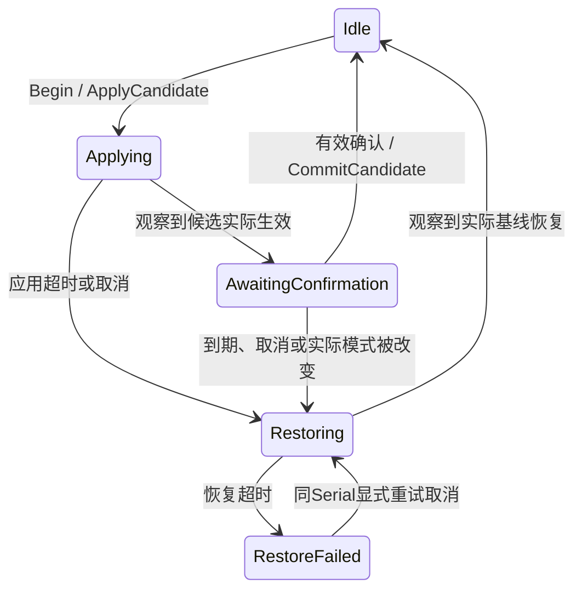

# M3-05B2-01：视频预览确认与回退事务内核

2026-11-05，UE **5.5.4**。[B1已验收](Reports/M3_05B1_Verification.md)，无待补。本章提供手动代码指南；正式Source尚未修改，没有本章Build / Success结论。

## 1. 分批与交付

B2分为**01事务内核 → 02原生窗口 / 实时时钟接入**，B3再接显示控件。01集中验证应用等待、确认期限、取消 / 恢复与失败，不调用显示API；02才读取实际Viewport、枚举平台尺寸并执行命令。这样真实切屏排错时不必同时猜状态规则和平台结果，不要求重复设计验收蓝图。



实际基线来自后续窗口适配，不能用B1请求配置代替；候选须先经B1正规化。内核只接收值与**绝对单调实时时间**，不读World时间、执行I/O或拥有Widget。默认应用等待3秒、确认15秒、恢复3秒集中在Timing；观察到候选后才开始完整确认期限。新预览有新Serial，旧页面确认 / 取消不得操作下一次。

**返回命令是待执行意图，不是已切屏。** 所有入口都必须检查Type：None不做副作用、ApplyCandidate申请候选、RestoreBaseline申请基线、CommitCandidate才允许确认配置 / 保存。尤其过期Confirm会返回RestoreBaseline，不能把“收到返回值”一律当确认成功。命令每次返回由适配层执行一次；本章没有适配层，不执行任何真实切换 / 保存。

预算代码45–70 / 阅读5–10 / 检查3–5分钟，等待另计。实际204 Source / 115cpp（Core80 / UI32 / Editor3）、35测试、300 Content / 来源81；完成后预计207 Source / 117cpp（Core82 / UI32 / Editor3）、36测试，资产保持。预计不计实耗。

## 2. 创建位置

Save All并关闭UE，在CLion创建以下三份**普通Core源码**。没有UCLASS / generated.h，不用UE类向导；不改Build.cs、Config、B1、UI或资产。

```text
E:\UE_Project\Demo\EmberTrial\Source\EmberTrial\Public\Settings\ETVideoPreviewTransaction.h
E:\UE_Project\Demo\EmberTrial\Source\EmberTrial\Private\Settings\ETVideoPreviewTransaction.cpp
E:\UE_Project\Demo\EmberTrial\Source\EmberTrial\Tests\ETVideoPreviewTransactionTests.cpp
```

## 3. 三份完整源码

### 3.1 Public/Settings/ETVideoPreviewTransaction.h

```cpp
#pragma once

#include "CoreMinimal.h"
#include "Settings/ETVideoModeRules.h"

enum class EETVideoPreviewPhase : uint8
{
    Idle,
    Applying,
    AwaitingConfirmation,
    Restoring,
    RestoreFailed
};

enum class EETVideoPreviewResult : uint8
{
    None,
    NoChange,
    Confirmed,
    Cancelled,
    TimedOut,
    ApplyFailed,
    ExternalChange,
    RestoreFailed
};

enum class EETVideoPreviewCommandType : uint8
{
    None,
    ApplyCandidate,
    RestoreBaseline,
    CommitCandidate
};

// 单次调用返回的副作用意图；内核不会执行切屏或保存。
struct EMBERTRIAL_API FETVideoPreviewCommand
{
    EETVideoPreviewCommandType Type = EETVideoPreviewCommandType::None;
    FETVideoMode Mode;
    uint64 Serial = 0;
};

struct EMBERTRIAL_API FETVideoPreviewTiming
{
    double ApplySeconds = 3.0;
    double ConfirmSeconds = 15.0;
    double RestoreSeconds = 3.0;

    bool IsValid() const;
};

struct EMBERTRIAL_API FETVideoPreviewSnapshot
{
    EETVideoPreviewPhase Phase = EETVideoPreviewPhase::Idle;
    EETVideoPreviewResult Result = EETVideoPreviewResult::None;
    FETVideoMode Baseline;
    FETVideoMode Candidate;
    uint64 Serial = 0;
    double Deadline = 0.0;
};

/** 视频预览事务内核；值与绝对单调时间输入，没有World / UObject / I/O依赖。 */
class EMBERTRIAL_API FETVideoPreviewTransaction
{
public:
    explicit FETVideoPreviewTransaction(FETVideoPreviewTiming InTiming = {});

    FETVideoPreviewCommand Begin(const FETVideoMode& ActualBaseline,
        const FETVideoMode& ResolvedCandidate, double Now);
    FETVideoPreviewCommand Advance(double Now, const FETVideoMode& Actual);
    FETVideoPreviewCommand Confirm(uint64 ExpectedSerial, double Now, const FETVideoMode& Actual);
    FETVideoPreviewCommand Cancel(uint64 ExpectedSerial, double Now);

    const FETVideoPreviewSnapshot& GetSnapshot() const { return Snapshot; }
    double GetRemainingSeconds(double Now) const;

private:
    bool CanUseTime(double Now) const;
    FETVideoPreviewCommand StartRestore(double Now, EETVideoPreviewResult Reason);
    FETVideoPreviewCommand MakeCommand(EETVideoPreviewCommandType Type, const FETVideoMode& Mode) const;

    FETVideoPreviewTiming Timing;
    FETVideoPreviewSnapshot Snapshot;
    EETVideoPreviewResult RestoreReason = EETVideoPreviewResult::None;
    double LastNow = 0.0;
};
```

### 3.2 Private/Settings/ETVideoPreviewTransaction.cpp

```cpp
#include "Settings/ETVideoPreviewTransaction.h"

bool FETVideoPreviewTiming::IsValid() const
{
    return FMath::IsFinite(ApplySeconds) && ApplySeconds > 0.0 &&
        FMath::IsFinite(ConfirmSeconds) && ConfirmSeconds > 0.0 &&
        FMath::IsFinite(RestoreSeconds) && RestoreSeconds > 0.0;
}

FETVideoPreviewTransaction::FETVideoPreviewTransaction(const FETVideoPreviewTiming InTiming)
    : Timing(InTiming)
{
}

bool FETVideoPreviewTransaction::CanUseTime(const double Now) const
{
    return Timing.IsValid() && FMath::IsFinite(Now) && Now >= LastNow && Now >= 0.0 &&
        FMath::IsFinite(Now + Timing.ApplySeconds + Timing.ConfirmSeconds + Timing.RestoreSeconds);
}

FETVideoPreviewCommand FETVideoPreviewTransaction::MakeCommand(
    const EETVideoPreviewCommandType Type, const FETVideoMode& Mode) const
{
    return {Type, Mode, Snapshot.Serial};
}

// ---- 先接收实际基线，再申请候选；繁忙 / 非法请求没有任何副作用意图 ----

FETVideoPreviewCommand FETVideoPreviewTransaction::Begin(
    const FETVideoMode& ActualBaseline, const FETVideoMode& ResolvedCandidate, const double Now)
{
    if (Snapshot.Phase != EETVideoPreviewPhase::Idle || !CanUseTime(Now) ||
        !ActualBaseline.IsWellFormed() || !ResolvedCandidate.IsWellFormed() ||
        Snapshot.Serial == MAX_uint64)
    {
        return {};
    }
    const FETVideoMode BaselineCopy = ActualBaseline;
    const FETVideoMode CandidateCopy = ResolvedCandidate;
    LastNow = Now;
    Snapshot.Baseline = BaselineCopy;
    Snapshot.Candidate = CandidateCopy;
    Snapshot.Deadline = 0.0;
    Snapshot.Result = EETVideoPreviewResult::NoChange;
    if (BaselineCopy == CandidateCopy)
    {
        return {};
    }

    ++Snapshot.Serial;
    Snapshot.Phase = EETVideoPreviewPhase::Applying;
    Snapshot.Result = EETVideoPreviewResult::None;
    Snapshot.Deadline = Now + Timing.ApplySeconds;
    RestoreReason = EETVideoPreviewResult::None;
    return MakeCommand(EETVideoPreviewCommandType::ApplyCandidate, Snapshot.Candidate);
}

FETVideoPreviewCommand FETVideoPreviewTransaction::StartRestore(
    const double Now, const EETVideoPreviewResult Reason)
{
    Snapshot.Phase = EETVideoPreviewPhase::Restoring;
    Snapshot.Result = EETVideoPreviewResult::None;
    Snapshot.Deadline = Now + Timing.RestoreSeconds;
    RestoreReason = Reason;
    return MakeCommand(EETVideoPreviewCommandType::RestoreBaseline, Snapshot.Baseline);
}

// ---- 观察实际结果；请求已发出不等于OS已切换，恢复也必须再次观察 ----

FETVideoPreviewCommand FETVideoPreviewTransaction::Advance(
    const double Now, const FETVideoMode& Actual)
{
    if (Snapshot.Phase == EETVideoPreviewPhase::Idle ||
        Snapshot.Phase == EETVideoPreviewPhase::RestoreFailed || !CanUseTime(Now))
    {
        return {};
    }
    LastNow = Now;
    switch (Snapshot.Phase)
    {
    case EETVideoPreviewPhase::Applying:
        if (Actual == Snapshot.Candidate)
        {
            // 候选真正被观察到后才给足确认时间；不消耗应用等待的秒数。
            Snapshot.Phase = EETVideoPreviewPhase::AwaitingConfirmation;
            Snapshot.Deadline = Now + Timing.ConfirmSeconds;
        }
        else if (Now >= Snapshot.Deadline)
        {
            return StartRestore(Now, EETVideoPreviewResult::ApplyFailed);
        }
        break;
    case EETVideoPreviewPhase::AwaitingConfirmation:
        if (Now >= Snapshot.Deadline)
        {
            return StartRestore(Now, EETVideoPreviewResult::TimedOut);
        }
        if (!(Actual == Snapshot.Candidate))
        {
            return StartRestore(Now, EETVideoPreviewResult::ExternalChange);
        }
        break;
    case EETVideoPreviewPhase::Restoring:
        if (Actual == Snapshot.Baseline)
        {
            Snapshot.Phase = EETVideoPreviewPhase::Idle;
            Snapshot.Result = RestoreReason;
            Snapshot.Deadline = 0.0;
        }
        else if (Now >= Snapshot.Deadline)
        {
            // 保留基线和Serial，可显式重试；不能循环请求或假报已恢复。
            Snapshot.Phase = EETVideoPreviewPhase::RestoreFailed;
            Snapshot.Result = EETVideoPreviewResult::RestoreFailed;
            Snapshot.Deadline = 0.0;
        }
        break;
    default:
        break;
    }
    return {};
}

// ---- 确认严格重验Serial / 阶段 / 时间 / 实际模式；过期确认返回恢复意图 ----

FETVideoPreviewCommand FETVideoPreviewTransaction::Confirm(
    const uint64 ExpectedSerial, const double Now, const FETVideoMode& Actual)
{
    if (ExpectedSerial != Snapshot.Serial ||
        Snapshot.Phase != EETVideoPreviewPhase::AwaitingConfirmation || !CanUseTime(Now))
    {
        return {};
    }
    const FETVideoPreviewCommand Command = Advance(Now, Actual);
    if (Command.Type != EETVideoPreviewCommandType::None ||
        Snapshot.Phase != EETVideoPreviewPhase::AwaitingConfirmation)
    {
        return Command;
    }
    Snapshot.Phase = EETVideoPreviewPhase::Idle;
    Snapshot.Result = EETVideoPreviewResult::Confirmed;
    Snapshot.Deadline = 0.0;
    // Confirmed表示允许提交；真实适配层仍须执行此命令并记录保存请求。
    return MakeCommand(EETVideoPreviewCommandType::CommitCandidate, Snapshot.Candidate);
}

FETVideoPreviewCommand FETVideoPreviewTransaction::Cancel(
    const uint64 ExpectedSerial, const double Now)
{
    if (ExpectedSerial != Snapshot.Serial || !CanUseTime(Now) ||
        Snapshot.Phase == EETVideoPreviewPhase::Idle ||
        Snapshot.Phase == EETVideoPreviewPhase::Restoring)
    {
        return {};
    }
    LastNow = Now;
    return StartRestore(Now, Snapshot.Phase == EETVideoPreviewPhase::RestoreFailed
        ? RestoreReason : EETVideoPreviewResult::Cancelled);
}

double FETVideoPreviewTransaction::GetRemainingSeconds(const double Now) const
{
    return Snapshot.Phase == EETVideoPreviewPhase::AwaitingConfirmation && CanUseTime(Now)
        ? FMath::Max(0.0, Snapshot.Deadline - Now) : 0.0;
}
```

### 3.3 Tests/ETVideoPreviewTransactionTests.cpp

```cpp
#if WITH_DEV_AUTOMATION_TESTS
#include "Settings/ETVideoPreviewTransaction.h"
#include "Misc/AutomationTest.h"
#include <limits>

IMPLEMENT_SIMPLE_AUTOMATION_TEST(FETVideoPreviewTransactionTest,
    "EmberTrial.M3.Settings.VideoPreviewTransaction",
    EAutomationTestFlags::EditorContext | EAutomationTestFlags::EngineFilter)

bool FETVideoPreviewTransactionTest::RunTest(const FString& Parameters)
{
    (void)Parameters;
    FETVideoMode Base;
    Base.Mode = EETVideoWindowMode::Windowed;
    Base.Resolution = FIntPoint(1280, 720);
    FETVideoMode Candidate = Base;
    Candidate.Resolution = FIntPoint(1600, 900);
    FETVideoMode Other = Base;
    Other.Resolution = FIntPoint(1920, 1080);
    auto Is = [&](const TCHAR* Label, const FETVideoPreviewCommand& Command,
        const EETVideoPreviewCommandType Type)
    {
        return TestTrue(Label, Command.Type == Type);
    };
    FETVideoPreviewTransaction Tx;
    Is(TEXT("Begin requests candidate once"), Tx.Begin(Base, Candidate, 10.0),
        EETVideoPreviewCommandType::ApplyCandidate);
    const uint64 First = Tx.GetSnapshot().Serial;
    Is(TEXT("Busy begin cannot replace baseline"), Tx.Begin(Other, Candidate, 10.25),
        EETVideoPreviewCommandType::None);
    Is(TEXT("Early confirm is not queued"), Tx.Confirm(First, 10.25, Candidate),
        EETVideoPreviewCommandType::None);
    Tx.Advance(10.5, Candidate);
    TestTrue(TEXT("Observed candidate awaits confirmation"),
        Tx.GetSnapshot().Phase == EETVideoPreviewPhase::AwaitingConfirmation);
    TestTrue(TEXT("Full 15 seconds starts after observation"),
        FMath::IsNearlyEqual(Tx.GetRemainingSeconds(10.5), 15.0));
    Is(TEXT("Explicit confirmation emits commit"), Tx.Confirm(First, 11.0, Candidate),
        EETVideoPreviewCommandType::CommitCandidate);
    Is(TEXT("Repeated confirmation cannot save twice"), Tx.Confirm(First, 11.25, Candidate),
        EETVideoPreviewCommandType::None);

    Tx.Begin(Base, Candidate, 20.0);
    const uint64 Second = Tx.GetSnapshot().Serial;
    TestTrue(TEXT("Each accepted preview has a new serial"), Second > First);
    Is(TEXT("Old page cannot cancel next preview"), Tx.Cancel(First, 20.25),
        EETVideoPreviewCommandType::None);
    Is(TEXT("Cancel while applying requests baseline"), Tx.Cancel(Second, 20.25),
        EETVideoPreviewCommandType::RestoreBaseline);
    const double RestoreDeadline = Tx.GetSnapshot().Deadline;
    Tx.Cancel(Second, 20.5);
    TestTrue(TEXT("Repeated cancel does not extend restoration"),
        Tx.GetSnapshot().Deadline == RestoreDeadline);
    Tx.Advance(20.75, Base);
    TestTrue(TEXT("Only actual restoration ends cancellation"),
        Tx.GetSnapshot().Phase == EETVideoPreviewPhase::Idle &&
        Tx.GetSnapshot().Result == EETVideoPreviewResult::Cancelled);

    // 使用能精确表示的半秒 / 四分之一秒，避免测试依赖浮点十进制边界误差。
    Tx.Begin(Base, Candidate, 100.0);
    Tx.Advance(100.5, Candidate);
    Is(TEXT("Old confirmation cannot approve a new waiting preview"),
        Tx.Confirm(First, 100.75, Candidate), EETVideoPreviewCommandType::None);
    Is(TEXT("Confirmation at deadline must restore, never commit"),
        Tx.Confirm(Tx.GetSnapshot().Serial, 115.5, Candidate),
        EETVideoPreviewCommandType::RestoreBaseline);
    Tx.Advance(115.75, Base);
    TestTrue(TEXT("Expired preview reports timeout after recovery"),
        Tx.GetSnapshot().Result == EETVideoPreviewResult::TimedOut);

    Tx.Begin(Base, Candidate, 200.0);
    Is(TEXT("OS not applying candidate eventually restores"), Tx.Advance(204.0, Base),
        EETVideoPreviewCommandType::RestoreBaseline);
    Tx.Advance(204.25, Base);
    TestTrue(TEXT("Apply failure distinguished"),
        Tx.GetSnapshot().Result == EETVideoPreviewResult::ApplyFailed);

    Tx.Begin(Base, Candidate, 300.0);
    Tx.Advance(300.5, Candidate);
    Is(TEXT("External mode change revokes confirmation"), Tx.Advance(301.0, Other),
        EETVideoPreviewCommandType::RestoreBaseline);
    Tx.Advance(301.25, Base);
    TestTrue(TEXT("External change recorded"),
        Tx.GetSnapshot().Result == EETVideoPreviewResult::ExternalChange);

    Tx.Begin(Base, Candidate, 400.0);
    const uint64 FailedSerial = Tx.GetSnapshot().Serial;
    Tx.Cancel(FailedSerial, 400.25);
    Tx.Advance(404.0, Candidate);
    TestTrue(TEXT("Failed restore is explicit, not silently idle"),
        Tx.GetSnapshot().Phase == EETVideoPreviewPhase::RestoreFailed);
    Is(TEXT("Failure cannot overwrite original baseline"), Tx.Begin(Other, Candidate, 405.0),
        EETVideoPreviewCommandType::None);
    Is(TEXT("Explicit cancel can retry same baseline"), Tx.Cancel(FailedSerial, 405.0),
        EETVideoPreviewCommandType::RestoreBaseline);
    Tx.Advance(405.25, Base);
    TestTrue(TEXT("Retry retains original cancel outcome"),
        Tx.GetSnapshot().Result == EETVideoPreviewResult::Cancelled);

    const double NaN = std::numeric_limits<double>::quiet_NaN();
    Is(TEXT("Invalid time cannot start preview"), Tx.Begin(Base, Candidate, NaN),
        EETVideoPreviewCommandType::None);
    Is(TEXT("Clock cannot move backwards"), Tx.Begin(Base, Candidate, 1.0),
        EETVideoPreviewCommandType::None);
    FETVideoPreviewTransaction Invalid(FETVideoPreviewTiming{0.0, 15.0, 3.0});
    Is(TEXT("Invalid timing policy is rejected"), Invalid.Begin(Base, Candidate, 1.0),
        EETVideoPreviewCommandType::None);
    FETVideoPreviewTransaction Clean;
    Is(TEXT("Unchanged mode does not apply"), Clean.Begin(Base, Base, 1.0),
        EETVideoPreviewCommandType::None);
    TestTrue(TEXT("No change stays idle"), Clean.GetSnapshot().Phase == EETVideoPreviewPhase::Idle);
    Is(TEXT("Invalid actual baseline rejected"), Clean.Begin(FETVideoMode{}, Candidate, 2.0),
        EETVideoPreviewCommandType::None);
    return true;
}
#endif
```


## 4. 正常Build与索引

UE关闭、源码保存，PowerShell依次执行：

```powershell
Set-Location 'E:\UE_Project\Demo'
.\Tools\Refresh-CLion.ps1
```

成功后Game Development：

```powershell
& 'D:\UE5\UE_5.5\Engine\Build\BatchFiles\Build.bat' EmberTrial Win64 Development '-Project=E:\UE_Project\Demo\EmberTrial\EmberTrial.uproject' -WaitMutex -NoHotReloadFromIDE
```

CLion Reload后预计Core82 / UI32 / Editor3；新文件应属EmberTrialCodeModel。遇错贴第一条error及前后10–20行，exit code 6仅为汇总。不删除缓存或手写generated.h。

## 5. 最小检查（约3–5分钟）

1. 重开UE、停止PIE，从Output Log的Cmd只运行新专项一次：

```text
Automation RunTests EmberTrial.M3.Settings.VideoPreviewTransaction
```

2. Success即可。它覆盖候选观察后再确认、重复确认不重复提交、Serial隔离、期限边界、取消 / 应用失败 / 外部变化、实际恢复、恢复失败与显式重试、非法 / 倒退时间。本章夹具没有切真实屏幕、创建确认页或证明暂停下原生倒计时；后者由02集成验证。
3. 正式地图Play，P开关一次、移动 / 转向短查；配置仍1 / 不反转。此批UI与分辨率没有新变化，符合内核范围，不要人为执行r.SetRes模拟接入完成。
4. Stop、源码保存，资产 / Config保持。不跑全36项、不重做B1查询 / A1重启、主菜单 / 死亡装卸矩阵或新Cook。

## 6. 状态与接入要点

- Applying是已发申请、还未观察到候选；只要实际结果未到就不能确认。AwaitingConfirmation才开放确认。
- 恢复命令发出后仍是Restoring，观察到基线才Idle。RestoreFailed保留基线 / Serial，拒绝新预览；同Serial Cancel可以显式重试，重复Cancel不会无限延长恢复期限。
- 内核Confirmed仅表示发出CommitCandidate许可，不等于OS、配置或磁盘都已成功。02需要执行命令、区分保存请求与结果，并保护同步回调 / 世界销毁。
- 02将用平台单调时钟推进，并在预览期间使用不依赖World暂停的更新来源；关闭页面、切图、窗口 / 所有者失效等沿同一取消路径处理，不能仅移除Widget而丢失基线。
- 事务内核没有回调或强对象引用，不保存第二套个人配置；B1只读Snapshot与实际窗口基线仍分开。UI只发带Serial的意图，不直接调用显示或写盘API。
- 所有状态调用由同一宿主顺序执行，后续接入放在Game Thread；平台异步回调不能并发修改这个值对象。

## 7. 完成后反馈

```text
M3-05B2-01 完成
三新Core；Editor Build / Core82-UI32-Editor3索引 / Game Build：
VideoPreviewTransaction一次：
原P默认1 / 不反转与移动短查：
源码保存，资产 / Config未改；失败或不理解处（无填无）：
完成时分 / 手动代码 / 阅读 / 检查 / 构建等待：
```

无需掐测试秒点、搭临时蓝图或抄长日志；我读取结果。代码报错用文字、第一条error及附近内容。

## 8. Commit / Push（固定放在最后）

**当前收尾文档**：B1实现在本地`caf1eec`，当前Stage B1验收 / 指南收尾、状态与本01指南；01正式源码尚未实施。英文`docs: verify video modes and prepare preview transactions`；中文`docs: 完成视频模式验收并准备预览事务`。

**本章实施后**，CLion核对第2节三新Core与实际修改的本指南 / Reports / Progress等共享文档。本章不改既有Source、Build.cs、Config / Content，不强制重存资产；未生成报告不建空文件。个人ini / Saved / Intermediate / Binaries / .idea / CMake生成 / Artifacts留本地。

英文实现建议：`feat: add video preview confirmation and rollback state machine`。

专业中文：`feat: 新增视频预览确认与回退状态机`。

Stage后继续修改需重新Stage最新版本 → Review → Commit / Push由用户操作。
