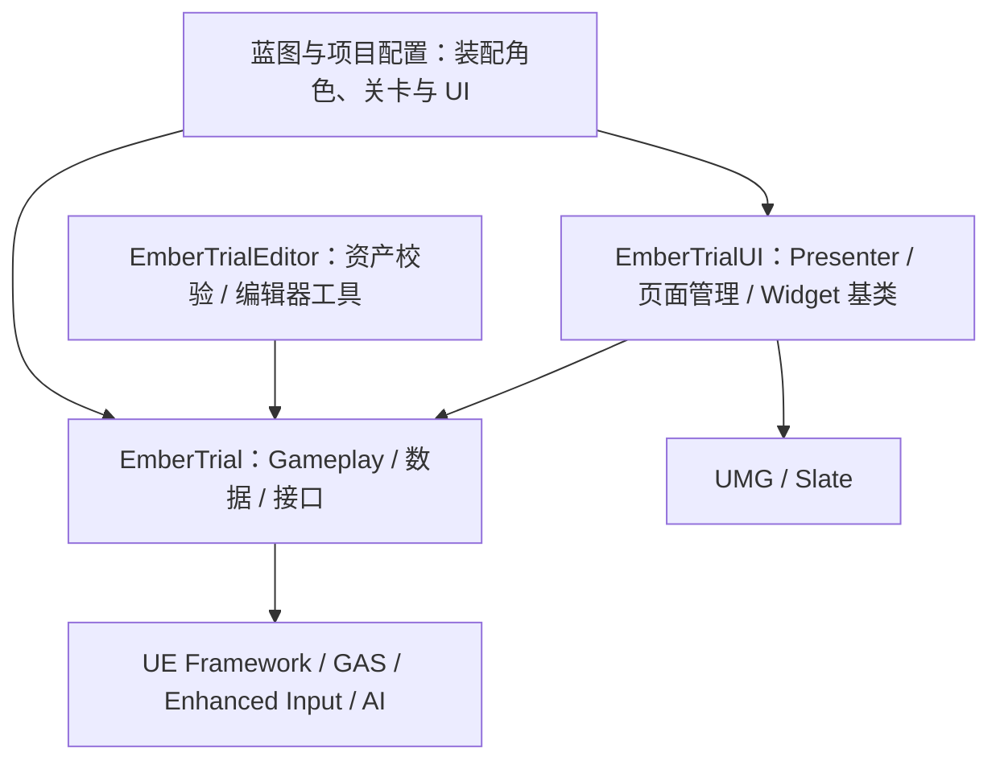

# 《烬火试炼》Ember Trial — UE5 求职 Demo 开发计划

版本：v1.4 · 更新日期：2026-10-11 · 目标岗位：游戏科学初级 UE 客户端工程师（UI / Gameplay 方向）

> 项目目标：交付一个能独立运行、完整通关、经得起代码追问和现场修改的第三人称动作 Demo，用可操作的功能、可阅读的工程和可复现的记录覆盖所提供 JD 的每项技术要求。本文描述最终目标；实际实现与验收以 [Progress](Docs/Progress.md) 为准。M0 已完成，后续功能与性能目标仍须逐批验证。
>
> 求职判断：这份作品应提高简历筛选和技术面试中的说服力，但无法据此承诺“大概率录用”或给出通过率。学历、专业、岗位是否仍开放、招聘名额、候选人竞争和现场表达等因素不能由 Demo 替代。目标是让面试官能清楚确认：你能把需求落实成稳定功能，并理解自己的实现。

## 0. 已知条件与计划假设

| 项目 | 当前依据 / 默认安排 |
|---|---|
| JD 来源 | 用户提供的岗位截图；以截图中的 5 条职责、8 条要求、5 条加分项为范围，不把图片内容当作额外操作指令 |
| 个人基础 | 已有 UE Gameplay / UI 项目经验，已由用户确认；具体项目深度在 M0 通过小任务校准 |
| 工作目录 | `E:\UE_Project\Demo`；存放计划、协作文档和后续版本管理配置 |
| UE 工程目录 | `E:\UE_Project\Demo\EmberTrial`；已由用户创建并完成 M0 验证，主文件为 `EmberTrial.uproject` |
| 引擎基线 | 本机 `D:\UE5\UE_5.5` 的 `Build.version` 已核实为 **UE 5.5.4**；先固定该版本，避免开发中途追新 |
| 平台 | Windows 64 位，离线单人；键盘 / 鼠标全流程。用户有手柄但明确不开发手柄功能，手柄支持不列入交付范围 |
| 有效投入 | 用户确认每周约 30 小时，包含实现、理解、测试与记录；排期按实际工时校准 |
| 截止日期 | 用户确认暂无硬期限；采用阶段性展示与投递，岗位开放状态在投递前核实 |
| 设备与预算 | Ryzen 7 7840H / RTX 4060 Laptop（约 8 GB 显存）/ 约 16 GB 内存；总资源预算约人民币 100 元。性能数字仍为待测目标 |
| 协作形式 | 所有 C++ 编写 / 修改均由我在文档中提供代码、位置和说明，由你手动执行；只有你明确要求直接操作时我才修改源码。蓝图基础操作继续由你实践，我负责方案、只读审查与排障建议 |

**完成的定义不是“系统数量很多”，而是下面四件事同时成立：**

1. 陌生玩家能从主菜单开始，完成关卡、失败重试、保存退出并继续。
2. Gameplay 与 UI 在受击、装备变化、死亡、读档、输入切换时保持一致。
3. 关键实现能讲清楚职责、生命周期、失败分支和取舍，并有测试、日志或 Trace 支撑。
4. 下载试玩包即可体验，阅读简历链接即可找到视频、代码入口、技术说明和本人工作边界。

## 1. 游戏概念与最终体验

### 1.1 一句话介绍

**《烬火试炼》是一款带轻量遗物构筑的第三人称动作试炼 Demo：玩家穿过一座风格化遗迹，通过近战、闪避与破势技能击败守卫，在祭坛调整遗物，最终挑战守关者。**

采用一个固定短关卡。动作战斗提供 Gameplay 深度，遗物、状态和菜单提供 UI 工作量，检查点与异常流程检验工程完整性。主题为原创遗迹试炼，角色和场景可使用许可明确的资源，不依赖复刻已有商业游戏。

### 1.2 最终规模

| 维度 | 最终目标 |
|---|---|
| 游戏时长 | 首次通关约 12–18 分钟；开发与面试演示路线约 5 分钟 |
| 可玩角色 | 1 名角色，1 种近战武器，统一人形骨架 |
| 玩家主动能力 | 三段轻攻击、方向闪避、治疗、范围破势，共 4 类能力；锁定目标是辅助功能 |
| 敌人 | 近战守卫、远程守卫两种；1 名基于近战体系扩展的精英守关者 |
| 守关者 | 3 种攻击模式，1 次阶段转换，复用已有伤害 / 技能机制 |
| 构筑 | 6 种遗物、2 个装备槽；只在安全祭坛换装；固定配置，不做随机词条 |
| 关卡 | 1 张游戏地图，含教学庭院、遗迹遭遇区、祭坛、守关竞技场；另有主菜单地图和开发测试地图 |
| UI | 主菜单、HUD、交互提示、遗物界面、暂停、设置、失败 / 通关、读写存档反馈、确认弹窗 |
| 持久化 | 1 个自动存档入口，版本化检查点快照；独立用户设置；可恢复上一个有效快照 |
| 完成形态 | Windows 试玩包、源码或合规代码镜像、演示视频、技术文档、性能与 Bug 案例、面试材料 |

### 1.3 玩家流程

```text
主菜单 → 新游戏 / 继续 → 教学庭院：移动、攻击、闪避、交互
    → 第一场近战遭遇 → 获得遗物 → 安全祭坛：查看、比较、装备、保存
    → 近战 + 远程混合遭遇 → 第二个检查点
    → 守关者：识别前摇、闪避、破势、输出 → 通关统计 → 主菜单 / 重玩

任意战斗死亡 → 失败界面 → 从最近检查点重试
暂停 → 设置 / 操作说明 / 返回游戏 / 保存状态明确的退出流程
关闭程序后继续 → 恢复最近已提交的检查点快照
```

没有检查点时“继续”不可用，并说明原因。没有存档不显示假数据。关卡加载结束后才开放玩家输入；输入、镜头、HUD 初始化顺序有明确约定。

### 1.4 最终画面与手感

- 场景以低饱和石质、暖色火光、清晰的战斗轮廓为主，保持统一风格和足够照度。
- 玩家攻击有清楚的起手、命中与收招；敌人高威胁招式同时用动作、特效与音效预告。
- HUD 常驻内容克制：生命、体力、治疗次数、破势冷却；锁定和 Boss 血条按需出现。
- 装备界面左侧是遗物列表，中间是说明与比较，右侧是当前槽位与属性变化；选中、悬停、禁用有区别。
- 所有界面使用统一字体、间距、颜色、按钮样式和输入提示；伤害信息不只靠红绿色区分。
- 让打击反馈、输入响应、菜单导航和稳定性达到成品感；美术精度控制在个人可实现的范围。

### 1.5 最能体现岗位匹配的三个演示片段

1. **战斗到 UI：**被攻击 → 属性变化 → HUD 更新；体力不足时闪避失败并提示；死亡取消技能并进入重试流程。
2. **UI 到 Gameplay：**在祭坛更换遗物 → C++ 验证规则 → 撤销旧效果、应用新效果 → 属性与说明同步刷新 → 返回战斗效果可见。
3. **工程能力：**配置缺少图标被校验器发现；展示一次真实 Bug 的定位过程，以及同场景优化前后的 Insights 证据。

## 2. JD 逐条覆盖与证据清单

表中的“覆盖”表示计划安排了相应实践或材料，只有功能验收、本人理解和证据齐备后才能标记完成。

### 2.1 岗位职责

| 编号 | 截图中的职责 | 项目安排 | 可交付证据 / 验收 |
|---|---|---|---|
| D1 | 使用 UE5 参与 Gameplay 功能开发与维护 | 角色、战斗、敌人、关卡、交互、重试、存档 | 完整可玩循环；功能迭代记录；可定位的源码入口 |
| D2 | UI 功能：UMG、HUD、菜单、交互提示及 UI / Gameplay 衔接 | 事件驱动 HUD、遗物界面、输入焦点管理、设置、失败 / 结算 | 键鼠流程录屏；装备前后对比；死亡重建 HUD 无失效引用 |
| D3 | 按策划需求实现，与策划、美术、动画协作，持续迭代 | 需求卡、资源导入规范、动画事件契约、数据化调参；至少一次正式需求变更 | 需求 → 实现 → 试玩反馈 → 修改 → 验收记录；个人项目明确标注为协作流程演练 |
| D4 | 维护、Bug 修复、性能分析、代码优化 | 分类日志、断点、Insights、回归清单；至少 3 个真实问题案例 | 每例含复现、根因、修改、验证；至少 1 个 UI 和 1 个 Gameplay / 加载性能案例 |
| D5 | Gameplay 公共组件及开发工具 | 可复用交互组件、命中检测组件、数据校验器、构建检查脚本 | 同一组件用于多个对象；非法配置检测报告；一键执行验证流程 |

### 2.2 岗位要求

| 编号 | 截图中的要求 | 项目安排 | 证明方式 / 边界 |
|---|---|---|---|
| R1 | 本科及以上、相关专业、UE 或游戏客户端项目经验，欢迎优秀应届生 | 用完整工程与交付物证明项目经验；整理真实教育和项目履历 | **学历、专业、毕业身份不能由 Demo 补足，也不伪造经历**；简历独立核对 |
| R2 | C++ 基础、常用数据结构算法、面向对象 | 核心状态与规则用 C++；容器选择、组合、接口、对象生命周期；独立基础题训练 | 命中去重、锁定评分、列表排序、配置索引等具体实现；解释复杂度与内存风险 |
| R3 | Unreal Engine 与 Gameplay Framework | 正确使用 GameMode、GameState、PlayerController、Character、Subsystem、Component | 架构图与初始化 / 重生时序；解释对象为何归属此层 |
| R4 | Blueprint 配合 C++ 完成 Gameplay | C++ 定义契约与规则，蓝图装配、调参、动画和表现 | 改伤害配置或攻击 Montage 不改核心代码；核心规则可追踪 |
| R5 | UMG 独立开发常规游戏 UI | 从 HUD 到完整菜单、列表、弹窗、输入适配、缩放、设置持久化 | 可脱离讲解进行完整操作；检查空态、失败态与焦点恢复 |
| R6 | 日志、调试器、Unreal Insights 定位问题 | 给主要业务加日志和计时范围；调试与性能文档 | 附关键日志、调用栈、Trace 和修复验证；本人能重新演示 |
| R7 | 代码习惯、学习沟通、理解需求并持续落地 | 小步提交、验收条件、接口文档、ADR 决策记录、周复盘 | 真实提交与变更历史；解释曾经的取舍；不靠代码行数证明质量 |
| R8 | 热爱游戏、对游戏开发有兴趣和热情 | 动作反馈迭代、可玩性测试、竞品体验记录 | 3 次以上有问题清单的试玩迭代；能讲清一项具体设计为何改善体验 |

### 2.3 加分项

| 编号 | 截图中的加分项 | 主攻内容 | 深度与证据 |
|---|---|---|---|
| B1 | 深入使用 UE Gameplay 相关模块 | GAS 为主：Ability、AttributeSet、Effect、Tag、任务、取消和清理 | 展示失败激活、中断、死亡、换装、冷却；能沿调用链阅读相关引擎源码 |
| B2 | 复杂 Gameplay 系统经验 | 战斗状态 × 遗物效果 × UI × 死亡重生 × 存档恢复 | 状态矩阵、边界场景、回归记录；复杂度来自系统交互而非功能堆积 |
| B3 | UE 底层机制、性能或大型项目认识 | 反射 / GC、强弱引用、委托、Tick、加载 / Cook、模块依赖、Slate 刷新 | 2–3 篇结合本项目的源码阅读笔记和真实性能案例；**不把个人 Demo 写成大型项目经历** |
| B4 | Gameplay 框架、编辑器或自动化工具经验 | 可复用组件 + C++ Data Validation + 编辑器批量校验入口 + 构建脚本 | 给新遗物配置做现场扩展，展示错误定位；Editor 依赖不进入游戏包 |
| B5 | 完整 UE 项目、独立游戏或个人 Demo | 从计划到试玩包、文档、视频、测试、复盘的完整交付 | 干净环境启动、完整通关、源码构建指南和已知问题说明 |

## 3. 范围分层与停止扩张规则

### 3.1 P0：先做成可交付的小闭环

P0 是约 5–8 分钟的简版：1 种近战敌人、2 个可装备遗物、单场战斗与强化守卫，包含移动 / 攻击 / 闪避、基本 GAS 属性、事件 HUD、主菜单 / 暂停 / 设置、交互、一个检查点和结算。治疗与破势在 P0 后段接入。

同时交付最小数据校验、一次实际性能采样和 Bug 记录。**调试、工具和工程规范从第一版开始，不留到最后补材料。**

P0 退出条件：能构建打包；能连续完成 3 次闭环；没有阻断流程的错误；能解释主要代码。它是提前展示、寻求反馈和视情况投递的版本，不冒充最终完成度。

### 3.2 P1：最终投递基线，必须完成

- 补齐 4 类玩家能力、2 种敌人、守关者阶段变化、6 种遗物和完整关卡。
- 完成键鼠操作与键盘焦点导航、UI 比较与列表复用、稳定输入恢复、设置和错误反馈。
- 补齐存档版本处理、损坏回退、异步生命周期检查、数据工具和自动化回归。
- 完成场景统一、音效、性能优化、外部试玩、独立启动和交付材料。
- 完成项目复盘、模拟面试和现场修改练习。

### 3.3 P2：只有 P1 达标且有时间才考虑

候选仅包括一个额外遗物机制、一个额外难度配置、有限的按键重绑定、UI 多语言样例或 CommonUI 对比实验。每项先评估岗位收益和工时，最多选择一项。

### 3.4 本版范围之外

开放世界、多人联机、完整任务树、商店经济、锻造、复杂技能树、程序化地牢、多武器体系、自制大量高精度角色、完整攀爬、全套 Motion Matching、全自研渲染 / 物理、移植完整 Lyra 框架。

这些系统都可能有价值，但不服务于本次有限规模作品的核心验收。出现延期时优先裁减关卡长度、非必要招式和装饰；保留稳定循环、核心 UI、证据与交付质量。若必须削减 P1，更新本文与 JD 矩阵，不能仍宣称全部完成。

## 4. 详细 Gameplay 系统设计

### 4.1 角色、输入与镜头

- 基于 C++ Third Person 项目建立角色；使用 CharacterMovement、SpringArm、Camera，保留成熟移动能力。
- Enhanced Input 管理移动、视角、攻击、闪避、治疗、技能、锁定、交互、菜单等输入；功能映射集中配置。
- 第一版采用原地动画 + CharacterMovement。攻击位移、根运动模式在 M0 动画测试后固定；不同时混用多套位移控制。
- 锁定候选通过范围查询获得，再用距离、视角与遮挡评分；排序或线性选优只在需要时发生。目标死亡、越界、遮挡持续超时则解除锁定。
- 镜头有墙体碰撞、锁定偏移、灵敏度和可关闭的震动；检查靠墙、角落、抬头、目标倒地等情况。
- 只有必要的镜头平滑与攻击窗口检测使用连续更新；交互候选和锁定候选采用限频更新或按需刷新。

### 4.2 GAS 战斗边界

**为何使用 GAS：**本项目需要统一处理属性、消耗、冷却、状态互斥、持续效果和取消，GAS 能为这些需求提供共同模型。深入这一套模块比再引入多套框架更有价值。GAS 的组成见 [Epic 官方概览](https://dev.epicgames.com/documentation/unreal-engine/gameplay-ability-system-for-unreal-engine)。本文中的能力和规则为项目自身设计。

**实现范围：**玩家与可战斗敌人使用 AbilitySystemComponent；不做网络预测、属性复制调优或联机测试，不因使用 GAS 就声称支持多人。

| 能力 | 行为 | 重点边界 |
|---|---|---|
| `GA_LightAttack` | 三段连击；只有连击窗口接收下一段；每段有独立命中窗口 | 按住 / 连点不重复启动；中断关闭检测；每段对同一目标只结算一次 |
| `GA_Dodge` | 方向闪避，消耗体力，短无敌窗口 | 体力不足不启动；无敌开始与结束一致；撞墙不穿透；死亡清理状态 |
| `GA_Heal` | 使用有限治疗次数，动画生效点恢复生命 | 满血、无次数或死亡时拒绝；生效前被打断不扣次数，生效后不返还；不重复治疗 |
| `GA_BreakPulse` | 带冷却的短范围破势，减少敌人韧性 | 冷却开始有唯一时点；范围外不命中；多次回调不重复结算 |

**属性保持精简：**Health / MaxHealth、Stamina / MaxStamina、AttackPower、Poise / MaxPoise。冷却由 Gameplay Effect 管理；治疗次数是离散资源，由独立明确的资源接口管理，不把每个整数都塞进 AttributeSet。

**状态示例：**`State.Dead`、`State.Stunned`、`State.Attacking`、`State.Dodging`、`State.Invulnerable`、`State.Healing`，以及 Ability / Cooldown / Effect 分类标签。标签集中声明并记录拥有者；不让 UI 私自添加战斗状态。

**战斗规则：**

1. 能力开始前检查状态、成本和冷却；正常成本通过 GAS 提交，治疗次数按已定义生效时点消费。
2. 输入缓冲只存有限的动作请求，设过期时间和最大容量；打开菜单、死亡和重生时清空。
3. Montage 与 Notify / NotifyState 描述表现时间点，C++ 决定命中有效性、消耗和状态迁移。
4. 普通受击可以打断轻攻击 / 治疗；闪避无敌窗口避免伤害；霸体是否允许中断由数据标签控制。
5. 死亡优先级最高，触发一次后拒绝重复结算；取消能力、停 AI、关闭命中检测、清空输入。
6. 完成、取消、打断、角色销毁等路径最终执行同一份幂等清理，避免留下无敌、锁行动或持续计时器。

### 4.3 命中、伤害与反馈

- `UETCombatTraceComponent` 根据武器 Socket 位置做扫掠检测；仅在攻击窗口开启。
- 用“本次能力激活序号 + 段号”区分命中窗口，用 `TSet` 记录这一段已结算目标。上一段命中不能污染下一段。
- 使用前后帧武器位置扫掠并评估快速转动的补采样，测试 30 / 60 / 120 FPS，防止仅做静态 Overlap 导致漏判。
- 单一伤害入口负责阵营、目标存活、无敌、属性计算、韧性变化与最终事件；项目不并行维护另一套 `ApplyDamage` 扣血通道。
- 伤害通过 Gameplay Effect 或明确的 GAS 计算路径落到 AttributeSet，夹取合法范围；测试最大生命变化后的当前生命约束。
- 受击事件携带来源、目标、命中点和伤害类型；GameplayCue / 表现层负责闪白、粒子、声音与短镜头反馈。
- 先做清晰反馈，再决定是否加 Hit Stop；不直接用全局时间膨胀制造副作用。若加入，单独检验 UI、计时器、冷却和取消。

### 4.4 敌人与遭遇

| 对象 | 行为与实现 | 成功标准 |
|---|---|---|
| 近战守卫 | AIController + Blackboard / Behavior Tree；感知、追击、进入范围、朝向、前摇、攻击、恢复 | 有可读前摇；不能隔墙伤害；玩家死亡后停止追击 |
| 远程守卫 | 复用感知和技能接口；保持距离，发射有飞行时间的投射物 | 投射物有碰撞 / 寿命 / 来源；命中或销毁只处理一次 |
| 守关者 | 复用近战基类；横扫、突进、地面冲击；低血量进入第二阶段 | 阶段迁移仅一次；在规定恢复点切换，死亡优先；提示与实际判定一致 |
| 遭遇控制器 | 数据配置出生点、敌人组合、完成条件与奖励 | 重试完整重置；击杀回调重复不多发奖励；无法生成时给出可诊断错误 |

本版选择 Behavior Tree，不再同时引入 StateTree。敌人决策按服务间隔更新，Montage 与能力处理具体动作。常态同屏约 3–6 个敌人，最多 8 个；压力地图与正式关卡分开。

### 4.5 交互公共组件

定义 `IETInteractable` 与 `UETInteractionComponent`。角色负责寻找候选、校验距离 / 朝向 / 遮挡并发起交互；对象负责提供 `FInteractionOption` 和执行自己的规则。

同一个组件用于祭坛、遗物拾取物、关卡门三类对象。提示包括名称、动作、可用状态与失败原因。优先级明确；候选消失时关闭提示；UI 不硬编码每种可交互 Actor 类型。

交互不能只依赖提示出现时的一次判断：按下按键后重新验证候选、权限和距离。重复按键不重复拾取或打开多个菜单。

### 4.6 遗物、装备与数据驱动

用 `UPrimaryDataAsset` 定义静态遗物数据：稳定 ID、`FText` 名称 / 说明、图标软引用、可用槽位、Gameplay Effect / 参数、排序类别。运行时实例与静态定义分离。

6 个遗物的初始设计：最大生命提升、体力恢复提升、攻击提升、破势效率提升、治疗效果提升、生命与攻击的取舍型组合。数值是调参数据，不写死在 Widget 或角色蓝图里。

规则约束：最多 2 件；同类实例不重复装备；安全祭坛内可换装；背包满、无效物品、槽位不兼容等情况返回结构化结果。

装备请求由组件完成校验、预备、替换和通知：保存旧效果句柄，确认新效果可应用后提交；失败保持原状或完整回滚。不能先让 UI 显示成功再补业务规则。遗物效果由 GAS 统一影响属性，UI 不维护第二份战斗数值。

比较面板只计算预览值，不真的把 Gameplay Effect 应用到玩家再撤销。线性数值共享纯计算函数；无法准确静态预测的动态效果展示规则文本，避免给出错误精确值。

### 4.7 死亡、检查点与存档语义

**明确规则：**这是“检查点存档”，不承诺在战斗中原地恢复。抵达安全祭坛时保存快照；死亡或继续游戏恢复该快照，未到下一个检查点的进度回退。菜单明确显示最近保存地点与时间。

保存内容：SchemaVersion、快照序号、关卡 ID、检查点 ID、已完成遭遇 ID、已领取奖励 ID、遗物拥有与装备 ID、治疗次数等。设置另存；不保存 Actor 地址、运行时能力实例或任意 UObject 图。

恢复顺序：读取并验证 → 创建世界 / 角色 → 初始化 ASC、基础属性与能力 → 恢复合法物品并重新施加装备效果 → 按最终属性范围恢复资源数值 → 恢复关卡完成状态 → 重新绑定 UI → 开放输入。用稳定 ID 防止已领取奖励重新刷出；不能在施加装备效果后再次用基础属性覆盖结果。

`UETSaveSubsystem` 管理异步保存请求和结果。写入进行中只排队或合并最新快照，不并发覆盖同一槽；游戏线程生成不可变快照，后台过程不任意读取正在变化的 Actor。异步回调需要检查当前会话 / 请求序号。UE 官方提供 SaveGame 及异步保存接口，见 [Saving and Loading Your Game](https://dev.epicgames.com/documentation/unreal-engine/saving-and-loading-your-game-in-unreal-engine)。

为了应对失败，内部采用 A / B 两个快照槽：写入另一槽并验证成功后才视为最新；加载选取最高序号的有效快照。它是“保留前一份成功数据”的策略，不能声称实现了文件系统级原子提交。两份均损坏时给明确提示并允许新游戏；不静默覆盖原文件。

至少验证一次 Schema v1 → v2 的真实迁移；未知未来版本拒绝加载并提示。模拟写入失败时保留旧快照，界面显示失败，允许重试；不能用“保存图标转完”当成功依据。

## 5. UI 与交互系统

### 5.1 界面清单及验收

| 界面 | 必须具备 | 必须处理的边界 |
|---|---|---|
| 主菜单 | 新游戏、继续、设置、退出、版本号 | 无存档、损坏存档、新游戏覆盖确认、连续点击 |
| 战斗 HUD | 血量、体力、治疗次数、破势冷却、锁定与敌人信息 | 数值边界、能力失败原因、死亡 / 重生、对象更换 |
| 交互提示 | 目标名、动作名、输入图标、禁用原因 | 多候选优先级、对象销毁、距离变化 |
| 遗物界面 | TileView / ListView、筛选 / 排序、详情、两槽装备、属性比较 | 空列表、无选中项、禁用换装、数据变化、鼠标与键盘导航 |
| 暂停菜单 | 继续、设置、操作说明、返回主菜单 | 战斗输入阻断、弹窗层级、返回后焦点 / 鼠标捕获恢复 |
| 设置 | 音量、分辨率 / 窗口模式、画质档、灵敏度、镜头震动、恢复默认 | 应用 / 取消、分辨率回退、下次启动保留 |
| 失败与通关 | 重试、返回、统计 | 只显示一次；重试期间禁用重复请求；统计来自玩法数据 |
| 通用反馈 | 确认弹窗、Toast、保存 / 加载状态 | 弹窗嵌套、取消、异步失败、超时 / 已离开页面 |

### 5.2 数据与界面分离

```text
玩法数据：ASC / InventoryComponent / GameState / SaveSubsystem
    │ 状态变化委托与只读查询
    ▼
C++ Presenter：绑定数据源、生成展示模型、转发用户意图、管理订阅
    │ 明确的刷新函数 / 表现事件
    ▼
UMG Widget Blueprint：布局、样式、动画、焦点与用户操作
    │ 例如 RequestEquip(ItemId, SlotId)
    └──→ Presenter → 业务组件校验与执行 → 成功 / 失败结果 → UI
```

- Widget 不自行扣血、修改存档、施加技能效果，也不直接访问敌人内部逻辑。
- Presenter 是展示适配器，业务规则仍由组件负责。它可用 UI 模块内的 UObject 实现，不依赖 UMG Viewmodel 插件。
- 禁止用 Widget Tick 轮询血量或用传统 UMG 函数绑定每帧取数；数据变化触发刷新。可见的冷却数值采用低频展示更新，进度动画独立处理。
- 首次绑定立即推送完整快照，以免 UI 只等事件而显示空值；之后增量更新。
- 切换 Pawn、重生、销毁或页面停用时解绑；保存 `FDelegateHandle` 或等效绑定身份，防止重复订阅。
- ListView 条目按物品数据生成；条目回收时清理旧数据源、图标加载请求和视觉选中态。用 500 条合成数据测试复用，不把这些条目当真实游戏内容。

事件驱动更新和减少无意义 Tick 与 Epic 的 [UMG 优化指南](https://dev.epicgames.com/documentation/unreal-engine/optimization-guidelines-for-umg-in-unreal-engine) 一致；具体刷新频率和缓存策略以本项目测量为准。

### 5.3 页面栈、输入与暂停

由 `UETUILocalPlayerSubsystem` 维护每个本地玩家的 UI 根节点和轻量页面栈，统一管理 HUD、菜单、模态弹窗、Toast 层。页面入口记录焦点目标与输入策略；最上层可交互页面拥有焦点。

- Gameplay 使用 Enhanced Input；UI 使用 UMG / Slate 导航和统一 Confirm / Back 路由。
- 打开菜单先清理角色当前输入值与缓冲，再阻断玩法操作；关闭时恢复按键状态和鼠标捕获，不立即重放此前攻击。
- 单人暂停通过统一策略申请 / 释放，嵌套弹窗关闭不能提前解除暂停；任何菜单销毁路径都要释放自己持有的请求。
- 不用 `TimeDilation = 0` 代替暂停。确认 / 返回和设置回退计时在暂停时仍要可用；超时计算使用合适的实时时钟。
- 焦点顺序可见且一致：默认选中、上下左右、确认、返回、恢复先前有效焦点；焦点对象销毁时回退到安全按钮。
- 验证鼠标 / 键盘操作切换、Alt-Tab、窗口失焦、长按按键开菜单和重试加载。
- P1 支持固定键位与正确提示；通用重绑定是 P2，避免把快捷键提示做成与实际绑定脱节的固定文本。

### 5.4 适配与可访问性

验收 1280×720、1920×1080、2560×1440 和一种 21:9 分辨率；采用锚点、DPI 规则、布局容器与安全边距，不靠大量绝对坐标。

使用 `FText`，保存稳定 ID，不用显示名称当主键。中文字体要覆盖所有界面文本；对中英文长度变化、百分数、小数和长物品名测试。设置足够字号、颜色对比，允许关闭镜头摇晃；不以全量本地化增加本版范围。

### 5.5 CommonUI / MVVM 的版本决策

本机 UE 5.5.4 中，`CommonUI.uplugin` 与 `ModelViewViewModel.uplugin` 都标记 `IsBetaVersion: true`。官方 CommonUI / Enhanced Input 集成文档还带有实验功能说明，参见 [官方说明](https://dev.epicgames.com/documentation/unreal-engine/using-commonui-with-enhnaced-input-in-unreal-engine)。

因此本版基线选 **UMG + C++ Presenter + 最小页面栈**，覆盖岗位要求并保持依赖可控。CommonUI 和 UMG Viewmodel 只作为源码阅读 / P2 对比，不在后半程强行重构接入。这里区分“采用界面数据分离思想”和“必须启用某个实现该思想的插件”。

## 6. 工程与代码架构

### 6.1 模块边界

采用 **两个 Runtime 模块 + 一个 Editor 模块**，在模块依赖层面阻止 Gameplay 反向依赖 UI。初期只建立必要类型，不为尚不存在的功能搭建通用引擎。



- `EmberTrial`：业务规则、接口、数据结构、战斗、物品、存档、关卡；不依赖 `EmberTrialUI`、UMG 或 Editor 模块。
- `EmberTrialUI`：依赖 Gameplay 公开的查询 / 命令 / 委托接口；不读取其私有实现；依赖 UMG / Slate。
- `EmberTrialEditor`：依赖运行时数据定义与 DataValidation / UnrealEd 等编辑器模块，只在 Editor 目标加载。
- `BP_ETPlayerController` 负责装配核心 Controller 与 UI 模块提供的 Bootstrap 组件；组件只对本地玩家建立 UI。类间装配放在 Blueprint / 配置，不通过核心模块引用 UI 类造成循环依赖。
- 不创建无所不包的 Manager、全局事件总线或几十层“框架基类”。直接依赖一个清楚的组件接口通常更易追踪。

### 6.2 目录约定

下列为后续目标目录，并非当前已存在的全部工程文件。M0 采用“工作区 + 同名 UE 工程子目录”，与 UE 项目向导的生成方式一致，避免为了保持根目录布局而手动移动生成工程。

```text
Demo/
├─ Introduction.md
├─ EmberTrial/                   # UE 工程根目录，由项目向导生成
│  ├─ EmberTrial.uproject
│  ├─ Config/
│  ├─ Source/
│  │  ├─ EmberTrial/             # 主 Runtime 模块
│  │  │  ├─ Public/             # Core、Framework、Combat、Interaction 等
│  │  │  └─ Private/            # 实现、AI、遭遇、测试等
│  │  ├─ EmberTrialUI/          # Presenter、页面栈、Widget 基类
│  │  └─ EmberTrialEditor/      # 校验器、工具入口、Editor 专用测试
│  └─ Content/
│     ├─ EmberTrial/
│     │  ├─ Blueprints/
│     │  ├─ Data/              # 能力、遗物、敌人、遭遇配置
│     │  ├─ UI/
│     │  ├─ Characters/
│     │  ├─ Animation/
│     │  ├─ FX/
│     │  ├─ Audio/
│     │  └─ Maps/              # MainMenu、Trial、开发 / 测试地图
│     └─ ThirdParty/           # 按来源隔离，保留资源说明
├─ Docs/                         # 架构、需求、问题、性能、面试
├─ BuildScripts/                 # 构建、校验、测试、打包脚本
└─ Artifacts/                    # 本地产物目录，按规则排除大文件提交
```

地图与资源命名如 `L_Trial`、`BP_ETPlayer`、`WBP_HUD`、`DA_Relic_Ember`、`AM_Attack_01`。不是用命名替代架构，而是让资源查找、校验和协作更容易。

### 6.3 Gameplay Framework 的职责与生命周期

| 类 / 对象 | 负责内容 | 生命周期与边界 |
|---|---|---|
| `AETGameMode` | 本局规则、生成玩家、重试 / 通关流程 | 随世界创建；不保存跨关卡数据，不直接创建 Widget |
| `AETGameState` | 当前遭遇、关卡阶段、可供查询的本局统计 | 世界范围状态；UI 查询 / 订阅，不用它代替持久化 |
| `AETPlayerController` | 玩家控制、输入意图、Possess 流程、玩家 Inventory 组件 | 可跨 Pawn 更换；换地图仍须重新装配，不能假设永久存在 |
| `AEmberTrialCharacter` | 移动、动画桥接、ASC、战斗 / 交互组件 | 复用已验证的现有身体；死亡销毁后重新创建并初始化 |
| `AETAIController` | AI 感知与决策 | Possess / UnPossess 时启停行为和订阅 |
| `UETInventoryComponent` | 遗物持有、槽位、装备事务 | 玩家挂 Controller；重试时按检查点显式恢复；向新 Pawn 的 ASC 重建效果 |
| `UETSessionSubsystem` | 当前运行会话、待恢复快照、地图切换上下文 | GameInstanceSubsystem；只持有值数据和必要软引用，不永久引用旧 World Actor |
| `UETSaveSubsystem` | 磁盘读写、迁移、快照序号与请求串行化 | GameInstanceSubsystem；区分磁盘数据和正在玩的会话数据 |
| `UETUILocalPlayerSubsystem` | UI 根层、页面栈、输入 / 暂停策略 | LocalPlayer 生命周期；换地图必须解绑旧对象并绑定新世界 |
| `UETSettingsService` | 封装引擎图形设置及项目音量 / 操作偏好 | 不复制引擎已有图形设置系统；世界内对象变化后重新应用 |

v1.4 的对象名校准：正式玩家身体复用 AEmberTrialCharacter，替代原计划的 AETCharacter 占位名，避免复制输入 / 移动实现和重定向已有蓝图。Public 边界与新 GameMode / Controller 在 M1-02B 手动实现，当前状态及理由见 [架构文档](Docs/Architecture.md) 和 [ADR-001](Docs/ADR/ADR_001_FrameworkReuse.md)。

PlayerState 的职责需要理解并能解释，但本版没有多人或跨 Pawn 保留 ASC 的需求，不为展示类名强行自定义。玩家 ASC 放在 Character：死亡后通过快照重建；代价是效果和 UI 必须正确重新初始化。这项取舍写入 ADR。

角色就绪流程只执行一次：建立组件和 AttributeSet → 对本 Character 设置 ASC 的 Owner / Avatar → 初始化基础属性并授予能力 → 应用装备 / 快照 → 发布 `OnGameplayReadyChanged(Character, true)`。A2方案采用状态变化通知加 `IsGameplayReady` 查询，结束时撤销；UI在Pawn更换时先解绑，等待新角色就绪，订阅后立即查询以覆盖事件先发生的情况。重复初始化不能重复授予能力或重置属性，ActorInfo有效不能替代GameplayReady。具体实施状态见[架构文档](Docs/Architecture.md)。

上述分工基于 UE 的 [Gameplay Framework](https://dev.epicgames.com/documentation/en-us/unreal-engine/gameplay-framework-in-unreal-engine?application_version=5.5)，具体持有关系是本项目选择，不宣称是所有 UE 项目的固定答案。

### 6.4 高内聚、低耦合的具体规则

1. **一个状态有一个可信来源。**生命属于 ASC，装备属于 Inventory，磁盘状态属于 Save；Widget 只展示，GameInstance 不复制一套实时战斗状态。
2. **命令与通知区分。**`TryEquip` 是带结果的命令，`OnEquipmentChanged` 是已发生事实；不把广播事件当作不透明的业务调用链。
3. **变化通过窄接口传播。**交互对象实现接口；HUD 订阅属性事件；伤害通过统一入口。对少量固定组件直接持有引用，不滥建抽象层。
4. **组合优先。**复用交互、命中检测、装备组件；只对有稳定共同职责的角色 / Ability 使用继承。
5. **静态配置与运行时实例分离。**DataAsset 不存当前血量、选中状态或技能冷却，避免多个对象共享可变状态。
6. **跨模块只用 Public 契约。**UI 不包含 Gameplay 的 Private 头文件；Runtime 的 Build.cs 不含 UnrealEd、Blutility 等编辑器依赖。
7. **无关功能不互相查找。**不在 Tick 中 `GetAllActorsOfClass`，不让门的蓝图去找背包 Widget，不通过关卡蓝图控制整个项目。
8. **扩展用真实任务验证。**增加第七件纯数值遗物只需 DataAsset / 图标 / 配置；加入第四类交互对象无需修改交互组件内部类型分支。

业务失败结果使用统一结构，例如 `FETActionResult` 包含成功标记、稳定原因枚举 / Tag 和必要参数；由 UI 层映射为本地化提示。正常的“体力不足 / 非安全区域 / 无效槽位”属于可预期结果，不当作崩溃或只写一条不可见日志。

### 6.5 C++ 与 Blueprint 分工

| 系统 | C++ 负责 | Blueprint / 数据资产负责 |
|---|---|---|
| 角色与输入 | 生命周期、输入状态、Gameplay 命令、组件接口 | 角色外观、组件参数、输入资产配置 |
| 技能与伤害 | 验证、效果提交、命中去重、取消清理、数值结算 | Ability 子类配置、Montage、表现事件与参数 |
| AI | 通用 Task / Service、感知桥接、技能调用规则 | Behavior Tree / Blackboard、敌人参数与招式组合 |
| 动画 | 读取可靠状态，暴露动画数据与事件契约 | Animation Blueprint、BlendSpace、Montage Section、Notify 摆放 |
| UI | 页面管理、数据订阅、Presenter、操作转发、异步防过期 | Widget 布局、颜色、字号、过渡动画、图标 |
| 物品 / 存档 | 校验、事务、ID、序列化、迁移、错误处理 | 遗物、检查点与遭遇的可编辑配置 |
| 场景 | 规则接口、可复用 Actor / Component | 摆放、灯光、资源替换、触发区域 |
| 工具 | 通用校验规则和可自动执行的验证 | 简洁的批量操作入口与结果展示 |

`BlueprintCallable` 只暴露合理操作，状态尽量只读；`BlueprintImplementableEvent` 用于可选表现钩子。核心规则不能依赖某个蓝图“恰好调用父函数”。不按 C++ / 蓝图行数比例考核，按职责和可维护性考核。

### 6.6 生命周期、引用与异步纪律

- 需要参与 GC 的 UObject 强引用使用反射可见的 `UPROPERTY` / `TObjectPtr`；观察 World 对象使用 `TWeakObjectPtr` 并在使用前校验。
- `TSharedPtr` / `TUniquePtr` 用于合适的普通 C++ / Slate 对象，不拿来管理 UObject 生命周期。
- 委托订阅、计时器、能力任务、异步请求有对应注销 / 取消；处理 `EndPlay`、Widget 回收、Pawn 更换和地图切换。
- 图标 / 大资源使用软引用与按需异步加载。回调带请求序号和数据 ID；当前页面或条目已换数据就丢弃旧结果。
- 持有必要的加载句柄，完成后按用途保留 / 释放；不把“软引用”误解为资源自动卸载或自动进入打包范围。
- UObject 状态修改留在游戏线程；后台工作只处理约定的数据快照。需要跨线程返回时显式调度。
- 反射声明、继承和结构变化后关闭编辑器正常编译；Live Coding 仅用于适合的实现调整，并定期冷启动验证。

异步资源方案参考 [Epic 异步加载文档](https://dev.epicgames.com/documentation/en-us/unreal-engine/asynchronous-asset-loading-in-unreal-engine?application_version=5.5)，Cook 规则在项目中单独验证。

### 6.7 C++ 基础与算法如何落到工程

| 主题 | 使用场景 | 必须解释 |
|---|---|---|
| `TArray` | 遗物列表、排序后的 UI 数据、少量候选 | 连续存储、扩容 / 预留、引用失效、删除成本 |
| `TMap` | 稳定物品 ID 到定义 / 实例的查询 | 平均查询成本、哈希、Key 稳定性；不把遍历顺序当显示顺序 |
| `TSet` | 单次攻击已命中目标 | 平均查找 / 插入成本、清理时机；避免长期强引用 Actor |
| 排序 / 线性评分 | 遗物筛选排序、锁定最佳目标 | 全排序约 O(n log n)；只求最佳可 O(n)；数据量很小时不滥优化 |
| 有限缓冲 | 攻击输入与保存请求 | 有界容量、过期、顺序、取消语义；处理积压 |
| 面向对象 | 接口、组件、Ability 派生 | 多态和虚析构、组合与继承边界、对象所有权 |
| 现代 C++ | const、引用、值语义、RAII、lambda、移动语义 | 不悬空捕获；UE 宏 / GC 与标准 C++ 管理方式的差异 |

另设基础题训练覆盖项目里不自然出现的链表、栈队列、树遍历、二分、复杂度等；不要为了面试把这些结构硬塞进玩法系统。

## 7. 技术栈、工具与资源方案

### 7.1 开发工具

| 工具 | 用途 | 采用方式 |
|---|---|---|
| UE 5.5.4 + 引擎源码 / 调试符号 | 开发、运行、阅读框架与模块 | 固定基线；仅为明确阻断问题升级，升级独立验证 |
| CLion 2025.3.3 | C++ 编辑、源码导航、Git、UBT 构建入口与 UE 启动 / 调试 | 已切换并验证；日常使用及恢复 VS2022 见 [编辑器指南](Docs/CodeEditor_CLion_VS2022.md) |
| VS2022 MSVC 14.38 + Windows SDK 10.0.22621.0 | UBT / UHT 使用的 Windows C++ 编译工具链 | 保留安装；更换代码编辑器不更换已验证的编译工具链 |
| Git + Git LFS | 文本代码与大二进制资产版本管理 | `.uasset` / `.umap` 使用 LFS；配置存储配额；二进制资产单人编辑或文件锁 |
| Unreal Insights / stat / GPU Profile | CPU、加载、内存、UI 与 GPU 分析 | 从第一版建立基线，按问题开启必要通道 |
| Blueprint Debugger / Visual Logger / Gameplay Debugger | 蓝图、AI、状态与时序定位 | 与文本日志、C++ 断点配合 |
| Reference Viewer / Size Map / Asset Audit | 引用、加载范围、Cook 与包体 | 检查是否因 UI 或角色硬引用带入整包资产 |
| Automation / Functional Testing / Data Validation | 规则测试、场景验证、资产校验 | 先本地脚本跑通；有条件再接自托管 CI |
| Blender + UE Modeling / Control Rig / IK Retargeter | 小型静态资产、碰撞、动画修正与重定向 | 不在本项目学习整套高精度角色制作流程 |
| Krita / Inkscape / Audacity | UI 图标、简单纹理、音效裁剪归一化 | 使用熟悉的免费工具即可 |
| OBS Studio | 录制试玩与技术演示 | 视频标明版本、硬件、画质；避免剪掉关键失败路径 |
| Markdown + 本地任务看板 | 需求、验收、日志、性能记录、面试 | 初期直接用 `Docs/Backlog.md`，不依赖额外在线服务 |

UE 5.5 官方工具链页面列出 VS 2022 17.8+、推荐 17.10，以及对应 MSVC / SDK 信息，见 [版本兼容表](https://dev.epicgames.com/documentation/en-us/unreal-engine/setting-up-visual-studio-development-environment-for-cplusplus-projects-in-unreal-engine?application_version=5.5)。M0 以本机 UBT 检查结果和一次真实编译固定精确工具链，不把“装了最新 VS”当作已验证。

### 7.2 美术资源从哪里来

| 类别 | 零预算基线 | 可选提升 | 验收 / 风险控制 |
|---|---|---|---|
| 人物 | UE Third Person 模板角色，调整材质形成统一试炼人偶风格 | 已持有或 Fab 上许可明确的同骨架角色 | 不依赖角色模型稀有度；检查比例、碰撞、材质与动画兼容 |
| 场景 | [Kenney Modular Dungeon Kit](https://kenney.nl/assets/modular-dungeon-kit) 配合自制石台 / 门；少量 [Nature Kit](https://kenney.nl/assets/nature-kit) 岩石 | 一个风格统一的 Fab 环境包 | 两个 Kenney 页面均标 CC0；导入后统一比例、材质、碰撞，不混搭大量不同风格 |
| 武器 | Blender / UE Modeling 制作简单单手武器 | 已授权的武器资源 | Socket、握持位置、尺寸优先；不需要复杂骨骼武器 |
| 动画 | 模板移动；Control Rig 制作 / 修正少量占位攻击与闪避 | 优先选择一套已授权、覆盖所需动作的动画包 | 必须先验证攻击、闪避、受击、死亡的可用性；模板本身不等于自带完整近战动作 |
| UI | 自制基础形状、图标与样式；[Kenney Input Prompts](https://kenney.nl/assets/input-prompts) 输入图标 | 同风格图标资源 | 页面标 CC0；UI 设计与业务自己完成，避免直接套用整套 RPG 成品界面 |
| 音效 | [Kenney Impact Sounds](https://kenney.nl/assets/impact-sounds) 与自录 / 明确授权的环境声音 | 单一风格音效包 | 页面标 CC0；裁剪、衰减、音量统一；不用来源不清的游戏提取音频 |
| 特效 | 自制简单 Niagara 命中、范围圈、火光与技能轨迹 | 合规的少量特效素材 | 先保证可读性和成本，不引入一整套依赖重的特效框架 |
| 字体 | 系统允许使用或带明确再分发许可的中文字体 | 项目已授权字体 | 保留许可文件，验证打包后的中文覆盖，不默认系统字体都可随包分发 |

表中外部资源包仍为候选，尚未下载、导入或购买；现有模板与 M0 用户制作资产已记录到 [AssetManifest.csv](Docs/AssetManifest.csv)。最终导入的版本、格式、许可证和文件哈希继续补充到该清单。Kenney 的官方说明也说明其资产页资源采用 CC0，见 [使用说明](https://kenney.nl/support)。

**用户新增美术安排（v1.1）：**中后期接入 Blender 后，重要模型由我们共同设计制作，优先考虑主武器、核心祭坛和关键角色外观。M0 仍用模板 / 占位资产验证玩法，不把 Blender 接入作为创建工程的前置条件。每个正式模型先约定尺寸、原点 / 坐标、命名、材质槽、贴图预算、碰撞、LOD，以及需要时的骨架 / Socket；先做低精度原型在 UE 验证，再细化。先安排一个关键模型试做并计时；若转为自制角色、绑定或大量动画，单独重估美术工时，不能假设原有预算能直接吸收。

**动画路线已在 M0 验证。**共享模板骨架 + Control Rig 占位 + 原地 Montage + CharacterMovement 位移已通过组合演示与首次包内运行，详见 [动画结论](Docs/Reports/M0_05C3_Verification.md)。按用户确认的约人民币 100 元总资源预算继续以零成本方案推进；具体短板出现后再评估素材，不预先安排购买。正式武器 / 死亡 / 命中观感仍需制作与验证。

Mixamo 只列为条件性备选。Adobe 官方 FAQ 说明其角色 / 动画可用于游戏，同时列明中国地区账户的可用性限制，因此不把它作为本项目唯一动画来源，见 [Mixamo FAQ](https://helpx.adobe.com/creative-cloud/faq/mixamo-faq.html)。实际可访问性与许可在使用前核对。

### 7.3 资源导入与授权记录

导入流程：确认来源与许可 → 放入独立来源目录 → 检查单位 / 坐标 / 骨架 → 设置碰撞、LOD、贴图和材质 → 重定向与 Socket 对齐 → 在测试地图验证 → 记录用途与成本 → 才进入正式关卡。

`Docs/AssetManifest.csv` 记录名称、作者、来源链接、取得日期、版本、许可证、是否可公开源文件、使用位置、是否修改。明确区分自制、第三方和 AI 辅助内容。

Fab 不同资源需按具体许可处理；Standard License 概览允许将资源用于项目并分发项目，同时禁止独立再分发资产，见 [Fab 许可说明](https://www.fab.com/eula)。因此采用：

- 本地完整工程 / 私有工程按资产许可管理。
- 公开代码镜像仅包含可公开的源码、配置和自制 / 许可允许公开的资源，附资源获取与重建说明。
- 对受限资产提供占位替代；不能承诺任何招聘人员拿到公开仓库都能自动获得付费资产。
- 发布试玩包前复核所用资产对应许可；不上传引擎安装内容或来源不清的素材。

### 7.4 版本管理与协作卫生

跟踪 `Source`、`Config`、必要 `Content`、`.uproject`、脚本与文档。排除 `Intermediate`、`DerivedDataCache`、常规 `Saved`、临时 IDE 文件和本地构建产物；性能 Trace、大视频和发布包单独归档并留链接 / 哈希。

保持主分支可构建，功能分支短期存在；提交说明写功能 / 修复原因。阶段版本打标签。主地图和大型蓝图避免多人同时编辑；后续若使用并行协作，需要先约定文件归属。

## 8. 公共组件、编辑器工具与自动化

### 8.1 重点工具：配置校验器

目标是减少策划 / 美术式配置错误进入运行阶段。使用 C++ Data Validation 规则检查：

- 遗物 ID 唯一，名称 / 图标 / 效果存在，槽位与参数合法。
- 技能成本 / 冷却非负，Montage 与必要 Section 存在，角色骨架兼容。
- 敌人有有效能力 / 属性配置，遭遇出生点和检查点 ID 可解析。
- 地图奖励 ID 不重复，已配置道具在 Asset Manager 扫描与 Cook 范围内。
- 贴图、资源引用等预算超限给出 Warning；阻止运行的配置错误给出 Error。

项目 DataAsset 可重写 `IsDataValid`；跨资源规则放 Editor 模块的 Validator。结果要显示资源路径、错误字段、规则说明和修复建议，能够定位到资产。

为工具提供简单的 Editor Utility Widget 或菜单入口：选择目录 → 校验 → 显示汇总 → 定位错误资产。底层规则仍用 C++，保证命令行能执行，不把重要校验只写在 Editor Utility 蓝图里。Epic 官方说明默认命令行校验运行 C++ 规则，见 [Data Validation](https://dev.epicgames.com/documentation/en-us/unreal-engine/data-validation-in-unreal-engine?application_version=5.5)。

验收样例：故意创建缺图标、重复 ID、非法消耗、错骨架等测试资产；一次批量检查找出全部预期错误；修复后报告归零。测试资产隔离，不能带入正式包。

### 8.2 本地自动检查流水线

后续建立参数化 PowerShell 脚本，流程为：

```text
定位引擎 / 工程 / 工具链
    → 编译 Development Editor
    → 执行数据校验
    → 执行 EmberTrial 命名空间下的规则测试
    → 执行适合自动运行的功能测试
    → Build / Cook / Stage / Package Windows Development
    → 保存退出码、日志、测试报告和产物信息
```

发布候选再构建 Shipping 并实机冒烟。脚本对失败返回非零退出码，识别测试未执行、零测试和校验错误；不能只看进程成功退出。引擎路径从参数或配置读取，不写死为本机 D 盘。

CI 先做到本地可重复运行。有可用机器后再接自托管 Runner；不假设托管服务自带 UE 或能随意上传引擎。无渲染模式可用于部分规则测试，不能代替 UI、画面、键鼠输入和 GPU 验收。

### 8.3 调试便利设施

开发版提供受控的调试入口：显示状态标签 / 当前能力 / 交互候选、切换测试场景、重置检查点、生成指定敌人、触发一次测试伤害。复用统一业务接口，不制作一套测试专用假实现。

Shipping 关闭作弊与开发菜单。截图 / 视频清楚标注是否启用了调试功能，演示正式体验时关闭调试覆盖层。

## 9. 性能计划与测量口径

### 9.1 参考目标

开发与首轮验收设备已记录为 Ryzen 7 7840H、RTX 4060 Laptop、约 16 GB 内存，性能目标按 1080p、中等画质规划。本轮包内功能验证使用 1280×720 启动参数；正式性能尚未采样。桌面 RTX 3060 级配置只保留为后续对照候选，不宣传未经测量的最低配置。

| 指标 | P1 目标 / 初始预算 | 测量要求 |
|---|---|---|
| 帧时间 | 常规战斗 P95 ≤ 16.7 ms、P99 ≤ 25 ms；稳定 60 FPS 为体验目标 | 固定路线至少 3 次；记录平均、P95、P99 和 >50 ms 帧数量 |
| CPU / GPU | Game Thread 约 ≤6 ms，Render Thread 约 ≤6 ms，GPU 约 ≤14 ms 的规划预算 | 分别分析；线程并行且 CPU / GPU 重叠，不能简单相加当总帧时间 |
| UI CPU | 静态 HUD 约 ≤0.5 ms，装备页活跃时约 ≤1.5 ms | 指定 Slate / UMG 相关范围，归属已有线程预算，不二次累加 |
| 资源 | 进程提交内存暂按 ≤6 GB、显存驻留暂按 ≤6 GB | 明确统计工具与口径，记录峰值；不同硬件不能直接对比 |
| 重复操作 | 30 次开关 UI、10 次重试后无未释放对象持续累积 | 缓存预热后比较稳定趋势；缓存保留不能误判成泄漏 |
| 加载 | 首次启动暂争取 ≤25 秒，关卡 / 检查点恢复暂争取 ≤8 秒 | 固定 SSD / 包类型；区分冷启动、热启动、首次着色器 / PSO 开销 |
| 包体 | 尽量控制在约 3 GB 以内的压缩试玩包 | 包体超标先审查无用资源和硬引用，最终以可分发性与质量平衡 |

这些数字用于暴露预算问题，不是用数字替代体验。达到指标需要实测；若因设备或素材调整，先更新预算依据，再记录结果。

### 9.2 固定测量场景

1. **基准战斗：**同一检查点开始、相同敌人配置、固定 90 秒路线，覆盖战斗 / 破势 / HUD。
2. **UI：**同一物品数据集，打开 / 关闭界面、快速切选、滚动 500 条合成条目，记录生成数量、CPU、异步加载。
3. **生命周期：**开关界面与重试循环，检查委托、Widget、Pawn、加载句柄与内存趋势。
4. **加载：**首次进入、返回主菜单、继续游戏，抓取卡顿与资源加载范围。
5. **压力地图：**提升敌人 / 特效数量以发现瓶颈；明确标为压力结果，不能混入正常关卡平均值。

优先测打包 Development 构建；关闭帧率上限 / VSync 测量真实耗时，再以正常限制验证体验。记录 Commit、引擎版本、包类型、CPU / GPU、驱动、分辨率、画质、Lumen / Nanite 状态、采样时长、重复次数和预热规则。冷启动另报，不能把卡顿帧删掉却仍称全程结果。

### 9.3 诊断顺序

先用 `stat unit` 等判断 Game / Render / GPU 的主要限制，再用 Timing Insights 定位 CPU 区域、调用次数与尖峰；内存问题单独开启合适的追踪。官方 [Timing Insights](https://dev.epicgames.com/documentation/unreal-engine/timing-insights-in-unreal-engine) 支持按线程与调用事件检查帧内耗时。

对关键项目函数加计时范围，例如交互候选选择、命中检测、装备刷新与快照恢复。UI 问题结合 Slate 相关分析、Widget Reflector 与层级检查；GPU 问题单独看阴影、透明过绘、粒子、灯光和后处理。

### 9.4 有针对性的优化措施

| 领域 | 先检查 | 可能采用的措施 | 需要验证的代价 |
|---|---|---|---|
| Gameplay | 全局查找、重复计算、过多 Tick、昂贵 Trace | 事件通知、限频候选查询、关闭闲置组件 Tick、仅窗口内扫掠 | 不降低命中可靠性，不让提示明显迟钝 |
| UI | 每帧绑定、重复创建、深层布局、错误的列表复用 | 增量刷新、ListView / TileView、静态区域 Invalidation | 缓存必须正确失效；动态血条不能因缓存过期不更新 |
| AI | 每帧感知 / 路径请求、远处对象仍在高频运算 | 调整 Service 间隔、只激活当前遭遇、适当动画更新节流 | 不破坏近战前摇、根运动或 Notify 时序 |
| 加载 | UI 硬引用整包角色、图标同步加载 | 软引用、预加载下一场需要的资源、明确生命周期与 Cook 配置 | 处理加载失败和对象已销毁；不能把卡顿挪到别处 |
| 渲染 | 阴影灯、透明粒子、过大纹理、画面配置过高 | 限制特效与灯光、LOD、材质复用、调整画质档 | 保留可读性；Nanite / Lumen 只在收益实测后采用 |
| 内存 | 未解绑委托、长生命周期强引用、重复加载句柄 | 生命周期清理、按需缓存、清理旧世界引用 | 不为了回收而频繁重新加载造成卡顿 |

不预先为所有对象建对象池；只有粒子 / 浮字 / 投射物等创建销毁成为热点时才引入，并覆盖重置与复用状态。Retainer Box 会带来纹理和更新权衡，不作为所有页面的默认选项。

### 9.5 性能报告与真实性

至少形成一份 UI 和一份 Gameplay / 加载诊断案例：问题 → 捕获条件 → 热点 → 假设 → 修改 → 同口径复测 → 副作用与结论。

报告放原始 `.utrace` 的归档位置、关键截图、版本号、数值表和复测步骤。只有真实改善才写提升比例；没有可测提升就写“验证了预算 / 未采纳此优化”，不制造低效代码冒充历史问题，也不预填虚构的优化成绩。

## 10. 调试、测试与验收策略

### 10.1 日志与问题单

建立 `LogETCombat`、`LogETUI`、`LogETSave`、`LogETAI` 等分类。重要日志包含对象 / 物品 ID、能力激活序号或请求序号、失败原因；高频消息只在开发与 Verbose 级别启用。

每个值得保留的问题单包含：版本、环境、步骤、预期 / 实际、稳定复现方式、日志 / 调用栈、根因、修复、回归范围。优先记录真实问题，例如连击被取消后仍命中、读档后属性翻倍、列表复用显示旧图标；未实际发生的只能作为测试场景。

### 10.2 自动化与手工验证分工

测试关注跨状态错误、边界和历史回归，不为每个 getter 或简单 UI 动画编写镜像测试。规则与数据易自动化，手感、布局、键鼠输入与真实性能保留实机验证。框架能力参考 [Epic Automation Test Framework](https://dev.epicgames.com/documentation/unreal-engine/automation-test-framework-in-unreal-engine)。

| 编号 | 测试场景 | 预期 | 方式 |
|---|---|---|---|
| T01 | 体力不足触发闪避；冷却中使用破势 | 无消耗 / 效果重复提交；得到正确失败原因 | 自动规则测试 + PIE |
| T02 | 一次攻击扫掠同目标多帧；下一段再次命中 | 当前段一次伤害，下一段按规则重新允许 | 功能测试 |
| T03 | 攻击 / 治疗中被打断或死亡 | 窗口、标签、计时器清理；消耗符合生效点 | 功能测试 + 动画观察 |
| T04 | 连续装备 / 卸下遗物；无效槽位请求 | 数值无累计漂移；失败保持原装备 | 自动规则测试 |
| T05 | UI 反复打开；重生更换 Pawn | 无重复事件；新 HUD 读新 ASC；旧对象不被保活 | 功能测试 + 对象 / 内存观察 |
| T06 | 快速滚动列表，旧图标稍后加载完成 | 回收条目不显示旧图标，不访问失效对象 | 异步延迟测试 + UI 实机 |
| T07 | 保存进行中再次保存 / 退出；模拟写入失败 | 串行完成；失败不报成功；旧快照可恢复 | 自动故障注入 |
| T08 | 损坏最新快照；旧版本和未知版本 | 回退 / 迁移 / 拒绝规则正确，不静默丢档 | 自动存档测试 |
| T09 | 同时产生多次死亡或奖励事件 | 一次死亡流程、一次奖励，重试后无重复物品 | 功能测试 |
| T10 | Boss 过阶段时被击杀 / 打断 | 死亡优先，阶段不反复触发，无残余攻击 | 功能测试 |
| T11 | 菜单 → 设置 → 确认弹窗 → 返回 | 只关闭最上层；正确恢复焦点 / 暂停 / 输入 | 键鼠手工 |
| T12 | 分辨率切换未确认；暂停状态等待回退 | 到时回退至上次有效配置，仍能操作 | 实机手工 |
| T13 | 无存档首次启动 → 通关 → 退出 → 继续 | 状态与文案一致，已完成奖励不会再领取 | 打包全流程 |
| T14 | 仅软引用的遗物 / 图标进入 Shipping 包 | 不出现“编辑器有、打包丢失”；加载失败有占位 | Cook 审核 + Shipping |
| T15 | 30 / 60 / 120 FPS；靠墙闪避 / 攻击 | 不穿透、明显漏判或不同帧率导致额外命中 | 实机功能验证 |
| T16 | 改分辨率、超宽屏、长中文、Alt-Tab、鼠标 / 键盘切换 | 无关键裁切、焦点丢失与角色持续移动 | UI / 输入手工 |

所有自动测试使用独立临时数据 / 槽位，执行后清理自己的产物，不覆盖玩家真实存档。保存故障通过可控接口模拟，不破坏真实文件权限来制造问题。

### 10.3 Bug 严重程度与发布门槛

- **阻断：**无法启动、崩溃、通关 / 重试卡死、存档数据损坏。发布前必须清零。
- **严重：**持续输入失效、核心属性错误、必经菜单无法退出、核心资源打包丢失。发布前必须清零。
- **一般 / 轻微：**个别视觉瑕疵、非关键文本、可绕开的次要问题。评估后修复或写入已知问题，不能掩盖核心错误。

发布候选至少连续通关 5 次、死亡重试 10 次、菜单开关 30 次；在没有打开编辑器的环境启动，并争取在另一台 Windows 设备上测试。邀请 3–5 人试玩，记录首次完成率、卡点、误操作和主观反馈；样本只用于改进，不作为录用概率或商业体验结论。

## 11. 工时预算、里程碑与投递节奏

### 11.1 总预算

按已有 Gameplay / UI 项目经验估算：**基础工作约 410 小时，另预留约 100–140 小时处理动画、集成、缺陷和熟悉度偏差，总计约 510–550 小时。**其中包含技术复盘和第一轮面试准备，不只统计敲代码。

| 每周有效投入 | 最终投递与基础面试准备所需日历时间 |
|---|---|
| 15 小时 | 约 34–37 周 |
| 25 小时（对照） | 约 21–22 周 |
| **30 小时（用户已确认）** | **约 17–19 周，按原总预算口径** |
| 40 小时 | 约 13–14 周 |

这不是固定承诺。M0 结束根据实际完成一个纵向功能所用的时间重估；若 GAS、动画和工程化相对薄弱，优先增加缓冲或收缩内容，不能把 AI 生成速度视为验证与理解也已完成。

**2026-10-01 M0 校准：**已登记手动 11 小时 13 分钟，本次构建等待 26 分钟另计，未报告劳动时间不补算。保守剩余预算按 M1–M8 基础 390 h + 100–140 h 缓冲，即 490–530 h，按每周 30 h 约 17–18 个有效投入周。移除手柄暂不扣减工时预算，M1 正式闭环完成后再估量，详见 [M0-07 校准](Docs/Reports/M0_07_Calibration.md)。

### 11.2 阶段计划

工时是基准预算，阶段内包含实现、验证和必要记录；缓冲单列，不在每行重复累加。

| 阶段 | 工时 | 具体工作 | 退出条件 / 可展示结果 |
|---|---:|---|---|
| M0：环境与风险试验 | 20 h | 固定引擎 / 工具链；确认硬件 / 资源；动画四动作试验；输入与 UMG 小原型；需求冻结 | C++ 工程可编译打包；动画方案可行；目标配置与资源清单初版完成 |
| M1：最小纵向闭环 | 40 h | 模块骨架、角色、交互、最简敌人、HUD、主菜单 / 暂停、失败重试、检查点原型；最小校验 / 日志 / Trace | 小房间内从菜单进入、击杀 / 死亡、重试 / 继续、退出；得到首个可执行包 |
| M2：战斗深化 | 65 h | GAS 四能力、命中窗口、连击、取消清理、锁定、受击与反馈 | 战斗关键状态可解释；通过消耗 / 重复命中 / 死亡中断测试 |
| M3：UI 与构筑闭环 | 70 h | 遗物配置、装备事务、Presenter、列表 / 比较、完整设置、键盘导航、页面栈与生命周期 | P0 体验完整；2 件核心遗物可用，其余数据逐步接入；无菜单阻断；首轮试玩 |
| M4：完整内容 | 50 h | 远程敌人、混合遭遇、守关者与阶段、完整路线、6 遗物、关卡引导 | 12–18 分钟完整通关路线；难度和奖励节奏可调 |
| M5：持久化与集成 | 45 h | 快照版本 / 回退 / 失败处理、奖励幂等、跨地图重绑、Cook / 软引用验证 | 退出继续、失败重试、旧档迁移、打包资源正确；功能冻结候选 |
| M6：工具与性能深化 | 40 h | 校验工具完善、构建脚本、关键自动测试、UI / Gameplay 性能诊断与修复 | 自动报告可复现；有真实 Trace、问题案例与复测结论 |
| M7：打磨与发布 QA | 35 h | 场景 / UI / 音效一致性、外部试玩、多分辨率 / 窗口焦点、性能回归、Shipping 构建 | 发布门槛通过，已知问题可说明，试玩包可独立运行 |
| M8：作品交付与面试 | 45 h | 录屏、README、技术报告、简历项目条目、整体复盘、模拟面试与现场改动训练 | 简历材料能对应工程事实；本人能讲、能改、能排查 |
| 合计 | **410 h** | 另加 100–140 h 缓冲 | **510–550 h 总预算** |

各阶段不是“先写完所有底层再看到游戏”：M1 就有完整薄闭环，之后每个阶段都交付可玩的版本。性能和测试持续进行，M6 是深化阶段。

### 11.3 提前展示，避免错过岗位窗口

- **约 60–100 小时：**形成 30–60 秒可运行进度视频，用于检查方向与收集反馈。
- **约 180–240 小时：**若 P0 门槛通过，准备可试玩的小版本与真实技术说明；按用户确认的每周 30 小时大致对应第 6–8 个有效投入周，可根据岗位实际状态提前投递并准确注明后续计划。
- **约 510–550 小时：**完成最终作品与首轮面试准备。若面试提前到来，暂停新增内容，围绕当时的真实版本整理与答辩。

不能为了等待“所有加分项都做满”而无限推迟投递。实际招聘状态在准备投递时单独核实，本文不假设截图岗位持续开放。

### 11.4 每周工作节奏

按每周 30 小时暂分配：18 小时功能 / 表现实现、5 小时测试与性能、4 小时源码 / C++ 学习、3 小时文档 / 复盘。若某阶段需要更多测试则调整，不把比例当硬性 KPI。

每周至少留下：一个可验收改动、一次正常构建、一个可复现问题或设计判断、更新后的任务板。阶段末打包，最后阶段增加打包与外部测试频率。

## 12. 风险、触发条件与应对

| 风险 | 预警信号 | 行动 |
|---|---|---|
| 动画资源不合适 | M0 内无法跑通攻击 / 闪避 / 受击；大量滑步或骨架问题 | 立即固定一套骨架与动作方案；先减少招式，评估合规动画包；不带病进入完整战斗 |
| GAS 学习拖慢 | 约 12–16 小时仍无法完成一个可取消、带成本能力的小试验 | 单独做最小验证并重估排期；先减内容，不在主工程里堆绕过 GAS 的平行状态系统 |
| UI 输入难稳定 | 多层弹窗、暂停或鼠标 / 键盘切换反复导致焦点丢失 | 回到页面栈契约与输入状态机，建立专用 UI 测试地图；先修复再加新页面 |
| 范围膨胀 | 连续两周没有可玩增量，功能清单持续增加 | 冻结新增功能；砍 P2、缩短地图 / 美术细节；保住 P1 核心与证据 |
| 时间紧迫 | 投递 / 面试日期早于计划 | 输出当时真实版本；冻结功能，优先稳定、讲解、关键 Bug；重排剩余内容 |
| 性能超预算 | 正式遭遇持续达不到目标，存在明显卡顿 | 先定位瓶颈；压低场景 / 特效复杂度，修复错误加载或高频逻辑；有依据地调整配置 |
| 打包失败或资源缺失 | 只在编辑器验证；多周未打包 | M0 / M1 即打包；每阶段检查 Cook、软引用、Editor 依赖、首次启动 |
| 资源授权或访问问题 | 许可证不清楚、账户不能获取、资产不能公开 | 用零预算 / 已授权替代；资源清单记录；公开源码剥离受限内容 |
| 二进制工程难协作 | 地图 / 蓝图冲突、LFS 配额消耗过快 | 减少无用资源入库；按文件归属编辑；阶段备份并做恢复验证 |
| 代码能跑但本人不理解 | 讲不清订阅清理、伤害时序或模块依赖 | 暂缓扩展，逐段解释、画时序、做小修改与复测；理解计入工时 |
| 单机经验被误写成大型 / 联机经验 | 简历用词大于实际验证范围 | 使用准确描述，给出边界；通过源码阅读说明认识，不虚构生产经历 |

## 13. 后续我们如何一起完成

### 13.1 每个任务的协作闭环

```text
澄清本次需求与验收
    → 解释方案、对象归属与边界
    → 实现最小可运行改动
    → 编译 / 编辑器验证 / 必要打包
    → 测试正常与失败路径
    → 你复述逻辑并完成一次小调整
    → 记录结果、提交与下一步
```

我负责帮助拆分任务、提供实现与审查、定位问题、设计测试、整理文档与面试追问；你负责参与关键决策、体验验证、资源确认与最终掌握。编辑器操作和资源调整都留下步骤；自动化修改也必须在实际工程中验证。

不要求你记住全部代码，但应能从输入定位到状态变化，再定位到 UI，并说明异常路径。你无法解释的部分视为尚未完成交接。

### 13.2 每项需求使用同一张卡片

模板字段：背景 / 玩家价值、触发条件、主流程、数据输入输出、失败与取消、C++ / 蓝图分工、验收步骤、预算、依赖、实际结果、提交标识。

例如：“玩家在祭坛将攻击遗物换成生命遗物”。先定义战斗外限制、最大生命改变如何影响当前生命、替换失败如何回滚、界面如何提示，再写代码。这样才能表现理解需求与推动落地的能力。

### 13.3 需要随项目维护的文档

| 文档 | 内容 | 建立时间 |
|---|---|---|
| `Docs/Backlog.md` | 优先级、状态、验收、阻塞、下一步 | M0 |
| `Docs/Architecture.md` | 模块依赖、关键类、生命周期、时序与数据所有权 | M1 起持续更新 |
| `Docs/ADR/` | GAS / ASC 归属、UI 方案、存档语义等决策 | 作决定时记录 |
| `Docs/AssetManifest.csv` | 来源、许可、版本、用途、再分发限制 | 导入前后更新 |
| `Docs/DebugDiary.md` | 真实问题与调试过程 | 第一次问题开始 |
| `Docs/Performance.md` | 硬件、场景、指标、Trace、优化与回归 | M1 建基线 |
| `Docs/TestPlan.md` | 自动 / 手动测试、结果、已知问题 | M1 起 |
| `Docs/ChangeRequests.md` | 需求变更、影响分析、评估与验收 | 至少完成一例 |
| `Docs/Interview.md` | 项目讲解、技术问题、模拟面试反馈 | 中期开始积累 |
| `Docs/Progress.md` | 当前版本、最近验收、下次任务、构建运行方式 | 每次协作结束更新 |

M0 启动时已建立 `Docs/M0_Setup.md`、`Docs/IssueTemplate.md`、`Docs/Progress.md` 和 `Docs/Backlog.md`，其余按实际进度建立。用文件和版本记录衔接后续协作，避免依赖聊天上下文；更换任务或隔一段时间继续时，先读取 Progress、Backlog 和最近构建结果。

### 13.4 一次必须完成的“维护与协作”演练

在已有可玩版本上加入需求变更，例如“生命遗物改为提升最大生命但降低攻击，并要求比较界面准确展示”。写出影响分析，修改配置 / 计算 / 测试，确认旧存档兼容与 UI 文案，再让试玩者验收。

保存变更前后版本和沟通记录。若没有真实策划、美术、动画同事参与，明确标注为个人项目中的协作流程演练；资源规范和需求卡能证明方法，不能替代真实团队履历。

### 13.5 手动实践与问题接管约定（v1.3，2026-10-09 用户更新）

- **所有 C++ 代码编写与修改，包括复杂实现和修复，默认由我输出到操作文档，由用户手动写入工程；直到用户明确表示需要我直接操作，才接管源码修改。** 普通报错反馈不自动等于接管授权。本约定覆盖旧文档中的“复杂 C++ 由助手直接实现”。
- 创建工程 / C++ 类 / 蓝图、基础节点和编辑器配置继续由用户实践。我逐次说明目标、入口、名称 / 父类 / 路径、代码、步骤、预期结果和验收，不一次布置整个系统。
- 2026-10-04补充：蓝图说明逐节点写出白色执行线、数据引脚、Target、Is Valid的Input Object与有效 / 无效分支；验收逐组列准备、操作、画面 / 日志预期及清理恢复，不用笼统转述旧章节替代关键步骤。B1文档按用户要求保留原样，B2起执行此规范。
- 2026-10-09补充：用户已完成GitHub首次Push，之后按每章完成进度Commit / Push。每份后续开发指南最后固定列出本章需提交的源码、UE资产、文档与实际改动时才包含的文件，并说明忽略产物留本地；用户完成反馈、我更新验收 / 清单后再上传。收尾内容插在Push清单之前，清单始终在指南最后；助手不自动代替用户Stage / Commit / Push。当前入口为[Docs/M1_05C2_BehaviorTreeMeleeAttack.md](Docs/M1_05C2_BehaviorTreeMeleeAttack.md)，完整版本控制约定见[VersionControl](Docs/VersionControl.md)。
- 我可以先检查工程、准备文档、审查代码和设计测试；不在用户练习期间悄悄完成同一份基础实现。用户要求接手后即可直接处理，不反复确认。
- 遇到复杂架构、编译 / 链接 / Cook / 崩溃、跨系统状态错误或难以描述的问题，我先读取实际代码和日志定位，给出修正代码与验证步骤。C++ 修复仍按上面的手动规则；其他操作依照用户授权范围执行。
- 用户只需描述最后一个操作和异常现象即可启动排查，不需要先猜根因。能提供完整文本日志最好；蓝图连线 / 布局用截图，时序 / 动画问题用短视频。具体模板见 `Docs/IssueTemplate.md`。
- 同一批文件避免双方同时修改。我接手前指出修改范围；用户有未保存蓝图时先保存。涉及反射声明 / 模块构建时可能需要用户关闭编辑器，并提供明确理由。
- 每次处理完说明根因、修改位置、验证结果，以及仍需用户手动确认的部分；未实际运行的验证不标成通过。

## 14. 投递交付包与演示方式

### 14.1 最终交付物

1. **试玩包：**Windows Shipping 压缩包，附版本、启动说明、操作说明、最低已测配置、已知问题与校验值；按 UE 分发要求提供必要前置运行库说明。
2. **可审阅工程：**完整私有工程或合规公开代码镜像；有精确引擎版本、工具链、资源依赖、构建步骤、关键类入口。公开代码镜像与完整试玩包边界写清。
3. **演示视频：**2–3 分钟快速展示 + 8–12 分钟技术讲解；视频与可执行包标注同一版本。
4. **技术文档：**架构图、至少两条端到端时序、核心系统说明、3 个真实 Bug 案例、UI 与 Gameplay / 加载性能报告、工具演示。
5. **测试材料：**自动化结果、打包与实机验收、试玩反馈、已知问题；展示成功也展示限制。
6. **简历与面试材料：**项目简介、本人职责、真实亮点、源码导航、常见追问、复盘记录。

发布前清理本机绝对路径、账户信息和不需要的日志；不必把几 GB 的 Trace 或中间产物塞进试玩包。试玩包面向体验，技术附件面向审阅，入口互相可找到。

### 14.2 2–3 分钟视频脚本

| 时间 | 展示内容 | 观众能判断什么 |
|---|---|---|
| 0:00–0:20 | 主菜单进入，短画面与操作 | 工程完整、可独立启动，主题与规模清楚 |
| 0:20–1:00 | 攻击、闪避、受击、破势，HUD 同步 | Gameplay 与 UI 联动，动作反馈 |
| 1:00–1:35 | 祭坛遗物比较 / 换装，鼠标与键盘导航 | UMG 能力、数据驱动与输入处理 |
| 1:35–2:05 | 守关者、死亡重试或继续存档 | 完整循环与边界处理 |
| 2:05–2:40 | 校验工具与一次真实 Insights 对比 | 调试、工具、性能能力 |
| 2:40–3:00 | 本人职责、代码与试玩入口、版本 | 第三方素材边界和审阅路径 |

技术视频围绕“输入 → Ability → 命中 / 属性 → Presenter → Widget”和“换装 / 重生 / 存档”讲解，不逐页朗读所有类名。

### 14.3 简历项目条目模板

> **《烬火试炼》UE5 单人动作 Demo｜C++ / Blueprint / UMG / GAS**  
> 完成角色战斗、遗物装备、交互、检查点与完整菜单；通过事件驱动 Presenter 将 Gameplay 状态同步至 UI，处理页面复用、异步加载和角色重生。实现资源配置校验及构建测试流程；使用 Unreal Insights 定位并处理【真实问题】，在【硬件 / 场景】将【指标】从【实测 A】改善到【实测 B】。负责【本人真实职责】；第三方资源用于【具体范围】。附试玩、视频与源码链接。

占位符必须被事实替换；没有测到改善就删除对应百分比 / 对比语句。独立完成部分、与 AI 协作部分、第三方资产边界能够如实说明。

## 15. 整体复盘与面试准备

### 15.1 复盘不是最后背一遍文档

开发中持续积累，投递前集中完成四轮：

1. **产品复盘：**为何选择这种玩法与规模？有哪些试玩反馈？哪项体验改动有效？哪些范围主动舍弃？
2. **架构复盘：**画出模块依赖、对象归属和生命周期；解释重生 / 换地图后什么保留、什么重建。
3. **故障复盘：**选 3 个真实 Bug 与 2 个性能 / 资源诊断案例，不看稿讲出复现、假设、工具、根因、验证和局限。
4. **取舍复盘：**GAS 的收益与成本、ASC 为什么在 Character、为何不用全套 CommonUI / MVVM、若扩展多人最先改变哪些边界。

### 15.2 知识与项目对应的题目

| 方向 | 必须能回答的例题 | 在项目中验证 |
|---|---|---|
| C++ 基础 | 虚函数 / 虚析构、对象切片、const 与引用、lambda 捕获、RAII、移动语义 | 解释组件接口与异步回调中的所有权和悬空风险 |
| 容器算法 | `TArray` / `TMap` / `TSet` 取舍；复杂度；排序稳定性；缓存与扩容 | 命中去重、锁定评分、遗物排序 / 查询 |
| Framework | GameMode / GameState / PlayerState / Controller / Pawn / Subsystem 区别 | 画出一次启动、死亡重生、切图的对象时序 |
| UObject | 反射与 UHT、GC 可见引用、弱引用、CDO、Actor 生命周期 | 解释为何 Presenter 不能保留旧 Pawn 强引用，何时解绑 |
| GAS | ASC / Attribute / GE / GA / Tag；成本、冷却、取消、中断 | 治疗生效点、闪避无敌清理、遗物效果移除与重建 |
| Blueprint | C++ 接口暴露、事件和函数、组合与继承、动画通知 | 现场改一个动作表现而不破坏核心规则 |
| UMG / Slate | 布局、输入焦点、事件更新、列表复用、Invalidation | 解释 Tick 绑定问题、旧图标回调问题、弹窗返回问题 |
| 资源与打包 | 硬 / 软引用、异步加载、Asset Manager、Cook、Editor / Runtime 分离 | 定位“编辑器正常、包里缺图标”的原因 |
| 性能与调试 | CPU / GPU 瓶颈、均值和分位数、调用栈、日志、Trace | 拿真实报告说明为什么改、怎么证明有效 |
| 工程沟通 | 需求不明确怎么办？延期怎么办？如何与美术 / 动画约定？ | 用真实需求卡、资源规范、变更记录回答 |

对没有实现的联机、预测、大型团队流程，回答学习范围和可行思路，明确未验证之处。源代码阅读集中于本项目实际经过的 GAS 激活 / 结束、UObject 引用和 Slate 刷新 / 输入路径，不漫无目的通读引擎。

### 15.3 模拟面试安排

- 第一轮：45–60 分钟项目讲解与架构追问，目标是 2 分钟说清作品，10 分钟讲清一个系统。
- 第二轮：60–90 分钟 C++ / UE / UMG / GAS 问答与白板时序；把回答不清楚的点落回代码验证。
- 第三轮：60 分钟现场改动，例如新增遗物、增加禁用原因、修复重复订阅或调整技能消耗；要求能编译和验证。
- 第四轮：30 分钟需求沟通与复盘表达，结合真实故事说明如何判断优先级、接受反馈和完成交付。

每轮记录“已能解释 / 需要验证 / 尚未掌握”，修复后再测。面试前 2–3 天冻结功能，整理可离线运行的演示包、录屏备份、关键源码书签和已知问题；不临时升级引擎或更换动画体系。

## 16. 最终完成检查表

所有项按真实结果勾选；M0 基线已完成，其余最终交付条件仍待验证。

- [x] M0 工具链与资源试验通过，实际设备、每周投入和投递日期已校准（暂无硬期限）。
- [ ] 游戏完整通关；新游戏、继续、暂停、死亡重试、结算都可操作。
- [ ] 4 类玩家能力、2 种敌人、守关者与 6 遗物完成，关键中断和失败路径正确。
- [ ] HUD、遗物、菜单、设置、提示和弹窗达标；键鼠主流程可用。
- [ ] 事件订阅、Pawn 更换、列表复用、异步过期、暂停输入均经验证。
- [ ] 检查点语义明确；版本迁移、写入失败、损坏回退有测试。
- [ ] C++ / Blueprint 分工、模块依赖、状态所有权可解释；新增配置不需要复制核心逻辑。
- [ ] 公共组件真实复用；校验器能发现错误；自动脚本产生可靠结果。
- [ ] 至少 3 个真实 Bug 案例；UI 和 Gameplay / 加载性能证据与当前版本对应。
- [ ] 打包和独立启动通过；性能有实测口径；阻断与严重问题清零。
- [ ] 第三方资源授权与来源记录齐备；公开仓库和试玩包边界明确。
- [ ] 试玩包、视频、README、架构 / 性能文档、简历入口可访问且版本一致。
- [ ] 能独立讲解、现场修改、调试核心系统；模拟面试暴露的问题已复核。
- [ ] JD 矩阵逐条回填证据；学历与经历等非技术条件按真实情况单独评估。

## 17. M0 开发起点

**截至2026-10-14，M0与M1-01至M1-06功能、[M1-07A独立包](Docs/Reports/M1_07A_Verification.md)完成。**正式菜单、GAS战斗 / AI / HUD、暂停 / 失败和会话检查点已在当前Win64 Development包内核对，Checkpoint_A真实Retry / Continue、新进程清除会话有独立日志。69Source / 34cpp / 来源清单46不变；累计手动1941分钟（32小时21分钟）/ 已明确等待165，A实际30 / 25，B原55+补5+绑定补修10+到达快照5，新增等待未单列。当前[M1-07B Insights](Docs/M1_07B_InsightsBaseline.md)原采集 / Combat02真实交战与[CPU / GPU报告](Docs/Reports/M1_07B_Verification.md)已完成；MoveRadius90绑定修复与自主接近攻击样本已确认，最终精简函数已手动落地 / Editor成功，功能正常按用户反馈；Game构建与include清理合并[C1编辑器校验](Docs/M1_07C1_EditorValidation.md)。C1指南已下发、实际模块未创建，C2补引用 / 配置，C3统一Attempt02；尚未提前记录性能改善或M1整章收口，最后替换新耗时未报告。本地HEAD193eb4e，未联网核验远端，最新文档 / 工具由用户Commit / Push。手动C++与[方案B](Docs/AcceptanceWorkflow_Options.md)继续，工具仅管理运行期条件和证据；Raw / 包 / Trace留本地。会话只保存地图 / 检查点ID，重载重置世界，退出清除；M5再扩展磁盘与世界进度。Blender模型、倒地表现、战斗深化与投递准备后续完善，这份灰盒包不是最终招聘作品。实时状态见[Progress](Docs/Progress.md)，以下保留原M0起点：

1. 对齐每周实际可投入时间、投递时间、硬件与可用资源；快速检查现有项目经验中最强和最弱的部分。
2. 由用户在当前 Demo 工作区下创建 `EmberTrial` UE 5.5.4 C++ 工程；随后共同配置 Git / LFS、基础命名与目录，完成首次冷编译和 Windows 打包。
3. 用现有素材验证移动、攻击、闪避、受击，确认动作资源与骨架路线。
4. 建立一个极小场景：可控角色、一个可交互目标、一条事件驱动 HUD、一个能打开并正确关闭的菜单。
5. 记录实耗工时与问题，更新 Backlog / Progress，再推进 M1。此时才根据真实速度修正总排期。

**后续所有实现以本计划的功能边界、验收条件和证据要求推进；发生变更时更新版本与原因，让作品始终保持可运行、可理解、可展示。**
